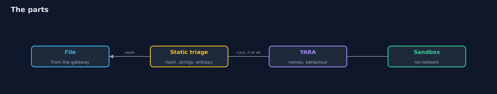
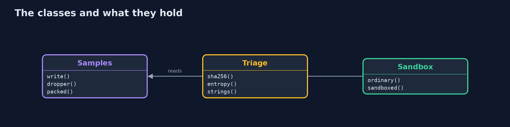
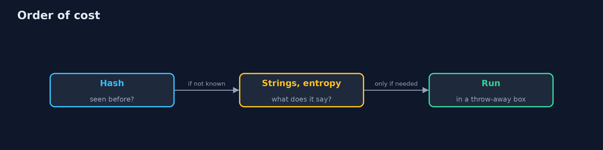
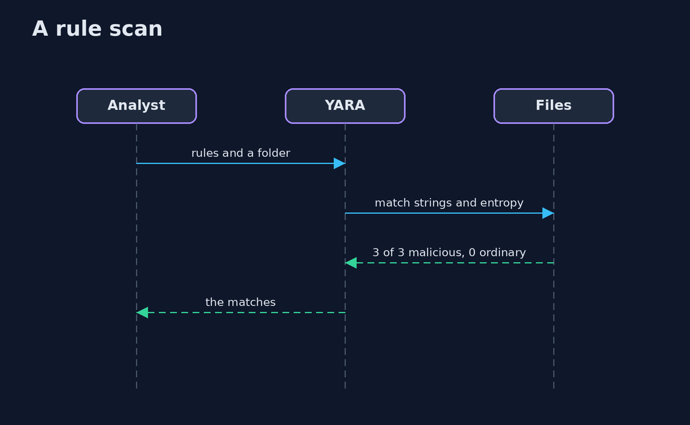

# Malware Analysis Fundamentals

```
src/main/java/com/jk/explore/security/malwaretriage/
├── MalwareAnalysisDemo.java  
├── Samples.java              Files made for this lesson
├── Sandbox.java              Runs a sample in a disposable container, once as an ordinary container and once with the restrictions of a sandbox, against a listener that is ours
├── Sh.java                   Runs a program and returns what it printed, whether it worked or not
├── Triage.java               Static triage: what a file is, without running it
└── Yara.java                 The yara command line (brew install yara): which files a rule file matches
```

**Five files made for this lesson, 3 malicious (a dropper, a variant with two names changed, a packed file) and 2 ordinary scripts, are triaged without running them: a hash of the dropper is on the list of known samples and the variant's is not; the strings give the dropper's domain and a base64 block that decodes to a second stage, and the packed file has an entropy of 8.0 against 4.8 for an ordinary script; a YARA rule on the dropper's names catches 1 of 3, rules on its behaviour and on the packed file catch 3 of 3 with 0 false alarms, and a rule on the word wget or curl flags both ordinary scripts; run against a listener of our own, the dropper makes 1 connection from an ordinary container and 0 from a sandboxed one, though its second stage runs in both.**

Malware analysis starts without running anything: what is this file, have we seen it, what does it mention, how random is it, which of our rules match? Only then, if at all, does it run, in something that is thrown away. This project does that on **five files made for the lesson** (three that stand for malware, two ordinary scripts) that do nothing harmful by construction. A Java program writes them, computes **hashes**, extracts **strings** and **indicators**, measures **entropy**, runs real **YARA** rules (`brew install yara`) and finally runs the dropper in a **disposable Docker container**, once as it comes and once with a sandbox's restrictions, against a listener of its own. The demo is tagged `integration`: `./gradlew integrationTest`.

What it shows:
- **Hashes.** The dropper's SHA-256 is on the list of known samples; a variant with two names changed is not.
- **Strings and entropy.** The dropper gives a domain and a base64 block that decodes to a second stage; the packed file has an entropy of **8.0** against **4.8** for an ordinary script.
- **YARA.** A rule on the names catches **1 of 3**; rules on behaviour and on the packed file catch **3 of 3** with no false alarm; a rule on the word wget or curl flags **both** ordinary scripts.
- **The sandbox.** The dropper makes **1** connection to the listener from an ordinary container and **0** from a sandboxed one, but its second stage runs in both.
- **The bill.** A hash finds only what you have seen; a container is a sandbox only with the restrictions on, and real malware needs a disposable virtual machine.

**Maps to:** MITRE ATT&CK T1027 (obfuscated files), T1059 (command interpreters), T1071 (application layer protocol) · NIST SP 800-83 · NIST CSF 2.0 DE.AE and RS.AN.

## The idea in everyday terms

A laboratory receiving a suspicious package. First they weigh it, photograph it and read the label. They check whether the same package has been seen before. Only then, in a sealed room with no door to the street, do they open it, and they know that a sealed room made of glass is not the same as one made of concrete.

## The scenario

A bank's security team receives a file from a mail gateway. It has to decide, quickly, whether it is hostile, whether similar files are already inside, and what it would have done. The demo triages five samples and runs one in a throw-away container.

## Run

```bash
./gradlew run
```

The demo tells the story in 5 acts, each printing exact numbers that the tests check:

| Act | What it shows |
| --- | --- |
| 1. The samples | Five files made for the lesson: a dropper, a variant, a packed file and two ordinary scripts. |
| 2. Hashes | The dropper's hash is on the list of known samples; the variant's is not. |
| 3. Strings, indicators and entropy | The dropper's strings give its domain and a second stage; the packed file's entropy is 8.0 against 4.8 for a script. |
| 4. YARA rules | A rule on names catches 1 of 3; rules on behaviour catch 3 of 3; a rule on wget or curl flags both ordinary scripts. |
| 5. Running it in a throw-away container | The dropper makes 1 connection from an ordinary container and 0 from a sandboxed one; its second stage runs in both. |

## Test

```bash
./gradlew test
```

8 tests in `DemoRunsTest`, `TriageTest`. The hashes, strings, entropy and samples are tested with the JDK only. The demo runs YARA and Docker (./gradlew integrationTest).

## What the simulation got right, and what it left out

YARA, Docker and the listener are real. The samples are made by the demo and do nothing harmful: the dropper prints, decodes a line and makes one request to an address given at run time. They are not real malware.

## Technologies and versions

Every version below is pinned in the project's build files and was the latest stable release when the project was built.

| Technology | Version | Used for |
| --- | --- | --- |
| Java | 25 | the language and runtime; a Gradle toolchain finds or downloads the JDK |
| Gradle | 9.8.1 (wrapper) | build and run; nothing to install, the wrapper downloads it |
| org.junit.jupiter:junit-jupiter | 6.1.3, set by junit-bom | JUnit 5: the tests (tests only) |
| org.junit.platform:junit-platform-launcher | 6.1.3, set by junit-bom | JUnit platform launcher, which Gradle needs to run the tests (tests only) |
| videokit | repository tool (`tools/videokit`) | the narrated video and animation: Piper `en_US-amy-medium`, speed 0.8, longer pauses (the amy-slow voice) |

## Learning Material

| Document | What it is for |
| --- | --- |
| [Problem statement](docs/problem-statement.md) | the situation and what the project must show |
| [Prerequisites](docs/prerequisites.md) | what you need to know first |
| [Malware Analysis Fundamentals, explained](docs/malware-analysis-fundamentals-explained.md) | the acts in prose |
| [Session guide](docs/session.md) | a one-hour lesson with exercises |
| [Animated walkthrough](docs/animation.html) | the acts step by step, narrated |
| [Threat model](docs/threat-model.md) | what is protected, who could harm it, and how, using STRIDE |
| [Spec](docs/spec.md) | what this project must be true of |
| [Expected output](docs/expected-output.txt) | the golden demo output every test and every port checks against |

### The idea in one picture

A file is triaged before it is run.



### Where each piece sits

The samples, the triage and the sandbox.



### How the data moves

Cheap questions first.



### Who calls whom, in order




### Video

`video/malware-analysis-fundamentals-explained.mp4` (with `.m4a` audio and `.srt` subtitles) is built by `video/build_video.sh`. Rendered media is not committed.

## What it costs

- **Hashes miss every variant,** and variants are cheap.
- **Rules need tests and tuning** against your own files.
- **Entropy flags compressed data** as well as packed malware.
- **A container shares the host's kernel;** it is not a safe place for real malware.
- **Analysis takes skill,** and the samples change.

## When this is too much

A small organisation can rely on its endpoint protection and a mail gateway. Build your own triage when you need to hunt for relatives of a sample, write detections, or explain what a file would do.

## Where you have already met this

- A hash pasted into a search page.
- A rule copied from a blog and never tested on your own files.
- A sample run on an analyst's laptop.
- A report that says "packed" and nothing else.

## Where this sits

This is the last project of the [offensive-security-methodology](..) module. The YARA rules it writes are detections, the subject of the detection modules; the sandbox restrictions are those of [runtime-security](../../kubernetes-and-container-security/runtime-security).
