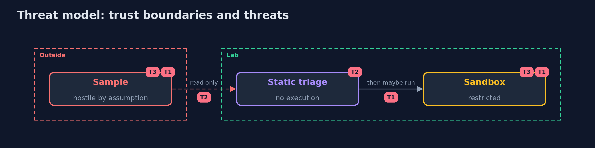

# Threat Model — Malware Analysis Fundamentals

A threat model answers four questions: what are we protecting, who or what could harm it, how, and what do we do about it. This one covers this project's own demo system, not a production deployment. Domain: a bank.

## Scope

The handling of a suspicious file in an analyst's lab. It does not cover the infection of production systems.

## What we protect (assets)

- The analyst's machine.
- The network.
- The detections.

## Who and what acts on the system

- A hostile file.
- An analyst who runs a sample.
- An author of rules.

## Trust boundaries

A trust boundary is a line that data or a request crosses between parts that trust each other differently. Threats cluster where those lines are.

- The sandbox: nothing leaves it.

Each dashed box is a trust boundary. A rose tag such as T1 shows where the threat of that number, in the table below, applies.

## Threats, using STRIDE

STRIDE is a checklist of six kinds of threat: **Spoofing** (S), **Tampering** (T), **Repudiation** (R), **Information disclosure** (I), **Denial of service** (D), **Elevation of privilege** (E).

| Id | Kind | Threat | Where it shows up | Control in this project | What is left |
| --- | --- | --- | --- | --- | --- |
| T1 | Elevation of privilege | A sample escapes from the place it is run | the sandbox | No network, a read-only root, no capabilities, limits; real malware only in a disposable virtual machine | A kernel flaw |
| T2 | Information disclosure | Triage by hash lets variants through | the rules | Rules on behaviour, tested on ordinary files | Behaviour that changes |
| T3 | Repudiation | Nobody can say what a file would have done | the analysis | Record the strings, the rules and the run | Behaviour only on some machines |

## Assumptions

- The samples in the lesson are harmless; real ones are not.

## Out of scope

- Kernel escapes from containers.
- Real malware.

## How the tests check this

- `TriageTest` checks the hashes, strings, entropy and samples with the JDK only.
- `DemoRunsTest` runs YARA and Docker and compares the whole demo with the golden output (integrationTest).

## Where this model goes next

This is the last project of the module.
