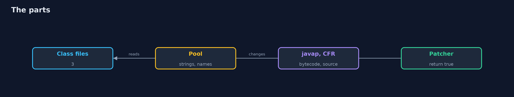
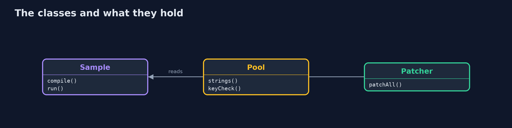
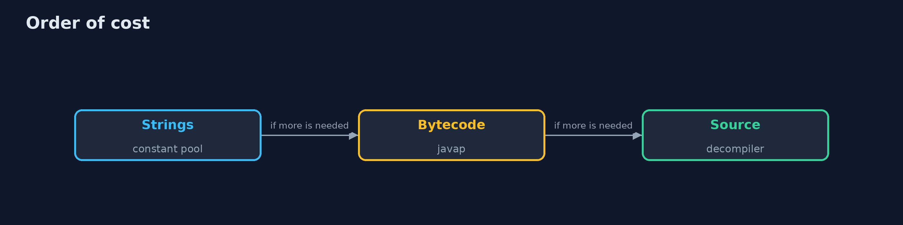
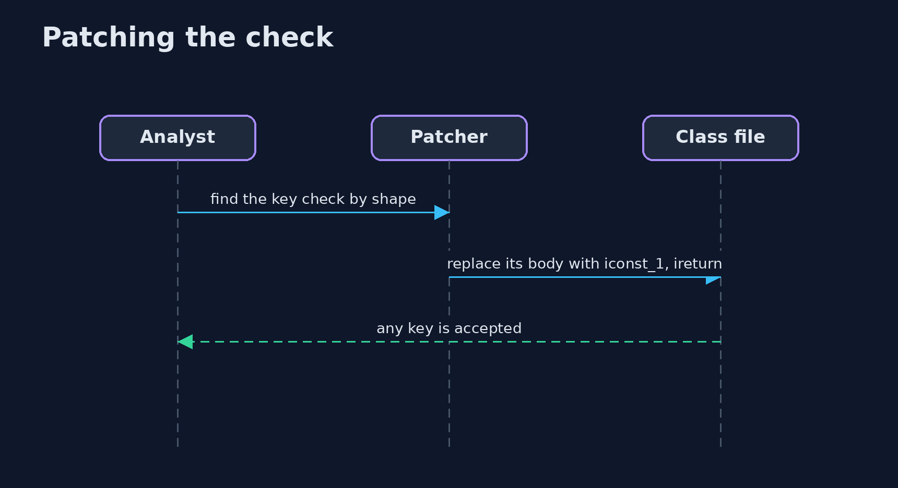

# Reverse Engineering Fundamentals

```
src/main/java/com/jk/explore/security/reverseeng/
├── Patcher.java                 Changes class files: the method that checks a key is replaced by one that says yes
├── Pool.java                    What can be read from class files without running them, with the JDK's own class file API: strings, names and the shape of methods
├── ReverseEngineeringDemo.java  
├── Sample.java                  A small program of the bank, compiled from source into class files, and run from a class loader so that its behaviour can be compared after changes
├── Sh.java                      Runs a program and returns what it printed, whether it worked or not
└── Tools.java                   The two tools of the JDK world that read class files: javap (in the JDK) and the CFR decompiler (a jar, downloaded once and checked)
```

**A bank's desktop client of 3 class files keeps its licence key in the constant pool, where 3 strings name a key, a licence or an address; javap shows the String.equals comparison and the decompiler gives back 19 lines of source for the 20 of the original; one method replaced by 'return true' makes a wrong key and no key pass; an obfuscated copy with one-letter names and encoded strings behaves identically and shows 0 of those strings, but its decompiled check is still readable, its own decoder gives back all 3 strings, and its key check is found by shape although it is called a and is patched the same way.**

Anything that runs on a machine you do not control can be read and changed by whoever owns the machine. This project takes a small desktop client of a bank, whose **licence check** compares a typed key with a key in the program, and takes it apart the way an analyst would: first the **strings** in the constant pool, then the **names**, then the **bytecode** with `javap`, then a **decompiler** (**CFR**). Then it **patches** the check with the JDK's own class file API so that any key passes, and repeats everything on an **obfuscated** copy to see what renaming and encoded strings really stop. The sample is compiled by the demo from source in `samples/`; everything is local and the program is the project's own. `./gradlew test`, then `./gradlew run` (CFR is downloaded once into `build/` and checked against its SHA-256).

What it shows:
- **Reading without running.** 3 of the strings in the constant pool name a key, a licence or an address, and the key is one of them; `javap` shows `String.equals` followed by `ifeq` in a method called `check`.
- **Decompiling.** CFR gives back **19** lines for the **20** of the original source, with the key and the comparison in them.
- **Changing it.** Replace one method by `return true` and a wrong key, or no key, passes: a client-side check decides nothing.
- **Obfuscation.** One-letter names and encoded strings leave **0** of the 3 strings, but the decompiled logic is readable, the program's own decoder gives back all **3**, and the check is found by its shape and patched the same way.
- **The bill.** Keep the decision on the server; obfuscation raises the cost of reading and does not prevent it.

**Maps to:** OWASP MASVS-RESILIENCE · OWASP Top 10 A04 Insecure Design · CWE-798 hard-coded credentials, CWE-602 client-side enforcement of server-side security · MITRE ATT&CK T1027 obfuscated files.

## The idea in everyday terms

A combination lock whose combination is printed inside the case. Locking the case with a smaller lock only makes the reader walk to the workshop. The honest fix is to keep the decision at the bank, behind a counter that the customer does not carry home.

## The scenario

A bank ships a desktop client that checks a licence key on the customer's own computer. A vendor wants to know how easily it can be read and changed. The demo reverse-engineers the client and then its obfuscated copy.

## Run

```bash
./gradlew run
```

The demo tells the story in 5 acts, each printing exact numbers that the tests check:

| Act | What it shows |
| --- | --- |
| 1. The program | A bank's desktop client of 3 class files accepts one key and refuses the rest. |
| 2. Reading it without running it | 3 strings in the constant pool name a key, a licence or an address, and javap shows the comparison. |
| 3. Decompiling it | CFR gives back 19 lines for the 20 of the original source, with the key and the comparison. |
| 4. Changing it | One method replaced by 'return true' makes a wrong key, or no key, pass. |
| 5. Obfuscation | Short names and encoded strings leave 0 strings to read, but the logic, the decoder and the check's shape give it all away. |

## Test

```bash
./gradlew test
```

8 tests in `ClassFileTest`, `DemoRunsTest`. The class file reading, the patching and the sample are tested with the JDK only. The demo also runs javap and CFR (./gradlew integrationTest).

## What the simulation got right, and what it left out

The sample is the project's own small program, compiled in the demo, and the key is a made-up string. javap and the JDK class file API are the JDK's; CFR is a real decompiler. The demo prints counts, never paths.

## Technologies and versions

Every version below is pinned in the project's build files and was the latest stable release when the project was built.

| Technology | Version | Used for |
| --- | --- | --- |
| Java | 25 | the language and runtime; a Gradle toolchain finds or downloads the JDK |
| Gradle | 9.8.1 (wrapper) | build and run; nothing to install, the wrapper downloads it |
| org.junit.jupiter:junit-jupiter | 6.1.3, set by junit-bom | JUnit 5: the tests (tests only) |
| org.junit.platform:junit-platform-launcher | 6.1.3, set by junit-bom | JUnit platform launcher, which Gradle needs to run the tests (tests only) |
| videokit | repository tool (`tools/videokit`) | the narrated video and animation: Piper `en_US-amy-medium`, speed 0.8, longer pauses (the amy-slow voice) |

## Learning Material

| Document | What it is for |
| --- | --- |
| [Problem statement](docs/problem-statement.md) | the situation and what the project must show |
| [Prerequisites](docs/prerequisites.md) | what you need to know first |
| [Reverse Engineering Fundamentals, explained](docs/reverse-engineering-fundamentals-explained.md) | the acts in prose |
| [Session guide](docs/session.md) | a one-hour lesson with exercises |
| [Animated walkthrough](docs/animation.html) | the acts step by step, narrated |
| [Threat model](docs/threat-model.md) | what is protected, who could harm it, and how, using STRIDE |
| [Spec](docs/spec.md) | what this project must be true of |
| [Expected output](docs/expected-output.txt) | the golden demo output every test and every port checks against |

### The idea in one picture

An analyst reads, decompiles and patches the class files.



### Where each piece sits

The program, the reading and the patch.



### How the data moves

Cheap reading first, expensive reading last.



### Who calls whom, in order




### Video

`video/reverse-engineering-fundamentals-explained.mp4` (with `.m4a` audio and `.srt` subtitles) is built by `video/build_video.sh`. Rendered media is not committed.

## What it costs

- **Obfuscation makes your own debugging harder,** and crash reports unreadable.
- **Patching is easy to repeat** for every new release.
- **Decompilers are not perfect,** and the output can differ from the source.
- **Analysis takes skill and time,** and the tools change.
- **A server-side check needs a network** and a server.

## When this is too much

A tool used only inside a company on managed machines does not need protection from its users. Think about reverse engineering when code ships to customers, devices or browsers, or when you analyse something that was shipped to you.

## Where you have already met this

- An API key in a mobile app.
- A licence check that returns a boolean.
- A password in a jar file.
- Obfuscation sold as security.

## Where this sits

This is a project of the [offensive-security-methodology](..) module. The hard-coded secrets found here are the kind that [secret-scanning](../../devsecops-pipelines/secret-scanning) looks for in the source.
