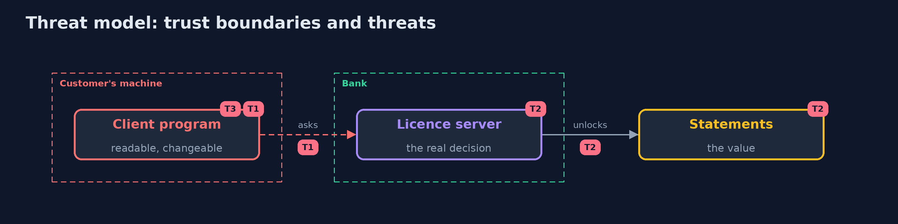

# Threat Model — Reverse Engineering Fundamentals

A threat model answers four questions: what are we protecting, who or what could harm it, how, and what do we do about it. This one covers this project's own demo system, not a production deployment. Domain: a bank.

## Scope

A client program that ships to customers and contains a check and a key. It does not cover the server or the network.

## What we protect (assets)

- The licence key.
- The licence decision.
- The program's code.

## Who and what acts on the system

- A customer who owns the machine.
- An analyst.
- A vendor.

## Trust boundaries

A trust boundary is a line that data or a request crosses between parts that trust each other differently. Threats cluster where those lines are.

- The customer's computer: everything on it is readable and changeable.

Each dashed box is a trust boundary. A rose tag such as T1 shows where the threat of that number, in the table below, applies.

## Threats, using STRIDE

STRIDE is a checklist of six kinds of threat: **Spoofing** (S), **Tampering** (T), **Repudiation** (R), **Information disclosure** (I), **Denial of service** (D), **Elevation of privilege** (E).

| Id | Kind | Threat | Where it shows up | Control in this project | What is left |
| --- | --- | --- | --- | --- | --- |
| T1 | Tampering | The licence check is patched out | the class files | Make the decision on the server | A client that still trusts local state |
| T2 | Information disclosure | A key stored in the program is read | the constant pool | Keep keys out of the client | Keys that must be on the device |
| T3 | Repudiation | Obfuscation is relied on instead of design | the release process | Treat it as a delay and assume the program is read | Time spent on it |

## Assumptions

- The attacker has the program and unlimited time.

## Out of scope

- Hardware attacks.
- Native code.

## How the tests check this

- `ClassFileTest` checks the sample, the class file reading and the patching in the plain and the obfuscated copy with the JDK only.
- `DemoRunsTest` also runs javap and CFR and compares the whole demo with the golden output (integrationTest).

## Where this model goes next

The next project in the module is malware-analysis-fundamentals.
