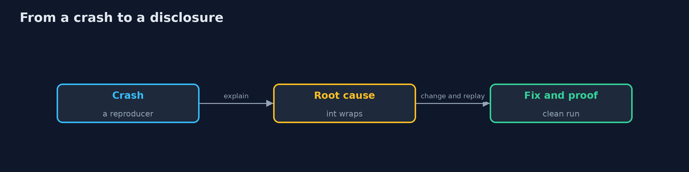

# Vulnerability Research

```
src/main/java/com/jk/explore/security/vulnresearch/
├── Advisory.java                   A security advisory as a vendor would publish it, and the dates of a coordinated disclosure
├── Cvss.java                       The base score of CVSS 3.1 from a vector such as AV:N/AC:L/PR:L/UI:N/S:U/C:N/I:H/A:N, with the formulas of the specification
├── Fuzz.java                       The fuzz target for version 1: any bytes in, and only the expected FormatException out
├── FuzzOracle.java                 A fuzz target that also knows the right answer: when version 1 returns a total, it must be the exact sum
├── FuzzV2.java                     The same fuzz target for version 2
├── Jazzer.java                     The Jazzer fuzzer (coverage-guided, for the JVM): downloaded once, run in a fresh folder with a fresh copy of the seeds, and its crashes read back
├── Sh.java                         Runs a program and returns what it printed, whether it worked or not
├── VulnerabilityResearchDemo.java  True when the reproducer makes version 1 throw something other than the error that the caller expects
├── v1/Statement.java               Version 1 of the statement reader of a bank's reporting tool
└── v2/Statement.java               Version 2 of the statement reader: every field is checked, every number is parsed in one place, and the arithmetic cannot wrap
```

**A bank's statement reader passes the 3 examples of its unit tests; Jazzer, a coverage-guided fuzzer, finds 7 distinct crash sites in 300,000 runs (4 array index errors, 2 number format errors, 1 negative total), which are 3 of 3 root causes: missing field checks, unguarded number parsing and arithmetic that wraps; a target that only watches for crashes sees 0 of the totals that are wrong without an exception and a target with an oracle that compares with an exact sum finds them; 50000 x 50000 as an int is -1794967296 and 70000 x 70000 is 605032704, positive and wrong; the fixed version crashes on none of the reproducers and shows 0 crash sites for the same seed and runs; the advisory scores 6.5 (CVSS 3.1) for the wrong totals and 4.3 for the exceptions, with disclosure 90 days after the report.**

Vulnerability research is a loop: find an input that breaks something, find out why, fix it, prove that the fix works, and tell the people who run the code. This project goes round it once on a small **statement reader** of a bank, with three planted flaws that its unit tests do not find. **Jazzer** (a coverage-guided fuzzer for the JVM) finds them from three example statements; a second fuzz target with an **oracle** finds the flaw that never throws; the arithmetic is worked out; **version 2** is proved with the reproducers and a clean fuzz run; and an **advisory** is written with a CVSS 3.1 score and the dates of a coordinated disclosure. Jazzer is downloaded once into `build/` and checked against its SHA-256; the demo is tagged `integration`: `./gradlew integrationTest`.

What it shows:
- **Fuzzing.** From 3 seeds, 300,000 runs find **7** distinct crash sites, which are **3 of 3** root causes.
- **An oracle.** A target that only watches for crashes sees **0** silent wrong totals; a target that compares with an exact sum finds them.
- **Root cause.** 50000 x 50000 as an int is **-1794967296** (the reader throws); 70000 x 70000 is **605032704**: positive, wrong, and no error.
- **The fix.** Version 2 survives every reproducer and shows **0** crash sites for the same seed and runs.
- **The advisory.** Wrong totals score **6.5** and exceptions **4.3**; the report is made public **90 days** after the day it was sent.

**Maps to:** CWE-190 integer overflow, CWE-129 improper validation of array index, CWE-20 improper input validation · OWASP ASVS V5 · NIST SSDF RV.1 and RV.2 · ISO/IEC 29147 and 30111 (disclosure and handling) · FIRST CVSS 3.1.

## The idea in everyday terms

A proofreader who throws random sentences at a form until it complains. The sentences that make it complain are the starting points. Then somebody has to read the form and find out why, change it, run the same sentences again, and write to the people who use it before telling everyone else.

## The scenario

A bank's reporting tool reads statements in a small text format. Its unit tests pass, and it has flaws that an attacker with a crafted file could use. The demo fuzzes it, explains what it finds, fixes it, and writes the advisory.

## Run

```bash
./gradlew run
```

The demo tells the story in 5 acts, each printing exact numbers that the tests check:

| Act | What it shows |
| --- | --- |
| 1. The code under test | The unit-test examples of the statement reader all parse; the flaws are in what they do not try. |
| 2. Fuzzing it | From 3 seeds Jazzer finds 7 distinct crash sites, which are 3 of 3 root causes. |
| 3. An oracle sees what a crash does not | A target that only watches for crashes finds 0 silent wrong totals; one that compares with an exact sum finds them. |
| 4. The root cause | 50000 x 50000 as an int is -1794967296; 70000 x 70000 is 605032704, positive and wrong. |
| 5. The fix, and the advisory | Version 2 survives every reproducer, shows 0 crash sites, and the advisory scores the flaws and sets the dates. |

## Test

```bash
./gradlew test
```

10 tests in `CvssStatementAdvisoryTest`, `DemoRunsTest`. The CVSS calculator, the two versions of the reader and the advisory are tested with the JDK only. The demo runs Jazzer (./gradlew integrationTest).

## What the simulation got right, and what it left out

Jazzer is real and runs on the JDK that runs the demo. The statement reader is the project's own small program and its flaws are planted. The advisory and its dates are an example; nothing is reported to anyone.

## Technologies and versions

Every version below is pinned in the project's build files and was the latest stable release when the project was built.

| Technology | Version | Used for |
| --- | --- | --- |
| Java | 25 | the language and runtime; a Gradle toolchain finds or downloads the JDK |
| Gradle | 9.8.1 (wrapper) | build and run; nothing to install, the wrapper downloads it |
| org.junit.jupiter:junit-jupiter | 6.1.3, set by junit-bom | JUnit 5: the tests (tests only) |
| org.junit.platform:junit-platform-launcher | 6.1.3, set by junit-bom | JUnit platform launcher, which Gradle needs to run the tests (tests only) |
| videokit | repository tool (`tools/videokit`) | the narrated video and animation: Piper `en_US-amy-medium`, speed 0.8, longer pauses (the amy-slow voice) |

## Learning Material

| Document | What it is for |
| --- | --- |
| [Problem statement](docs/problem-statement.md) | the situation and what the project must show |
| [Prerequisites](docs/prerequisites.md) | what you need to know first |
| [Vulnerability Research, explained](docs/vulnerability-research-explained.md) | the acts in prose |
| [Session guide](docs/session.md) | a one-hour lesson with exercises |
| [Animated walkthrough](docs/animation.html) | the acts step by step, narrated |
| [Threat model](docs/threat-model.md) | what is protected, who could harm it, and how, using STRIDE |
| [Spec](docs/spec.md) | what this project must be true of |
| [Expected output](docs/expected-output.txt) | the golden demo output every test and every port checks against |

### The idea in one picture

Seeds go in, crashes come out, and a fix is proved by the same run.


### Where each piece sits

The target, the fuzzer and the advisory.


### How the data moves

Each step makes the next one possible.



### Who calls whom, in order


### Video

`video/vulnerability-research-explained.mp4` (with `.m4a` audio and `.srt` subtitles) is built by `video/build_video.sh`. Rendered media is not committed.

## What it costs

- **A fuzzer finds only what it reaches and recognises,** so seeds and oracles matter.
- **Many crashes are one flaw;** sorting them takes judgement.
- **A fix can move a flaw** instead of removing it.
- **Disclosure takes weeks** and is a conversation, not a post.
- **The tools change,** and results are not exactly repeatable.

## When this is too much

A tool that only your own team feeds with files you made does not need fuzzing. Do it for parsers of data that comes from outside: files, messages and network input.

## Where you have already met this

- A parser with five unit tests and no hostile input.
- A fuzzer that ran for a night and nobody read.
- An exception that is caught and ignored.
- A security fix with no advisory.

## Where this sits

This is a project of the [offensive-security-methodology](..) module. The unit tests for the earlier projects check what their authors thought of; fuzzing checks what they did not. The same idea in the intermediate track is the mutation fuzzer in the secure-coding module.
