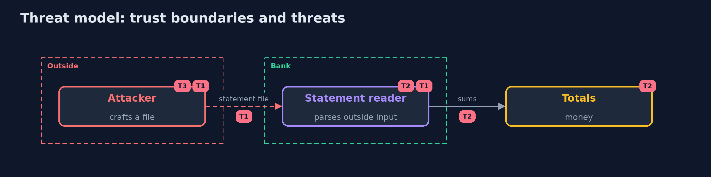

# Threat Model — Vulnerability Research

A threat model answers four questions: what are we protecting, who or what could harm it, how, and what do we do about it. This one covers this project's own demo system, not a production deployment. Domain: a bank.

## Scope

A parser of statement files that come from outside. It does not cover the rest of the reporting tool.

## What we protect (assets)

- The totals.
- The availability of the tool.

## Who and what acts on the system

- An attacker with a crafted file.
- A researcher.
- A maintainer.

## Trust boundaries

A trust boundary is a line that data or a request crosses between parts that trust each other differently. Threats cluster where those lines are.

- The parser: its input is not trusted.

Each dashed box is a trust boundary. A rose tag such as T1 shows where the threat of that number, in the table below, applies.

## Threats, using STRIDE

STRIDE is a checklist of six kinds of threat: **Spoofing** (S), **Tampering** (T), **Repudiation** (R), **Information disclosure** (I), **Denial of service** (D), **Elevation of privilege** (E).

| Id | Kind | Threat | Where it shows up | Control in this project | What is left |
| --- | --- | --- | --- | --- | --- |
| T1 | Denial of service | A crafted file crashes the reader | the parser | Fuzz it and refuse bad input as the expected error | Flaws the fuzzer does not reach |
| T2 | Tampering | A wrong total is accepted silently | the arithmetic | Exact arithmetic and an oracle in the fuzz target | Other wrong answers |
| T3 | Repudiation | A fix is shipped and nobody is told | the release | An advisory with a score and dates | Users who do not read it |

## Assumptions

- The fuzzer runs on a copy of the code.

## Out of scope

- Memory corruption.
- Other components.

## How the tests check this

- `CvssStatementAdvisoryTest` checks the score, both versions of the reader and the advisory with the JDK only.
- `DemoRunsTest` runs Jazzer and compares the whole demo with the golden output (integrationTest).

## Where this model goes next

The next project in the module is reverse-engineering-fundamentals.
