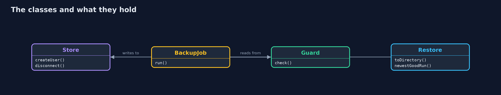
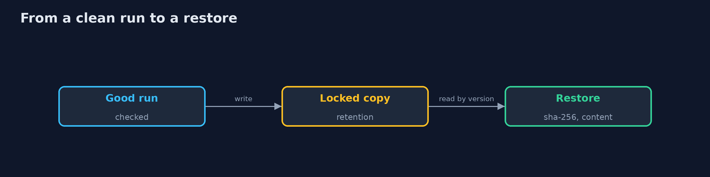
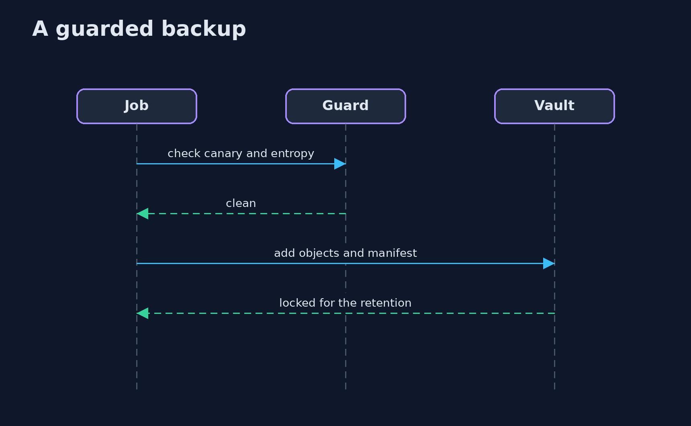

# Ransomware Resilience

```
src/main/java/com/jk/explore/security/ransomres/
├── BackupJob.java                 The nightly (here hourly) job: copy a data directory to a bucket under a prefix for the run, with a manifest of SHA-256 sums
├── Bucket.java                    The few S3 calls the demo uses over and over, and how an answer is turned into "ok" or an error code
├── Entropy.java                   Shannon entropy in bits per byte: about 4 to 5 for a text ledger, close to 8 for encrypted or compressed data
├── Guard.java                     The check a backup job makes before it copies anything: is the canary file untouched, and does the data still look like a ledger?
├── Ledger.java                    A bank's ledger as text: the same bytes for the same number, on every run
├── Policies.java                  The access policies of the people and programs around the backups (S3 policy documents)
├── Ransomware.java                A harmless simulation of ransomware: it only touches the directory it is given
├── RansomwareResilienceDemo.java  A bank's ledger backups against ransomware: what an attacker with the backup credentials can destroy, and what an immutable, isolated copy survives
├── Recovery.java                  The recovery time and the recovery point as arithmetic
├── Restore.java                   Getting the backups back: which versions are good, written to a fresh directory, with every step counted
├── Sh.java                        Runs a program and returns what it printed, whether it worked or not
├── Sha.java                       SHA-256 as lower-case hex: the checksum that the manifests carry
└── Store.java                     An S3-compatible object store (RustFS) in a Docker container, started for the demo and removed at the end
```

**An attacker with the backup credentials overwrites 24 of 24 ledger backups in a plain bucket and deletes 24 of 24, and in a versioned bucket deletes all 48 versions by id and leaves 0 of 24 restorable; in a bucket with object lock in COMPLIANCE mode the same attacker, and the root administrator, are refused 24 of 24 times with AccessDenied, retention cannot be shortened or turned into GOVERNANCE and the bucket cannot be deleted, while 24 of 24 backups still restore by version; a backup account that can only add objects is refused 7 of 7 other actions, a copy in a second store answers InvalidAccessKeyId to the first store's root and survives its loss; ransomware that encrypts 9 files poisons the 10:00 backup (SHA-256 matches 10 of 10, looks like a ledger 1 of 10) unless the guard refuses it, and the restore of the 09:00 run is identical for 9 of 9 files with 3000 transactions lost; restoring 24 backups takes 91.6 minutes from the first store and 168.4 minutes from the air-gapped copy against a 240 minute target.**

Ransomware does not only encrypt the live data. It looks for the backups, and an attacker who has the backup credentials can overwrite or delete them. This project builds the ledger backups of a **bank** in four layers and measures what each layer survives: a plain bucket, a **versioned** bucket, a bucket with **object lock in COMPLIANCE mode**, and a vault with **separate credentials** and a **copy in a second store**. It then runs a **ransomware simulation** (AES, originals deleted) to show the **poisoned backup**, a guard with a **canary file** and **entropy** checks, and a **restore exercise** whose time and data loss are computed. The store is **RustFS** (S3 API with versioning, object lock and policies) in Docker, driven with the **AWS SDK for Java v2**; the demo is tagged `integration`: `./gradlew integrationTest`.

What it shows:
- **No protection.** An attacker with the backup credentials loses the bank **24 of 24** backups by overwriting them, and the deletes are accepted **24 of 24** times.
- **Versioning only.** Overwrites are survived (**24 of 24** restore by version), but a permanent delete of all **48** versions by id leaves **0 of 24**.
- **Object lock.** Delete of a locked version is refused **24 of 24** times with **AccessDenied** for the backup credentials and for the root administrator; shortening the retention is refused, and 24 of 24 backups restore.
- **Isolation.** A writer that can only add objects is refused 7 of 7 other actions; a copy in a second store is unreachable from the first store's credentials and restores **24 of 24** after the first store is lost.
- **Poisoned backups.** After the infection the 10:00 backup matches its own SHA-256 manifest **10 of 10** but looks like a ledger **1 of 10**; the guard refuses it, and restoring run 09:00 gives **9 of 9** identical files with **3000** transactions lost.
- **The exercise.** 24 backups restore in **91.6** minutes from the first store and **168.4** minutes from the air-gapped copy (target 240).

**Maps to:** MITRE ATT&CK T1486 data encrypted for impact and T1490 inhibit system recovery · NIST CSF 2.0 RC.RP and PR.DS-11 · NIST SP 800-34 contingency planning · ISO/IEC 27001 A.8.13 information backup · 3-2-1-1-0 backup rule · FFIEC business continuity guidance for banks.

## The idea in everyday terms

A safe deposit box with a time lock that even the bank manager cannot open early, and a second box in another city. A burglar with the manager's keys can empty a normal drawer, but not the box that will not open until the date, and not the one he does not know about. A guard at the door checks that what goes into the box is still the ledger and not scrambled paper.

## The scenario

A bank keeps hourly backups of its ledger in an object store. Ransomware reaches the data directory at 09:20, and the attacker has the backup service credentials. The demo measures what is lost with no protection, versioning, object lock, separate credentials and a second store, and then runs a timed restore.

## Run

```bash
./gradlew run
```

The demo tells the story in 6 acts, each printing exact numbers that the tests check:

| Act | What it shows |
| --- | --- |
| 1. A plain bucket | With the backup credentials an attacker overwrites 24 of 24 backups and deletes 24 of 24. |
| 2. Versioning only | Versions survive an overwrite, but a permanent delete by version id removes all 48. |
| 3. Object lock in COMPLIANCE mode | Deleting a locked version is refused 24 of 24 times, even for root; retention cannot be shortened. |
| 4. Isolation and an air-gapped copy | A writer that can only add objects is refused 7 of 7 other actions; a second store answers InvalidAccessKeyId to the first store's root. |
| 5. Ransomware and the poisoned backup | The 10:00 backup of encrypted files passes its SHA-256 manifest 10 of 10; the guard refuses it and run 09:00 restores 9 of 9 files. |
| 6. The restore exercise | 24 backups restore into a fresh directory in 91.6 minutes from the first store and 168.4 from the air-gapped copy. |

## Test

```bash
./gradlew test
```

12 tests in `DemoRunsTest`, `ResilienceUnitTest`. The ledger, the entropy and canary guard, the ransomware simulation on a temporary directory, the policies and the recovery arithmetic are tested without tools. The demo starts two RustFS containers (./gradlew integrationTest).

## What the simulation got right, and what it left out

RustFS is a real S3-compatible store and enforces the lock, the versions and the policies; the data are the project's own generated ledgers, the key of the ransomware is thrown away, and the production size and speed of the recovery time are a fixed model. No tool from the plan was skipped except OpenTofu, which the demo does not need.

## Technologies and versions

Every version below is pinned in the project's build files and was the latest stable release when the project was built.

| Technology | Version | Used for |
| --- | --- | --- |
| Java | 25 | the language and runtime; a Gradle toolchain finds or downloads the JDK |
| Gradle | 9.8.1 (wrapper) | build and run; nothing to install, the wrapper downloads it |
| software.amazon.awssdk:s3 | set by the build | library the code uses |
| software.amazon.awssdk:apache5-client | set by the build | library the code uses |
| org.slf4j:slf4j-nop | 2.0.17 | library the code uses |
| org.junit.jupiter:junit-jupiter | 6.1.3, set by junit-bom | JUnit 5: the tests (tests only) |
| org.junit.platform:junit-platform-launcher | 6.1.3, set by junit-bom | JUnit platform launcher, which Gradle needs to run the tests (tests only) |
| videokit | repository tool (`tools/videokit`) | the narrated video and animation: Piper `en_US-amy-medium`, speed 0.8, longer pauses (the amy-slow voice) |

## Learning Material

| Document | What it is for |
| --- | --- |
| [Problem statement](docs/problem-statement.md) | the situation and what the project must show |
| [Prerequisites](docs/prerequisites.md) | what you need to know first |
| [Ransomware Resilience, explained](docs/ransomware-resilience-explained.md) | the acts in prose |
| [Session guide](docs/session.md) | a one-hour lesson with exercises |
| [Animated walkthrough](docs/animation.html) | the acts step by step, narrated |
| [Threat model](docs/threat-model.md) | what is protected, who could harm it, and how, using STRIDE |
| [Spec](docs/spec.md) | what this project must be true of |
| [Expected output](docs/expected-output.txt) | the golden demo output every test and every port checks against |

### The idea in one picture

The data directory, the guard, the lock and the second store.


### Where each piece sits

The store, the job, the guard and the restore.



### How the data moves

Each step needs the one before it.



### Who calls whom, in order




### Video

`video/ransomware-resilience-explained.mp4` (with `.m4a` audio and `.srt` subtitles) is built by `video/build_video.sh`. Rendered media is not committed.

## What it costs

- **A lock also keeps bad backups,** so a poisoned backup stays for the whole retention and costs storage until it ends.
- **COMPLIANCE mode cannot be undone,** not by you either: a mistake in the retention period is paid for in full.
- **A lock does not stop an overwrite by key,** it only keeps the old version, so restores must look at versions and checksums.
- **A second store is a second system** to run, to patch and to test, with its own credentials to guard.
- **Detectors raise false alarms:** a compressed export looks like ciphertext, and half-encrypted files hide from a whole-file entropy test.
- **An untested restore is a guess,** and a real one costs people and hours.

## When this is too much

A laptop with no data that cannot be rebuilt does not need a locked vault. Use compliance locking for data that the business cannot recreate: ledgers, customer records and audit logs.

## Where you have already met this

- Backups on a share that the same admin account can delete.
- A backup job that copies encrypted files every night.
- A restore that has never been tried.
- A retention period nobody checked against the time an attacker stays unnoticed.

## Where this sits

This is a project of the [resilience-and-recovery](..) module. It builds on the AWS SDK and policy work of the cloud-security modules and on the chaos experiments of security-chaos-engineering, which deletes things on purpose; here the thing that must survive is the backup.
