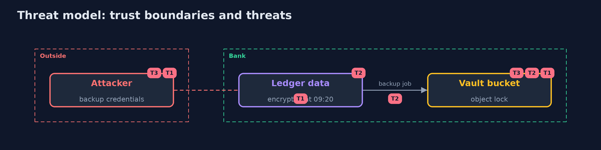

# Threat Model — Ransomware Resilience

A threat model answers four questions: what are we protecting, who or what could harm it, how, and what do we do about it. This one covers this project's own demo system, not a production deployment. Domain: a bank.

## Scope

The ledger backups of a bank, from the data directory to the stores and the restore. It does not cover the live database or the network of the bank.

## What we protect (assets)

- The backups of the ledger.
- The ability to restore in time.

## Who and what acts on the system

- An attacker with the backup credentials.
- Ransomware in the data directory.
- A careless administrator.

## Trust boundaries

A trust boundary is a line that data or a request crosses between parts that trust each other differently. Threats cluster where those lines are.

- The backup credentials: they can add objects only.
- The second store: other credentials, other system.

Each dashed box is a trust boundary. A rose tag such as T1 shows where the threat of that number, in the table below, applies.

## Threats, using STRIDE

STRIDE is a checklist of six kinds of threat: **Spoofing** (S), **Tampering** (T), **Repudiation** (R), **Information disclosure** (I), **Denial of service** (D), **Elevation of privilege** (E).

| Id | Kind | Threat | Where it shows up | Control in this project | What is left |
| --- | --- | --- | --- | --- | --- |
| T1 | Tampering | Backups are overwritten or deleted with the backup credentials | the vault | Object lock in COMPLIANCE mode, a writer that can only add, a copy in a second store | Root on the host of a store |
| T2 | Tampering | A poisoned backup replaces the good one | the data and the vault | A canary file and entropy checks before backup, restore by manifest and content | Slow or partial encryption below the thresholds |
| T3 | Denial of service | The restore takes too long or loses too much | the recovery | A timed exercise with a computed RTO and RPO and a backup schedule | A schedule longer than the time to detect |

## Assumptions

- The hosts of the stores are not compromised.

## Out of scope

- Root on the host of a store.
- Attacks on the live database.

## How the tests check this

- `ResilienceUnitTest` checks the ledger, the guard, the ransomware simulation, the policies and the recovery arithmetic with the JDK only.
- `DemoRunsTest` starts two RustFS containers and compares the whole demo with the golden output (integrationTest).

## Where this model goes next

The next project in the module is security-chaos-engineering.
