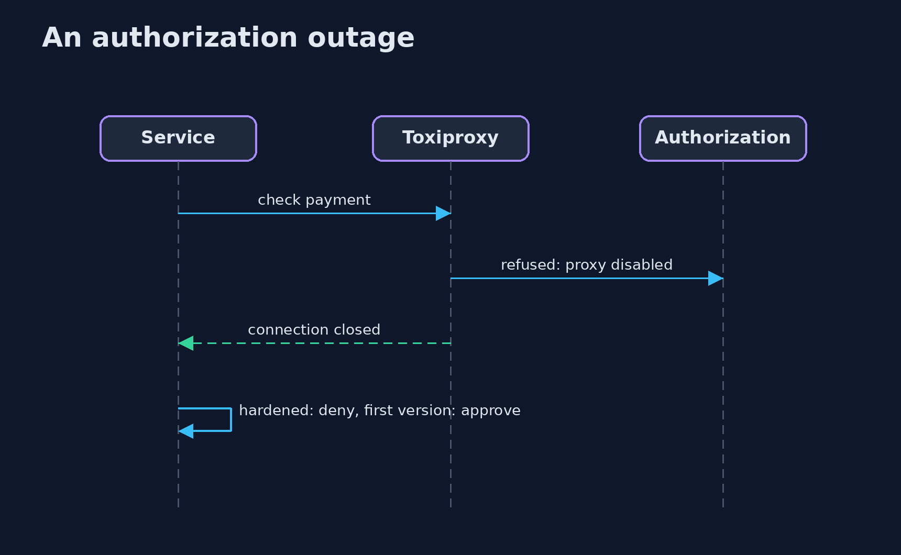

# Security Chaos Engineering

```
src/main/java/com/jk/explore/security/securitychaos/
├── AuditTrail.java         Where the decisions of the payments service are written for the auditors
├── Backends.java           The five services a payment depends on, each on its own port: authorization, fraud scoring, the audit sink, the rate-limit store and the revocation responder
├── BankPayments.java       A bank payments service with five controls, each a call to a dependency: rate limit, certificate revocation, authorization, fraud score and an audit trail
├── Decision.java           What the service did with a payment, and whether the fraud service really scored it
├── DroppingAudit.java      The first version: a small in-memory buffer and a sender thread; what cannot be sent or does not fit is dropped, and nobody is told
├── Experiment.java         One chaos experiment: a hypothesis about a control, a failure to inject, and what the scenario will measure
├── Fault.java              A failure Toxiproxy can inject between the service and a dependency
├── Http.java               A client with a hard deadline for the whole call, body included
├── Lab.java                Runs the experiments against one version of the service, through Toxiproxy, and keeps the scoreboard
├── Monitor.java            Probes the health endpoint of each dependency; N failed probes in a row raise one alert
├── Payment.java            A payment request: who pays, how much, and the serial of the client certificate that signed it
├── SecurityChaosDemo.java  Chaos experiments on the security controls of a bank payments service: steady state, injected failure, observation, verdict
├── Sh.java                 Runs a program and returns what it printed, whether it worked or not
├── SpooledAudit.java       The hardened version: the record is written to a journal file first, then sent
└── Toxiproxy.java          A Toxiproxy container started from Java and driven through its HTTP API
```

**A bank payments service has five controls that each call a dependency: a rate limit, a revocation check, authorization, a fraud score and an audit trail; with Toxiproxy between the service and each dependency, 10 experiments (down, slow, hung, reset, trickle, slow close) each test 2 hypotheses, that the control holds and that an alert fires; the first version holds 2 of 20: it approves 6 of 6 payments with authorization down, slow or reset, 6 of 6 without a fraud score, 6 of 6 with a revoked certificate and 40 of 40 from one account with the limit at 5, loses 20 of 20 audit records and raises 0 alerts; the hardened version holds 20 of 20: it approves 0 of 6, holds 6 of 6 payments for review, approves 5 of 40, loses 0 of 20 audit records and raises an alert after 3 failed probes; it still approves 1 of 1 payment whose certificate was revoked during an outage after a good answer was cached.**

A security control is a dependency like any other: it is a call over a network, and it can be slow, hung, reset or gone. What the service does then is a decision somebody made, often by accident. This project asks the question by experiment. A **bank payments service** (built with the JDK `HttpServer`) calls five dependencies through **Toxiproxy**, which runs in Docker and is driven from Java through its HTTP API. Each of 10 experiments states a **steady state**, **injects a failure**, **observes** and gives a **verdict**, for two hypotheses: the control **fails closed**, and **an alert fires**. The first version has planted weaknesses; the hardened version fixes them. The demo needs Docker and the `ghcr.io/shopify/toxiproxy` image (a few MB) and is tagged `integration`: `./gradlew integrationTest`.

What it shows:
- **Fail open.** With authorization down, slow or reset the first version approves **6 of 6** payments; the hardened one approves **0 of 6**.
- **Unscreened payments.** With the fraud service hung or on a trickle **6 of 6** are approved without a score; the hardened version holds **6 of 6** for review.
- **Silent loss.** A burst of 20 decisions while the audit sink is down loses **20 of 20** records in the first version and **0 of 20** in the hardened one.
- **Limits and revocation.** One account gets **40 of 40** payments through a limit of 5 when the store resets, against **5 of 40**; a revoked certificate is approved **6 of 6** when the responder is down or slow, against **0 of 6**.
- **Alerts.** The first version raises **0** alerts; the hardened version raises one after **3** failed probes, and none for a slow close that costs nothing. Scoreboard: **2 of 20** hypotheses held against **20 of 20**.

**Maps to:** NIST SP 800-53 SI-13, SC-24 (fail in known state), AU-5 (response to audit processing failures), CP-10 · OWASP ASVS V7 and V11 · MITRE ATT&CK T1562 (impair defenses) · Principles of Chaos Engineering.

## The idea in everyday terms

A fire drill for the locks. You do not wait for a real power cut to find out whether the doors open or stay shut: you cut the power on purpose, with the building watched, and write down what each door did and whether the alarm rang.

## The scenario

A bank's payments service checks every payment against five controls. In a real incident the dependencies fail one at a time. The demo breaks them one at a time on purpose, and counts what the service approves, what it loses and what it reports.

## Run

```bash
./gradlew run
```

The demo tells the story in 5 acts, each printing exact numbers that the tests check:

| Act | What it shows |
| --- | --- |
| 1. Steady state | Before every experiment four ordinary payments give the expected answers and 4 of 4 audit records arrive. |
| 2. Authorization and fraud | The first version approves 6 of 6 payments with authorization down, slow or reset, and 6 of 6 without a fraud score; the hardened one approves 0 and holds 6 for review. |
| 3. Audit, limit and revocation | The first version loses 20 of 20 audit records, lets 40 of 40 through a limit of 5 and approves 6 of 6 revoked certificates; the hardened one loses 0 and approves 5 of 40 and 0 of 6. |
| 4. Does anybody hear it? | The first version raises 0 alerts; the hardened version raises one after 3 failed probes, and none for a slow close. |
| 5. The scoreboard | Hypotheses held: 2 of 20 for the first version, 20 of 20 for the hardened one, with one gap measured: 1 of 1 certificate revoked during an outage is approved. |

## Test

```bash
./gradlew test
```

18 tests in `DemoRunsTest`, `ExperimentTest`, `MonitorTest`, `PaymentsTest`. The service, the audit trails and the monitor are tested with stub dependencies and no Docker. The demo starts Toxiproxy (./gradlew integrationTest).

## What the simulation got right, and what it left out

Toxiproxy is real and runs in Docker. The payments service and its five dependencies are the project's own small programs; the failures are injected on the real connections between them. Nothing is simulated in the service's own code.

## Technologies and versions

Every version below is pinned in the project's build files and was the latest stable release when the project was built.

| Technology | Version | Used for |
| --- | --- | --- |
| Java | 25 | the language and runtime; a Gradle toolchain finds or downloads the JDK |
| Gradle | 9.8.1 (wrapper) | build and run; nothing to install, the wrapper downloads it |
| org.junit.jupiter:junit-jupiter | 6.1.3, set by junit-bom | JUnit 5: the tests (tests only) |
| org.junit.platform:junit-platform-launcher | 6.1.3, set by junit-bom | JUnit platform launcher, which Gradle needs to run the tests (tests only) |
| videokit | repository tool (`tools/videokit`) | the narrated video and animation: Piper `en_US-amy-medium`, speed 0.8, longer pauses (the amy-slow voice) |

## Learning Material

| Document | What it is for |
| --- | --- |
| [Problem statement](docs/problem-statement.md) | the situation and what the project must show |
| [Prerequisites](docs/prerequisites.md) | what you need to know first |
| [Security Chaos Engineering, explained](docs/security-chaos-engineering-explained.md) | the acts in prose |
| [Session guide](docs/session.md) | a one-hour lesson with exercises |
| [Animated walkthrough](docs/animation.html) | the acts step by step, narrated |
| [Threat model](docs/threat-model.md) | what is protected, who could harm it, and how, using STRIDE |
| [Spec](docs/spec.md) | what this project must be true of |
| [Expected output](docs/expected-output.txt) | the golden demo output every test and every port checks against |

### The idea in one picture

The service reaches every dependency through a proxy that can hurt it.


### Where each piece sits

The service, its audit trail and the monitor.


### How the data moves

Each step produces something that can be counted.


### Who calls whom, in order




### Video

`video/security-chaos-engineering-explained.mp4` (with `.m4a` audio and `.srt` subtitles) is built by `video/build_video.sh`. Rendered media is not committed.

## What it costs

- **Experiments need a safe place:** a copy of the service, not production at first.
- **Fail closed costs customers:** payments wait or are refused while a dependency is down.
- **Probes see failures, not every degradation:** a slow close passes them.
- **A cache or fallback has its own gap,** like a certificate revoked during an outage.
- **Injected failures are tidy;** real ones are messier.

## When this is too much

A service with no dependencies that guard anything needs no drill. Start with the controls that, if they quietly stopped, would turn a bad payment into an approved one.

## Where you have already met this

- A try and catch that returns true.
- A timeout that falls back to allow.
- A log buffer that drops when it is full.
- A revocation check that soft-fails.

## Where this sits

This is a project of the [resilience-and-recovery](..) module. The earlier modules built the controls; this one asks what they do when they are hurt. It uses the same idea as ransomware resilience: assume the failure and measure the response.
