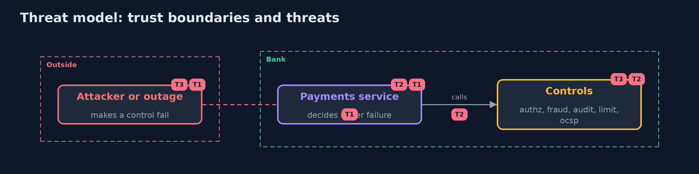

# Threat Model — Security Chaos Engineering

A threat model answers four questions: what are we protecting, who or what could harm it, how, and what do we do about it. This one covers this project's own demo system, not a production deployment. Domain: a bank.

## Scope

The decision a payments service takes when a control it calls cannot answer. It does not cover the controls' own correctness.

## What we protect (assets)

- Approved payments.
- Audit records.
- The limit on one account.

## Who and what acts on the system

- An attacker who degrades a dependency.
- An outage.
- An operator.

## Trust boundaries

A trust boundary is a line that data or a request crosses between parts that trust each other differently. Threats cluster where those lines are.

- The network between the service and each dependency.

Each dashed box is a trust boundary. A rose tag such as T1 shows where the threat of that number, in the table below, applies.

## Threats, using STRIDE

STRIDE is a checklist of six kinds of threat: **Spoofing** (S), **Tampering** (T), **Repudiation** (R), **Information disclosure** (I), **Denial of service** (D), **Elevation of privilege** (E).

| Id | Kind | Threat | Where it shows up | Control in this project | What is left |
| --- | --- | --- | --- | --- | --- |
| T1 | Denial of service | A dependency is slowed or dropped on purpose | the network path | Fail closed and a deadline on every call | Payments wait in review |
| T2 | Tampering | The service reads silence as permission | the decision code | Deny, review or a local fallback | A stale cache of revocation answers |
| T3 | Repudiation | A failed control is not reported | operations | Probes with an alert after 3 failures | Degradations the probes do not see |

## Assumptions

- The experiments run on a copy of the service.

## Out of scope

- Attacks on the proxy.
- Load and capacity.

## How the tests check this

- `PaymentsTest` runs both versions against stub dependencies, the audit trails and the deadline with the JDK only.
- `MonitorTest` checks that an alert comes after exactly 3 failed probes.
- `DemoRunsTest` starts Toxiproxy and compares the whole demo with the golden output (integrationTest).

## Where this model goes next

The next project in the module is the ransomware resilience work.
