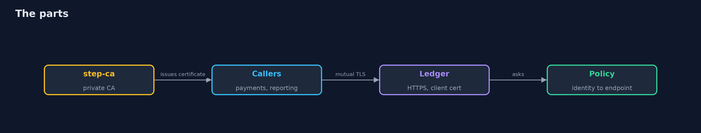
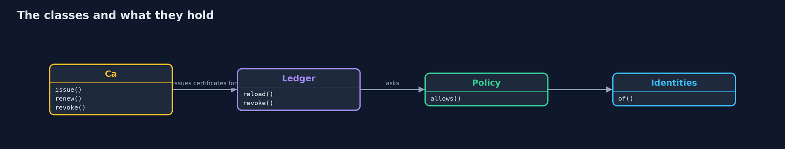
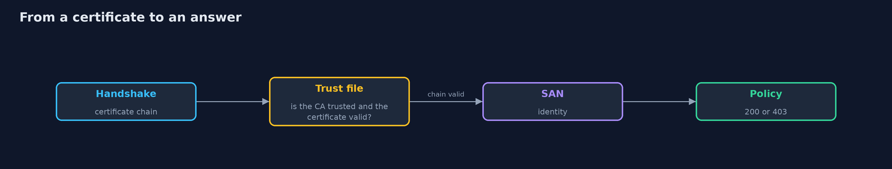
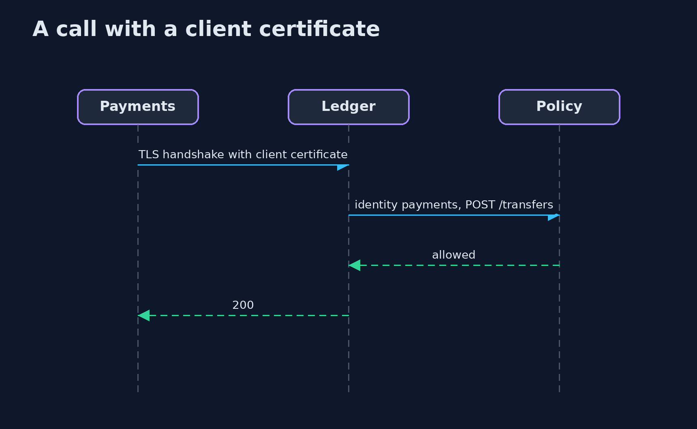

# Mutual TLS Between Services

```
src/main/java/com/jk/explore/security/mtls/
├── Ca.java             A real private certificate authority: step-ca (the pinned release in StepTools), driven with the step command line
├── Caller.java         A service calling another over HTTPS with the certificate it holds (or none)
├── ChainSteps.java     A teaching class: the chain check the ledger's TLS makes on a caller's certificates, redone by hand
├── Credential.java     A certificate chain with its private key, read from files
├── Identities.java     Reads the identity of a service from a certificate: the URI in the subject alternative name, never the subject name
├── Ledger.java         The bank's ledger service: HTTPS that demands a client certificate and decides by the identity in it
├── MutualTlsDemo.java  Mutual TLS between a bank's services: a real private CA (step-ca), a ledger service on the JDK's HTTPS server that demands a client certificate and decides by the identity in it, and callers using the JDK's HttpClient
├── NetworkGate.java    The old way: a plain HTTP service that lets in anything coming from the trusted network (here the loopback range) and asks nothing else
├── Policy.java         Which service identity may call which endpoint
├── Sh.java             Runs a program and returns what it printed, whether it worked or not
├── StepTools.java      The step command line and step-ca, one pinned release each
├── Tls.java            Builds the TLS settings of a service: the certificate it shows and the authorities it trusts
└── Traffic.java        A service that keeps calling the ledger on new connections while certificates are renewed and the server reloads
```

**step-ca issues each service a certificate whose subject is a host-style name (CN=svc-payments-7) and whose SAN holds the identity (spiffe://bank/payments); the chain payments sends, 2 certificates, is checked by hand link by link up to the one root in trust.pem; no certificate, a certificate from Partner Bank CA that names payments, and a server certificate for another host are all refused at the handshake, and 0 requests reach the ledger's code; payments gets 200 on POST /transfers and 403 on GET /statements, reporting the other way round, fraud-engine 403; trusting the network lets 2 of 2 callers in, the certificate identity 1 of 2; a certificate that lives 8 seconds is renewed halfway, the server reloads its certificate and trust file without a restart (roots 1, then 2), at least 20 calls fail 0 times, and the expired certificate is refused; a stolen certificate revoked at the CA still gets 200 until the ledger reads the CRL, then 403.**

In ordinary TLS only the server proves who it is. In **mutual TLS** the caller shows a certificate too, so the server learns **which service** is calling and can decide by that identity instead of by the network address. This project runs a bank's **ledger service** as a real HTTPS server (the JDK's `HttpsServer`) that demands a client certificate, and a real private CA, **step-ca**, that issues the certificates; the Java code drives the `step` command line and makes real TLS calls with the JDK's `HttpClient`. What step-ca issues decides the golden output, so the demo downloads one pinned release of `step` (0.31.0) and `step-ca` (0.30.2) into `build/tools` and checks each against its SHA-256. The demo is tagged `integration` (about 25 seconds): `./gradlew integrationTest`.

What it shows:
- **The identity in a certificate.** The subject is `CN=svc-payments-7`; the identity is the URI in the SAN, `spiffe://bank/payments`. The chain payments sends (**2** certificates) is checked by hand, link by link, up to the one root in `trust.pem`.
- **Who gets in.** No certificate, a certificate from Partner Bank CA that names `payments`, and a server certificate for another host are all refused at the handshake; **0** requests reach the ledger's code.
- **Identity, not the network.** `payments` gets **200** on `POST /transfers` and **403** on `GET /statements`; `reporting` the other way round; `fraud-engine` **403**. Trusting the network lets **2 of 2** callers in; the certificate identity **1 of 2**.
- **Rotation.** A certificate that lives **8 seconds** is renewed halfway; the server reloads its certificate and trust file without a restart; **0** of at least 20 calls fail; the expired certificate is refused.
- **A stolen certificate.** Revoked at the CA, it still gets **200** until the ledger reads the CA's revocation list; then **403**.

**Maps to:** NIST SP 800-207 (zero trust) · NIST SP 800-204B · OWASP ASVS 5.0 V12 Secure Communication · PCI DSS 4.0 req. 4.2 and 8.6 · RFC 8446, RFC 5280.

## The idea in everyday terms

A staff door that reads a badge instead of looking at the corridor. Anyone in the corridor is not let in for being there; the badge says who they are and the door knows what that person may open. Badges expire in minutes and are reissued, so a lost badge stops working soon, even if nobody remembers to cancel it.

## The scenario

A bank's payments, reporting and fraud-engine services call a ledger service. The ledger must know which of them is calling, let payments move money, let reporting read statements, and refuse the rest, even from the same host.

## Run

```bash
./gradlew run
```

The demo tells the story in 5 acts, each printing exact numbers that the tests check:

| Act | What it shows |
| --- | --- |
| 1. The identity in a certificate | step-ca issues the ledger a certificate for DNS localhost and each caller one whose subject is a host-style name and whose SAN is a URI: payments is CN=svc-payments-7 with spiffe://bank/payments. payments sends 2 certificates; checked by hand, each names and is verified by the next, up to the one root in trust.pem. The ledger ignores the subject, takes the URI and removes the prefix spiffe://bank/: payments. The key is EC, signed with SHA256withECDSA, and lives 600 seconds. |
| 2. Who gets through the handshake | Three calls to POST /transfers: no client certificate; a certificate from Partner Bank CA that names spiffe://bank/payments; and payments calling a ledger whose certificate names DNS ledger-old.bank.internal. All three are refused at the handshake, the first two by the ledger and the third by the client, and 0 requests reach the ledger's own code. |
| 3. Allowed by identity, not by the network | The ledger's rules: POST /transfers for payments, GET /statements for reporting. payments gets 200 and 403, reporting 200 and 403, and fraud-engine, with a valid certificate and no rule, 403. The same two callers on one host: a rule that trusts the network lets 2 of 2 in, the identity in the certificate 1 of 2. |
| 4. Rotation: a certificate that lives 8 seconds | payments gets a certificate with notAfter - notBefore = 8 seconds, accepted at first, while a caller keeps calling on new connections. Halfway through its life it is renewed: new serial number, later expiry. The ledger reloads a renewed server certificate and a trust file that grows from 1 root to 2, without a restart; Partner Bank CA's certificate for payments goes from handshake refused to 200. After its expiry the first certificate is refused at the handshake, 0 requests reach the ledger, the renewed one gets 200, and of at least 20 calls meanwhile 0 failed. |
| 5. A stolen certificate, and revocation | A copy of payments' certificate and key, used from another process, gets 200 on POST /transfers. It is revoked at the CA and is on the CA's revocation list (CRL, 1 entry, signature checked). Before the ledger reads the list it still gets 200; after, 403, certificate revoked. payments' own certificate, not revoked, still gets 200. |

## Test

```bash
./gradlew test
```

14 tests in `ChainStepsTest`, `DemoRunsTest`, `IdentitiesTest`, `PolicyTest`. The identity rule, the policy, the SAN listing and the chain check by hand (against the JDK's own check, on a fixed chain made once with step) are tested with no tools. The demo runs the pinned step and step-ca (./gradlew integrationTest).

## What the simulation got right, and what it left out

step-ca, step and the TLS handshakes are real; the CA runs on this machine from a pinned release. Keys, serial numbers, ports and times change on every run, so the demo prints names, lifetimes, answers and comparisons only. The services are the project's own.

## Technologies and versions

Every version below is pinned in the project's build files and was the latest stable release when the project was built.

| Technology | Version | Used for |
| --- | --- | --- |
| Java | 25 | the language and runtime; a Gradle toolchain finds or downloads the JDK |
| Gradle | 9.8.1 (wrapper) | build and run; nothing to install, the wrapper downloads it |
| tools.jackson.core:jackson-databind | 3.1.5 | library the code uses |
| org.junit.jupiter:junit-jupiter | 6.1.3, set by junit-bom | JUnit 5: the tests (tests only) |
| org.junit.platform:junit-platform-launcher | 6.1.3, set by junit-bom | JUnit platform launcher, which Gradle needs to run the tests (tests only) |
| videokit | repository tool (`tools/videokit`) | the narrated video and animation: Piper `en_US-amy-medium`, speed 0.8, longer pauses (the amy-slow voice) |

## Learning Material

| Document | What it is for |
| --- | --- |
| [Problem statement](docs/problem-statement.md) | the situation and what the project must show |
| [Prerequisites](docs/prerequisites.md) | what you need to know first |
| [Mutual TLS Between Services, explained](docs/mutual-tls-between-services-explained.md) | the acts in prose |
| [Session guide](docs/session.md) | a one-hour lesson with exercises |
| [Animated walkthrough](docs/animation.html) | the acts step by step, narrated |
| [Threat model](docs/threat-model.md) | what is protected, who could harm it, and how, using STRIDE |
| [Spec](docs/spec.md) | what this project must be true of |
| [Expected output](docs/expected-output.txt) | the golden demo output every test and every port checks against |

### The idea in one picture

A CA issues badges; the ledger reads them.



### Where each piece sits

The CA, the ledger and its rules.



### How the data moves

The handshake first, then the identity.



### Who calls whom, in order




### Video

`video/mutual-tls-between-services-explained.mp4` (with `.m4a` audio and `.srt` subtitles) is built by `video/build_video.sh`. Rendered media is not committed.

## What it costs

- **Revocation works only where the list is read.**
- **Short lifetimes need a renewal that never fails.**
- **Every CA in the trust file can mint any identity.**
- **Certificates must be issued, renewed and watched** for every service.

## When this is too much

Two processes on one machine that only talk to each other over a local socket do not need mutual TLS. Any call that crosses a network, or a team, does.

## Where you have already met this

- An internal API that trusts the source address.
- A client certificate checked for validity but never for who it names.
- A certificate renewal that is a calendar reminder.
- A revocation that nobody's server reads.

## Where this sits

This is the first project of the [service-identity-and-zero-trust](..) module. The next one, service-mesh-mtls, lets a mesh issue and rotate these certificates; workload-identity replaces the private CA with SPIRE.
