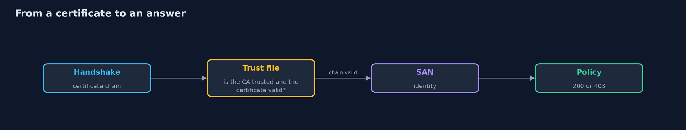

# Mutual TLS Between Services

```
src/main/java/com/jk/explore/security/mtls/
├── Ca.java             A real private certificate authority: step-ca running on this machine, driven with the step command line
├── Caller.java         A service calling another over HTTPS with the certificate it holds (or none)
├── Credential.java     A certificate chain with its private key, read from files
├── Identities.java     Reads the identity of a service from a certificate: the URI in the subject alternative name, never the subject name
├── Ledger.java         The bank's ledger service: HTTPS that demands a client certificate and decides by the identity in it
├── MutualTlsDemo.java  
├── NetworkGate.java    The old way: a plain HTTP service that lets in anything coming from the trusted network (here the loopback range) and asks nothing else
├── Policy.java         Which service identity may call which endpoint
├── Sh.java             Runs a program and returns what it printed, whether it worked or not
├── Tls.java            Builds the TLS settings of a service: the certificate it shows and the authorities it trusts
└── Traffic.java        A service that keeps calling the ledger on new connections while certificates are renewed and the server reloads
```

**A bank's ledger service runs real HTTPS that demands a client certificate from a real private CA (step-ca): a call with no certificate and a call with a certificate from another CA that names itself payments are both refused at the handshake and neither reaches the ledger's code (0 requests); the identity is the URI in the certificate's SAN, so payments is allowed to POST /transfers (200) and refused GET /statements (403), reporting is the other way round, and a valid fraud-engine certificate with no rule gets 403; an allow-the-network rule lets 2 of 2 callers on the same host in, the certificate identity 1 of 2; a certificate that lives 8 seconds is renewed halfway, the server reloads its certificate and trust file without a restart with 0 failed calls out of at least 20 made meanwhile, and the old certificate is refused after its expiry while the renewed one gets 200; a stolen certificate that is revoked at the CA still gets 200 at the ledger until the ledger reads the CA's revocation list, and then gets 403.**

In ordinary TLS only the server proves who it is. In **mutual TLS** the caller shows a certificate too, so the server learns **which service** is calling and can decide by that identity instead of by the network address. This project runs a bank's **ledger service** as a real HTTPS server (the JDK's `HttpsServer`) that demands a client certificate, and a real private CA, **step-ca**, that issues the certificates; the Java code drives the `step` command line and makes real TLS calls with the JDK's `HttpClient`. The demo is tagged `integration` (needs `step` and `step-ca` on the PATH, about 25 seconds): `./gradlew integrationTest`.

What it shows:
- **Who gets in.** No certificate, or a certificate from another CA that names itself `payments`, is refused at the handshake and **0** requests reach the ledger's code. A server that shows a certificate for another host is refused by the client.
- **Identity from the SAN.** The ledger takes the caller from the URI in the certificate (`spiffe://bank/payments`), not from the subject name. `payments` gets **200** on `POST /transfers` and **403** on `GET /statements`; `reporting` the other way round; `fraud-engine`, with a valid certificate and no rule, gets **403**.
- **Identity, not the network.** An allow-the-network rule lets **2 of 2** callers on the same host in; the certificate identity lets **1 of 2**.
- **Rotation.** A certificate that lives **8 seconds** is renewed halfway; the server reloads its certificate and trust file without a restart, and **0** of at least 20 calls on new connections fail; the old certificate is refused after its expiry and the renewed one gets 200.
- **A compromised certificate.** Revoked at the CA, it still gets **200** at the ledger until the ledger reads the CA's revocation list; then **403**.

**Maps to:** NIST SP 800-207 (zero trust) · NIST SP 800-204B · OWASP ASVS V9 · PCI DSS 4.0 req. 4.2 and 8.6 · RFC 8446, RFC 5280.

## The idea in everyday terms

A staff door that reads a badge instead of looking at the corridor. Anyone in the corridor is not let in for being there; the badge says who they are and the door knows what that person may open. Badges expire in minutes and are reissued, so a lost badge stops working soon, even if nobody remembers to cancel it.

## The scenario

A bank's payments, reporting and fraud-engine services call a ledger service. The ledger must know which of them is calling, let payments move money, let reporting read statements, and refuse the rest, even from the same host.

## Run

```bash
./gradlew run
```

The demo tells the story in 5 acts, each printing exact numbers that the tests check:

| Act | What it shows |
| --- | --- |
| 1. Who gets in | No certificate, or a certificate from another CA, is refused at the handshake and no request reaches the ledger's code. |
| 2. Identity, not the network | payments and reporting get different answers for the same call; an allow-the-network rule lets both in. |
| 3. Rotation | A certificate that lives 8 seconds is renewed halfway and the server reloads trust with no failed call; the old one is refused after expiry. |
| 4. A compromised certificate | A stolen certificate revoked at the CA still gets 200 until the ledger reads the revocation list. |
| 5. The bill | A revocation is only as good as the server that reads it; short lifetimes are the revocation that always works; a CA in the trust file can mint any identity. |

## Test

```bash
./gradlew test
```

9 tests in `DemoRunsTest`, `IdentitiesTest`, `PolicyTest`. The identity rule and the policy are tested with no tools. The demo starts step-ca and takes about 25 seconds (./gradlew integrationTest).

## What the simulation got right, and what it left out

step-ca, the step command line, the TLS handshake and the HTTP calls are real and run on this machine. The bank, its services and the endpoints are made up. The demo prints counts and yes or no, never ports, serial numbers or paths.

## Technologies and versions

Every version below is pinned in the project's build files and was the latest stable release when the project was built.

| Technology | Version | Used for |
| --- | --- | --- |
| Java | 25 | the language and runtime; a Gradle toolchain finds or downloads the JDK |
| Gradle | 9.8.1 (wrapper) | build and run; nothing to install, the wrapper downloads it |
| tools.jackson.core:jackson-databind | 3.1.5 | library the code uses |
| org.junit.jupiter:junit-jupiter | 6.1.3, set by junit-bom | JUnit 5: the tests (tests only) |
| org.junit.platform:junit-platform-launcher | 6.1.3, set by junit-bom | JUnit platform launcher, which Gradle needs to run the tests (tests only) |
| videokit | repository tool (`tools/videokit`) | the narrated video and animation: Piper `en_US-amy-medium`, speed 0.8, longer pauses (the amy-slow voice) |

## Learning Material

| Document | What it is for |
| --- | --- |
| [Problem statement](docs/problem-statement.md) | the situation and what the project must show |
| [Prerequisites](docs/prerequisites.md) | what you need to know first |
| [Mutual TLS Between Services, explained](docs/mutual-tls-between-services-explained.md) | the acts in prose |
| [Session guide](docs/session.md) | a one-hour lesson with exercises |
| [Animated walkthrough](docs/animation.html) | the acts step by step, narrated |
| [Threat model](docs/threat-model.md) | what is protected, who could harm it, and how, using STRIDE |
| [Spec](docs/spec.md) | what this project must be true of |
| [Expected output](docs/expected-output.txt) | the golden demo output every test and every port checks against |

### The idea in one picture

A CA issues badges; the ledger reads them.


### Where each piece sits

The CA, the ledger and its rules.


### How the data moves

The handshake first, then the identity.



### Who calls whom, in order


### Video

`video/mutual-tls-between-services-explained.mp4` (with `.m4a` audio and `.srt` subtitles) is built by `video/build_video.sh`. Rendered media is not committed.

## What it costs

- **A CA is now critical infrastructure:** if it is down, nothing renews.
- **Short lifetimes need a renewal job that never fails,** and a clock that is right.
- **Revocation does not happen by itself:** a server must read the list.
- **Every CA in a trust file can mint any identity.**
- **Every service needs a key it can keep secret.**

## When this is too much

A few services behind one gateway on a private network may be fine with the gateway doing TLS. Use mutual TLS when many services call each other and the network alone cannot say who is calling.

## Where you have already met this

- An internal API that trusts anything from the office network.
- A shared API key in every service's configuration.
- A certificate that expired on a Sunday and stopped payments.
- A firewall rule named after a subnet that nobody can explain.

## Where this sits

This is the first project of the [service-identity-and-zero-trust](..) module. The service mesh version, where the mesh issues the identities and does the handshake, comes next.
