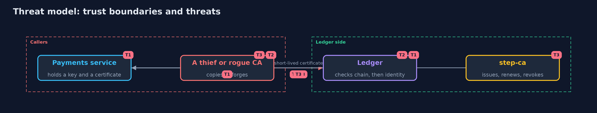

# Threat Model — Mutual TLS Between Services

A threat model answers four questions: what are we protecting, who or what could harm it, how, and what do we do about it. This one covers this project's own demo system, not a production deployment. Domain: a bank.

## Scope

Calls between a bank's services inside its network. It does not cover end users, browsers or the protection of keys in hardware.

## What we protect (assets)

- The ledger's transfers and statements.
- The private keys of the services.
- The CA and its trust file.

## Who and what acts on the system

- A service with a valid certificate and no business calling an endpoint.
- A process on the same host.
- A thief holding a copy of a certificate and key.
- A second CA that the ledger is told to trust.

## Trust boundaries

A trust boundary is a line that data or a request crosses between parts that trust each other differently. Threats cluster where those lines are.

- The TLS handshake: the chain is checked before any application code runs.
- The policy: the identity decides what a caller may do.

Each dashed box is a trust boundary. A rose tag such as T1 shows where the threat of that number, in the table below, applies.

## Threats, using STRIDE

STRIDE is a checklist of six kinds of threat: **Spoofing** (S), **Tampering** (T), **Repudiation** (R), **Information disclosure** (I), **Denial of service** (D), **Elevation of privilege** (E).

| Id | Kind | Threat | Where it shows up | Control in this project | What is left |
| --- | --- | --- | --- | --- | --- |
| T1 | Spoofing | A service calls the ledger as another service or with no identity | the ledger | Mutual TLS with a private CA; the identity is read from the SAN and authorized per endpoint | A service that is allowed too much |
| T2 | Spoofing | A certificate from another CA names itself payments | the trust file | The chain must lead to a trusted root; a handshake that fails never reaches the code | A CA added to the trust file can mint any identity |
| T3 | Elevation of privilege | A stolen certificate and key is used from another machine | the keys | Lifetimes of minutes or hours, renewal, and a revocation list that the ledger reads | Use until expiry if the list is not read |

## Assumptions

- Each service keeps its private key secret.
- The clocks agree within a second.

## Out of scope

- Hardware-protected keys.
- A compromised CA.
- Traffic analysis.

## How the tests check this

- `IdentitiesTest` and `PolicyTest` check the identity rule and the policy with no tools.
- `DemoRunsTest` starts step-ca and compares the whole demo with the golden output (integrationTest).

## Where this model goes next

The next project in the module is service-mesh-mtls.
