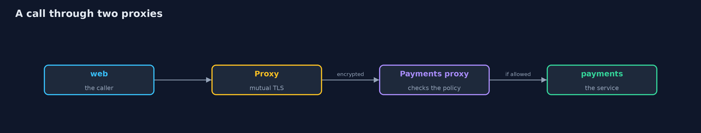

# Service Mesh and Automatic mTLS

```
src/main/java/com/jk/explore/security/meshmtls/
├── CertInfo.java             What a workload certificate says: who it names and for how long it is valid
├── Cluster.java              A real Kubernetes cluster made by kind (one node, itself a container), with its own kubeconfig file, deleted on close
├── Design.java               Which workload may call which, as the design says, and a measured matrix compared with it
├── Lab.java                  The bank's workloads on a real cluster with Linkerd installed, and the measurements of who can call whom
├── Linkerd.java              The Linkerd release the demo uses, downloaded from the project's own GitHub releases into build/ the first time
├── Metrics.java              Reads a proxy's own counters (Prometheus text) and sums one counter by the identity on the other end of the connection
├── Policies.java             Linkerd's policy objects: a Server names a port of a workload, an AuthorizationPolicy says which mesh identities may use it
├── Service.java              A workload of the bank: the namespace it runs in, its name and the ServiceAccount its pod runs as
├── ServiceMeshMtlsDemo.java  
├── Sh.java                   Runs a program and returns what it printed, whether it worked or not
└── Sniffer.java              A packet capture run beside the cluster's node (sharing its network and process space), the way someone with root on the node would
```

**On a real kind cluster with Linkerd (edge-26.10.1), a call from web to payments shows the account number on the wire before the proxies (yes) and not after (no), and each proxy counts the other end by certificate: payments sees web.bank.serviceaccount.identity.linkerd.cluster.local, web sees payments, so both ends proved who they are; all 4 workloads hold a certificate named from their ServiceAccount; with mutual TLS alone 16 of 16 caller and service pairs answer (14 unwanted, 4 of 4 from a pod outside the mesh, and the node itself gets HTTP 200); a Server and an AuthorizationPolicy per service leave exactly the 2 designed pairs (2 of 16, 0 unwanted, 0 missing) and refuse the others with HTTP 403, including the pod outside the mesh and the node; the mesh still lets an allowed web send an injection string through intact, shows the account number to root on the node between the proxy and the app, leaves a call to a pod outside the mesh readable, and gives a new pod that runs as the payments ServiceAccount payments' access (HTTP 200) while a ServiceAccount of the same name in another namespace gets 403; a certificate issued for 5 minutes (Linkerd's default is 24 hours) is renewed with the same name and no restart, and the trust anchor is valid for 365 days.**

A service mesh puts a proxy beside every pod. The proxies get a **certificate for the pod from its ServiceAccount**, encrypt every call between them and check each other's certificates, with no change to the application. This project installs **Linkerd** (release `edge-26.10.1`, downloaded from the project's GitHub releases into `build/` the first time) on a real **kind** cluster and measures a bank's pods before the proxies, after them, with a policy, and where the mesh stops. A Java program drives `kind`, `kubectl`, the Linkerd CLI and a packet capture; the demo is tagged `integration`: `./gradlew integrationTest` (Docker, kind, kubectl and a network once).

What it shows:
- **Before and after.** A call from web to payments carries the account number in clear on the wire, then not at all once the pods have proxies; each proxy counts the other end by its certificate.
- **Identities.** All **4** workloads hold a certificate named `<serviceaccount>.<namespace>.serviceaccount.identity.linkerd.cluster.local`.
- **Mutual TLS is not a decision.** With no policy **16 of 16** pairs answer, 14 of them unwanted, including a pod outside the mesh and the node.
- **A policy.** A Server and an AuthorizationPolicy per service leave **2 of 16**, the designed pairs; the others get HTTP **403**.
- **What the mesh does not protect.** An allowed caller can send any request; root on the node reads the plaintext between the proxy and the app; a pod outside the mesh talks in clear; whoever may create pods may take a ServiceAccount's identity.
- **Lifetime.** A certificate issued for 5 minutes (default 24 hours) is renewed with the same name and no restart.

**Maps to:** NIST SP 800-207 (zero trust) · NIST SP 800-204A/B (service mesh) · OWASP ASVS V9 · CIS Kubernetes Benchmark 5.

## The idea in everyday terms

A building where every employee wears a badge printed by security from their HR record, and every door has a reader. The badge is only as good as who may order one, the reader only works on doors that have one, and a guard who stands inside the room still sees what is said there.

## The scenario

A bank's web front calls payments, and payments calls the ledger. A statements service and an older batch job sit nearby. The demo measures who can call whom, with and without the mesh.

## Run

```bash
./gradlew run
```

The demo tells the story in 5 acts, each printing exact numbers that the tests check:

| Act | What it shows |
| --- | --- |
| 1. Before and after the proxies | The account number can be read from the wire before the proxies and not after; each proxy counts the other end by certificate. |
| 2. Identities from ServiceAccounts | All 4 workloads hold a certificate named from their ServiceAccount, namespace and trust domain. |
| 3. Mutual TLS is not a decision | With no policy 16 of 16 pairs answer, 14 unwanted, including a pod outside the mesh and the node. |
| 4. A policy names who may call | A Server and an AuthorizationPolicy per service leave exactly the 2 designed pairs; the rest get HTTP 403. |
| 5. What the mesh does not protect | An allowed caller sends anything, root on the node reads the plaintext, and a new pod can take an identity. |

## Test

```bash
./gradlew test
```

15 tests in `CertInfoTest`, `DemoRunsTest`, `DesignTest`, `MetricsTest`, `PoliciesTest`. The identity names, the policy manifests, the counter parsing, the certificate reading and the pair scoring are tested with no tools. The demo needs Docker, kind and kubectl (./gradlew integrationTest).

## What the simulation got right, and what it left out

Linkerd, kind and the packet capture are real and run on your machine. The bank is made up: small web servers stand in for the services. The demo prints counts, names and yes or no, never pod names, addresses or certificate serials.

## Technologies and versions

Every version below is pinned in the project's build files and was the latest stable release when the project was built.

| Technology | Version | Used for |
| --- | --- | --- |
| Java | 25 | the language and runtime; a Gradle toolchain finds or downloads the JDK |
| Gradle | 9.8.1 (wrapper) | build and run; nothing to install, the wrapper downloads it |
| org.junit.jupiter:junit-jupiter | 6.1.3, set by junit-bom | JUnit 5: the tests (tests only) |
| org.junit.platform:junit-platform-launcher | 6.1.3, set by junit-bom | JUnit platform launcher, which Gradle needs to run the tests (tests only) |
| videokit | repository tool (`tools/videokit`) | the narrated video and animation: Piper `en_US-amy-medium`, speed 0.8, longer pauses (the amy-slow voice) |

## Learning Material

| Document | What it is for |
| --- | --- |
| [Problem statement](docs/problem-statement.md) | the situation and what the project must show |
| [Prerequisites](docs/prerequisites.md) | what you need to know first |
| [Service Mesh and Automatic mTLS, explained](docs/service-mesh-mtls-explained.md) | the acts in prose |
| [Session guide](docs/session.md) | a one-hour lesson with exercises |
| [Animated walkthrough](docs/animation.html) | the acts step by step, narrated |
| [Threat model](docs/threat-model.md) | what is protected, who could harm it, and how, using STRIDE |
| [Spec](docs/spec.md) | what this project must be true of |
| [Expected output](docs/expected-output.txt) | the golden demo output every test and every port checks against |

### The idea in one picture

Proxies in each pod, a control plane that issues identities.


### Where each piece sits

A workload, its policy and the design it is scored against.


### How the data moves

The proxies carry the call.



### Who calls whom, in order


### Video

`video/service-mesh-mtls-explained.mp4` (with `.m4a` audio and `.srt` subtitles) is built by `video/build_video.sh`. Rendered media is not committed.

## What it costs

- **A proxy in every pod** costs memory, latency and a control plane to run.
- **Policy has to be written,** or mutual TLS only encrypts.
- **Certificates expire,** so the control plane must stay up to renew them.
- **Pods outside the mesh are not covered.**
- **The mesh trusts the cluster's ServiceAccount control.**

## When this is too much

A cluster with a few services and a team that already runs mutual TLS in the application may not need a mesh. A mesh pays off when many teams need identities and policy without changing every service.

## Where you have already met this

- A security review that asks whether traffic inside the cluster is encrypted.
- A network policy that allows a whole namespace.
- A shared database password between services.
- A certificate that expired on a Sunday.

## Where this sits

This is a project of the [service-identity-and-zero-trust](..) module, next to [mutual-tls-between-services](../mutual-tls-between-services) where the application does the same work itself. The cluster is the one of [kubernetes-network-policies](../../kubernetes-and-container-security/kubernetes-network-policies).
