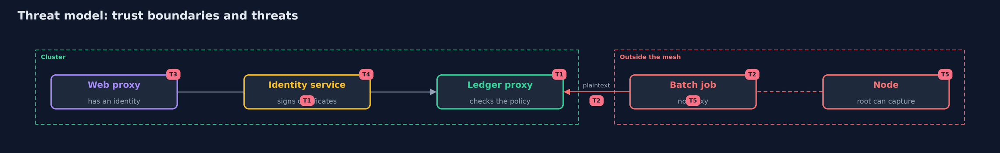

# Threat Model — Service Mesh and Automatic mTLS

A threat model answers four questions: what are we protecting, who or what could harm it, how, and what do we do about it. This one covers this project's own demo system, not a production deployment. Domain: a bank.

## Scope

Calls between a bank's pods in a Kubernetes cluster that runs Linkerd. It does not cover the application's own flaws, the cluster's control plane or the nodes' operating system.

## What we protect (assets)

- The account data in the calls.
- The identities and the trust anchor.
- The policies.

## Who and what acts on the system

- A pod that is not in the mesh.
- A user who can create pods.
- Root on a node.
- A caller that is allowed but sends hostile requests.

## Trust boundaries

A trust boundary is a line that data or a request crosses between parts that trust each other differently. Threats cluster where those lines are.

- The proxy of each pod.
- The ServiceAccount: who may create pods that run as it.

Each dashed box is a trust boundary. A rose tag such as T1 shows where the threat of that number, in the table below, applies.

## Threats, using STRIDE

STRIDE is a checklist of six kinds of threat: **Spoofing** (S), **Tampering** (T), **Repudiation** (R), **Information disclosure** (I), **Denial of service** (D), **Elevation of privilege** (E).

| Id | Kind | Threat | Where it shows up | Control in this project | What is left |
| --- | --- | --- | --- | --- | --- |
| T1 | Spoofing | A service is called by a workload that is not meant to | the ledger | A Server and an AuthorizationPolicy naming one identity | A workload that holds the named identity |
| T2 | Information disclosure | Traffic to or from a pod outside the mesh is readable | the account data | Put the pod in the mesh and require mesh identity in the policy | Pods and ports with no Server |
| T3 | Elevation of privilege | A new pod takes another workload's identity | the identities | Restrict who may create pods and ServiceAccounts | Anyone with the right to create pods |
| T4 | Repudiation | A stolen certificate is used until it expires | the identities | Short certificate lifetime and automatic renewal | No revocation before expiry |
| T5 | Information disclosure | Root on a node reads the plaintext inside a pod | the account data | Node hardening and access control | The mesh cannot protect it |

## Assumptions

- The control plane and its trust anchor are not compromised.

## Out of scope

- Compromise of the identity service.
- Denial of service.

## How the tests check this

- `PoliciesTest`, `MetricsTest`, `CertInfoTest` and `DesignTest` check the manifests, the counters, the certificate reading and the scoring with no tools.
- `DemoRunsTest` makes the cluster and compares the whole demo with the golden output (integrationTest).

## Where this model goes next

The next project in the module continues with the identity of workloads.
