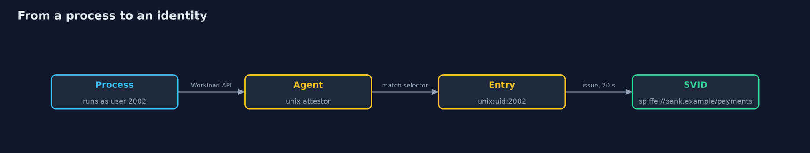
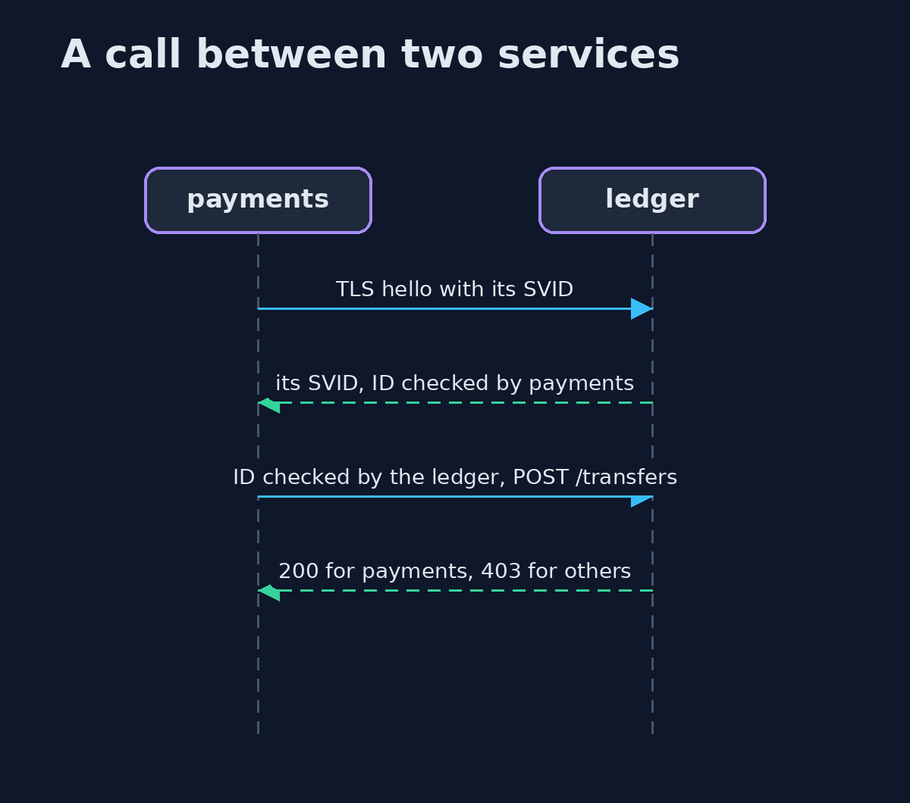

# Workload Identity

```
src/main/java/com/jk/explore/security/workloadid/
├── Lab.java                   A real SPIRE server and agent in one Linux container, plus the Java workloads that run beside them as different operating system users
├── LegacyLedger.java          The "before": a ledger that trusts one static secret and the caller's own word about who it is
├── Policy.java                The ledger's authorization: which SPIFFE ID may call which route
├── Rotations.java             Counts how often a certificate was replaced, from the serial numbers seen one after the other
├── Sh.java                    Runs a program and returns what it printed, whether it worked or not
├── Workload.java              The program that runs inside the SPIRE container, once per workload
└── WorkloadIdentityDemo.java  A bank's ledger is called by payments and reporting
```

**One static secret copied into 3 services lets a leak from any one of them act as every service; with SPIRE each workload gets a SPIFFE ID chosen by a registration entry and its operating system user, not by what it claims, and an X.509-SVID that lives 20 seconds; two Java services verify each other's SPIFFE ID against the trust bundle, the ledger authorizes by that ID (200 and 403 as the rules say), the SVID is renewed on its own at least 3 times in 50 seconds with 0 calls failed, a stolen copy works while it lives and is refused after 20 seconds, and a process that matches no entry gets no SVID.**

A shared secret says "someone who holds this key is calling", never which service. This project first shows that **before**: one static key copied into the configuration of payments, reporting and fraud-engine; when the fraud-engine's copy leaks, the attacker is every service. It then runs a real **SPIRE** server and agent (SPIFFE's reference implementation) and gives each workload a **SPIFFE ID** such as `spiffe://bank.example/payments`, chosen by a registration entry and the operating system user the process runs as, plus an **X.509-SVID** that lives 20 seconds. SPIRE has no macOS build, so the official linux arm64 release runs in one Docker container (`eclipse-temurin:25-jre`, the release downloaded once into `build/spire`); the Java workloads run in that container as different users and use the `java-spiffe` Workload API client. The demo is tagged `integration`: `./gradlew integrationTest` (about 3 minutes).

What it shows:
- **The shared secret.** Held by **3** services, it lets a copy from one service call as any of them; the ledger takes the caller's word for who it is.
- **Identity by registration.** The same Java program gets `ledger`, `payments` or `reporting` depending on the user it runs as; a claim in its environment changes nothing.
- **Mutual verification.** Two Java services check each other's SPIFFE ID against the trust bundle; the ledger answers 200 and 403 by the rules; a server with the wrong ID and a certificate made by an attacker are refused (0 requests reach the ledger).
- **Rotation.** SVIDs are replaced at least **3** times in 50 seconds with **0** failed calls and no renewal code in the services.
- **A stolen SVID.** It works while it lives and is refused after 20 seconds; a shared secret still works.
- **No entry, no identity.** A process that matches nothing gets no SVID, and deleting an entry ends a workload's identity.

**Maps to:** NIST SP 800-207 (zero trust) · SPIFFE and SPIRE · OWASP ASVS V9 · CWE-798 (hard-coded credentials).

## The idea in everyday terms

A shared secret is a master key cut three times: whoever finds one lost copy can open every door and nobody can tell which copy it was. A SPIFFE ID is a name badge printed at the door by a guard who looks at who is standing there, and the badge stops working after 20 seconds.

## The scenario

A bank's ledger is called by payments (which moves money) and reporting (which reads statements). The demo first lets one shared key leak, then replaces it with SPIRE identities, rotates them, steals one and starts a process that matches no entry.

## Run

```bash
./gradlew run
```

The demo tells the story in 6 acts, each printing exact numbers that the tests check:

| Act | What it shows |
| --- | --- |
| 1. One shared secret | One key in 3 services lets a leak from any of them act as every service. |
| 2. Identity by registration | SPIRE gives the same Java program a different SPIFFE ID for each user it runs as. |
| 3. Two services check each other | Each side verifies the other's SPIFFE ID against the trust bundle, and the ledger authorizes by it. |
| 4. Rotation without a restart | SVIDs are replaced at least 3 times in 50 seconds and no call fails. |
| 5. A stolen SVID | A copy works while the SVID lives and is refused after 20 seconds; a shared secret still works. |
| 6. No entry, no identity | A process that matches no entry gets no SVID, and deleting an entry ends an identity. |

## Test

```bash
./gradlew test
```

10 tests in `DemoRunsTest`, `LegacyLedgerTest`, `PolicyTest`, `RotationsTest`. The policy, the rotation count and the shared-secret ledger are tested with no tools. The demo runs SPIRE in Docker (./gradlew integrationTest).

## What the simulation got right, and what it left out

SPIRE (server and agent 1.15.5), Docker and the java-spiffe client are real, and every number is measured. The "bank" is a ledger and three callers on one node; a real deployment has many nodes and a node attestor stronger than a join token. The demo never prints ports, serial numbers, tokens or times.

## Technologies and versions

Every version below is pinned in the project's build files and was the latest stable release when the project was built.

| Technology | Version | Used for |
| --- | --- | --- |
| Java | 25 | the language and runtime; a Gradle toolchain finds or downloads the JDK |
| Gradle | 9.8.1 (wrapper) | build and run; nothing to install, the wrapper downloads it |
| io.spiffe:java-spiffe-provider | 0.8.17 | library the code uses |
| io.grpc:grpc-netty-shaded | 1.80.0 | library the code uses |
| org.junit.jupiter:junit-jupiter | 6.1.3, set by junit-bom | JUnit 5: the tests (tests only) |
| org.junit.platform:junit-platform-launcher | 6.1.3, set by junit-bom | JUnit platform launcher, which Gradle needs to run the tests (tests only) |
| videokit | repository tool (`tools/videokit`) | the narrated video and animation: Piper `en_US-amy-medium`, speed 0.8, longer pauses (the amy-slow voice) |

## Learning Material

| Document | What it is for |
| --- | --- |
| [Problem statement](docs/problem-statement.md) | the situation and what the project must show |
| [Prerequisites](docs/prerequisites.md) | what you need to know first |
| [Workload Identity, explained](docs/workload-identity-explained.md) | the acts in prose |
| [Session guide](docs/session.md) | a one-hour lesson with exercises |
| [Animated walkthrough](docs/animation.html) | the acts step by step, narrated |
| [Threat model](docs/threat-model.md) | what is protected, who could harm it, and how, using STRIDE |
| [Spec](docs/spec.md) | what this project must be true of |
| [Expected output](docs/expected-output.txt) | the golden demo output every test and every port checks against |

### The idea in one picture

A SPIRE server and agent give each Java workload an identity.


### Where each piece sits

The rules, the lab, the workloads and the shared-secret ledger.


### How the data moves

The agent looks at who is asking, not at what it says.



### Who calls whom, in order




### Video

`video/workload-identity-explained.mp4` (with `.m4a` audio and `.srt` subtitles) is built by `video/build_video.sh`. Rendered media is not committed.

## What it costs

- **SPIRE is more to run:** a server, an agent on each node and registration entries to keep.
- **The agent and the server must stay up,** because a short lifetime depends on renewal.
- **The identity is only as strong as the selector,** here the operating system user.
- **A stolen SVID works until it expires,** so the lifetime is the revocation.
- **Services need a Workload API client** and a TLS context that reads the SVID at each handshake.

## When this is too much

One service calling one other service inside a closed network may be fine with a managed secret that is rotated. Use workload identity when many services call each other and a leak from any one of them must not be worth everything.

## Where you have already met this

- An API key in an environment variable copied into every service.
- A service account password nobody has changed since it was created.
- A client certificate that lives for a year.
- A header that says which service is calling.

## Where this sits

This is a project of the [service-identity-and-zero-trust](..) module, with [mutual-tls-between-services](../mutual-tls-between-services) and [service-mesh-mtls](../service-mesh-mtls). The first runs its own CA; this one lets SPIRE decide who a workload is and renew its certificate.
