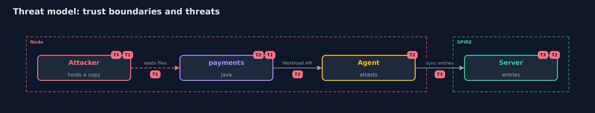

# Threat Model — Workload Identity

A threat model answers four questions: what are we protecting, who or what could harm it, how, and what do we do about it. This one covers this project's own demo system, not a production deployment. Domain: a bank.

## Scope

Service-to-service calls at a bank on one node, authenticated by SPIFFE IDs from a real SPIRE server and agent. It does not cover the node's own security, the SPIRE server's key storage, or the people who write entries.

## What we protect (assets)

- The ledger's transfers.
- The SVIDs and their private keys.
- The registration entries.

## Who and what acts on the system

- An attacker with a copy of a service's files.
- A process that claims to be another service.
- A service that is not allowed to move money.

## Trust boundaries

A trust boundary is a line that data or a request crosses between parts that trust each other differently. Threats cluster where those lines are.

- The operating system user a process runs as.
- The agent's Workload API socket.

Each dashed box is a trust boundary. A rose tag such as T1 shows where the threat of that number, in the table below, applies.

## Threats, using STRIDE

STRIDE is a checklist of six kinds of threat: **Spoofing** (S), **Tampering** (T), **Repudiation** (R), **Information disclosure** (I), **Denial of service** (D), **Elevation of privilege** (E).

| Id | Kind | Threat | Where it shows up | Control in this project | What is left |
| --- | --- | --- | --- | --- | --- |
| T1 | Spoofing | A leaked secret or SVID is used to act as a service | the ledger | Short-lived SVIDs; no shared secret | A copy works until it expires |
| T2 | Spoofing | A process claims to be another workload | the Workload API | Identity from registration entries and the user, never from claims | Anyone who runs as that user on the node |
| T3 | Elevation of privilege | An identity that should end keeps working | SVIDs and entries | Delete the entry; the SVID expires in 20 seconds | Up to one lifetime of use |

## Assumptions

- The node is not fully compromised: root there is every identity.
- The registration entries are written by someone trusted.

## Out of scope

- A stronger node attestor than a join token.
- Federation between trust domains.
- Denial of service on the SPIRE server.

## How the tests check this

- `PolicyTest`, `RotationsTest` and `LegacyLedgerTest` check the rules, the rotation count and the shared-secret ledger with no tools.
- `DemoRunsTest` runs SPIRE in Docker and compares the whole demo with the golden output (integrationTest).

## Where this model goes next

The next project in the module is service-mesh-mtls.
