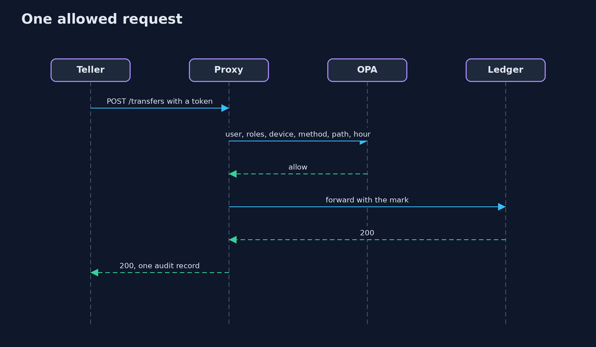

# Zero Trust Access

```
src/main/java/com/jk/explore/security/zerotrust/
├── AuditLog.java             One JSON line per decision: who, what, allow or deny, and why
├── Decider.java              Whoever answers "may this request happen?": OPA in the demo, a lambda in the unit tests
├── Forge.java                What an attacker (and the tests) can make without Keycloak: tokens built and edited by hand
├── Jwks.java                 Reads the RSA signing keys out of an issuer's JWKS document (RFC 7517)
├── Jwt.java                  Validates a JWT the way a resource server must: the algorithm is chosen by the verifier (RS256 only), the key by the key id from the issuer's published key set, and the signature is checked before any claim is trusted
├── Keycloak.java             A real Keycloak in Docker (start-dev) with the realm "bank" imported from lab/bank-realm.json
├── Ledger.java               The bank's internal ledger API
├── Opa.java                  The opa binary run as a server with one Rego file, asked for a decision over its REST API
├── Proxy.java                An identity-aware proxy in front of the ledger
├── Sh.java                   Runs a program and returns what it printed, whether it worked or not
└── ZeroTrustAccessDemo.java  A bank's internal ledger API
```

**A bank's ledger API behind the network perimeter answers 10 of 10 requests that carry no identity, 3 of them transfers; behind an identity-aware proxy the same 10 requests get 0 successes, and a request that skips the proxy and goes straight to the ledger gets 0 too; the proxy checks a Keycloak JWT (signature from the JWKS, issuer, audience, expiry) and refuses 7 of 7 bad tokens with 401 (none, expired, wrong audience, edited roles, flipped signature, forged with the attacker's own key, algorithm none), then asks OPA, which answers 403 for the wrong role, a device that is not compliant, and a transfer at 23:00; of 39 requests every one has exactly one audit record (39 of 39) and 0 of 22 tokens appear in the log; a token outlives its ended session and is still accepted (200) until it expires, a session check at Keycloak refuses it (401) for 1 extra call per request, a 4 second lifetime bounds the exposure, and with OPA down the proxy answers 503.**

Zero trust says that being inside the network proves nothing: **every request is authenticated, authorized and logged, close to the resource**. This project puts that into one small system for a bank's internal **ledger API**. A real **Keycloak** (in Docker) issues the tokens, a real **OPA** server decides, and an **identity-aware proxy** written in Java (the JDK's HttpServer) sits in front of the ledger: it validates the JWT, asks OPA, enforces the answer, and writes one audit record. Everything is measured with real HTTP requests; the demo is tagged `integration`: `./gradlew integrationTest` (needs Docker and the opa binary).

What it shows:
- **The perimeter.** The ledger inside the network answers **10 of 10** requests with no identity. Behind the proxy the same 10 get **0**, and 0 more when they go straight to the ledger.
- **Authentication.** **7 of 7** bad tokens get 401: none, expired, wrong audience, roles edited, signature flipped, signed with the attacker's own key, algorithm none.
- **Authorization.** OPA answers 403 for the wrong role, a device that is not compliant and a transfer outside business hours; its Rego has **15 of 15** tests.
- **Audit.** **39** requests, **39** records, **0 of 22** tokens in the log.
- **Lifetime.** A token stays valid after its session ends (**200**) until it expires; a session check refuses it (**401**) for one more call per request; a **4 second** lifetime bounds the window.

**Maps to:** NIST SP 800-207 (zero trust architecture) · OWASP ASVS V3 and V4 · RFC 7519 (JWT) and RFC 8725 (JWT best practices) · CIS Controls 6 and 8 · ISO/IEC 27001:2022 A.8.2 and A.8.15.

## The idea in everyday terms

A building where the lobby guard used to wave everyone through because they were already inside. Now every office door checks a badge, looks up what that badge may open, and writes down each attempt, so being in the lobby opens nothing.

## The scenario

A bank's ledger API serves balances, transfers, audit exports and account freezes. Today anything that can reach it can call it. The demo puts a proxy in front that knows who is calling, asks a policy whether they may, and records every answer.

## Run

```bash
./gradlew run
```

The demo tells the story in 5 acts, each printing exact numbers that the tests check:

| Act | What it shows |
| --- | --- |
| 1. The perimeter | The ledger inside the network answers all 10 requests that carry no identity. |
| 2. Who is calling | The proxy refuses 7 of 7 bad tokens with 401, and the same 10 identity-less requests now get 0 successes. |
| 3. May they | OPA answers 403 for the wrong role, a device that is not compliant, and a transfer at 23:00. |
| 4. Logged | 39 requests, 39 audit records, and 0 of 22 tokens in the log. |
| 5. A token outlives its session | After logout the token is still accepted until it expires; a session check or a 4 second lifetime closes the window. |

## Test

```bash
./gradlew test
```

18 tests in `DemoRunsTest`, `JwtTest`, `ProxyTest`. The JWT validation, the proxy, the audit log and the ledger are tested with the JDK only, with a stand-in for OPA. The demo runs Keycloak in Docker and the opa binary (./gradlew integrationTest).

## What the simulation got right, and what it left out

Keycloak and the opa binary are real. The proxy and the ledger are the project's own small Java programs. Envoy and oauth2-proxy were not run: they would do the proxy's job, and writing it in Java shows every step. The device posture is a claim set per Keycloak client, standing in for a device management system.

## Technologies and versions

Every version below is pinned in the project's build files and was the latest stable release when the project was built.

| Technology | Version | Used for |
| --- | --- | --- |
| Java | 25 | the language and runtime; a Gradle toolchain finds or downloads the JDK |
| Gradle | 9.8.1 (wrapper) | build and run; nothing to install, the wrapper downloads it |
| com.fasterxml.jackson.core:jackson-databind | 2.21.2 | library the code uses |
| org.junit.jupiter:junit-jupiter | 6.1.3, set by junit-bom | JUnit 5: the tests (tests only) |
| org.junit.platform:junit-platform-launcher | 6.1.3, set by junit-bom | JUnit platform launcher, which Gradle needs to run the tests (tests only) |
| videokit | repository tool (`tools/videokit`) | the narrated video and animation: Piper `en_US-amy-medium`, speed 0.8, longer pauses (the amy-slow voice) |

## Learning Material

| Document | What it is for |
| --- | --- |
| [Problem statement](docs/problem-statement.md) | the situation and what the project must show |
| [Prerequisites](docs/prerequisites.md) | what you need to know first |
| [Zero Trust Access, explained](docs/zero-trust-access-explained.md) | the acts in prose |
| [Session guide](docs/session.md) | a one-hour lesson with exercises |
| [Animated walkthrough](docs/animation.html) | the acts step by step, narrated |
| [Threat model](docs/threat-model.md) | what is protected, who could harm it, and how, using STRIDE |
| [Spec](docs/spec.md) | what this project must be true of |
| [Expected output](docs/expected-output.txt) | the golden demo output every test and every port checks against |

### The idea in one picture

A request meets identity, policy and a log before the ledger.


### Where each piece sits

The proxy, the token check and the audit log.


### How the data moves

Each step can refuse; the last one always writes.


### Who calls whom, in order




### Video

`video/zero-trust-access-explained.mp4` (with `.m4a` audio and `.srt` subtitles) is built by `video/build_video.sh`. Rendered media is not committed.

## What it costs

- **Every request pays for a signature check and a policy decision,** and the proxy and policy engine become part of availability.
- **A token is valid until it expires,** so revoking a session needs a short lifetime or a check on every request.
- **A device posture claim is only as good as its source;** here it is set by the demo.
- **Policies are code** that needs its own tests and review.
- **The last hop matters:** a ledger that any process can reach directly undoes the proxy.

## When this is too much

A single-tenant tool that only one trusted process calls does not need a proxy and a policy engine. Use this where many people and services reach sensitive operations and someone must later say who did what.

## Where you have already met this

- A VPN that puts a laptop on the same flat network as the databases.
- An internal admin page with no login because it is internal.
- A role check copied into five services, each slightly different.
- An access log with IP addresses and no names.

## Where this sits

This is a project of the [service-identity-and-zero-trust](..) module. mutual-tls-between-services and workload-identity prove which service is calling; this one adds which person, on which device, may do what, and the record of it.
