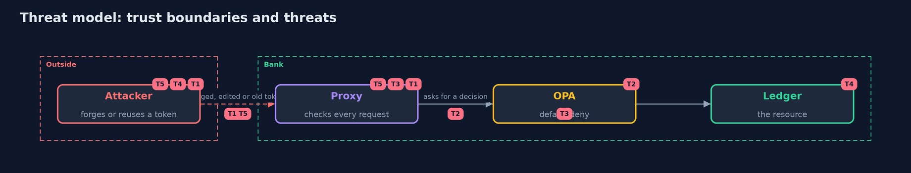

# Threat Model — Zero Trust Access

A threat model answers four questions: what are we protecting, who or what could harm it, how, and what do we do about it. This one covers this project's own demo system, not a production deployment. Domain: a bank.

## Scope

Access to a bank's ledger API through an identity-aware proxy with Keycloak and OPA, on one machine. It does not cover the security of Keycloak itself, the user's device, or the network between the proxy and the ledger.

## What we protect (assets)

- Balances and transfers.
- The audit log.
- The signing keys of the identity provider.

## Who and what acts on the system

- An attacker inside the network.
- A teller, an auditor and an admin.
- A user whose session was ended.

## Trust boundaries

A trust boundary is a line that data or a request crosses between parts that trust each other differently. Threats cluster where those lines are.

- The proxy: a request outside it is untrusted.
- The ledger: it trusts only the proxy.

Each dashed box is a trust boundary. A rose tag such as T1 shows where the threat of that number, in the table below, applies.

## Threats, using STRIDE

STRIDE is a checklist of six kinds of threat: **Spoofing** (S), **Tampering** (T), **Repudiation** (R), **Information disclosure** (I), **Denial of service** (D), **Elevation of privilege** (E).

| Id | Kind | Threat | Where it shows up | Control in this project | What is left |
| --- | --- | --- | --- | --- | --- |
| T1 | Spoofing | A forged or edited token | the proxy | RS256 only, signature from the JWKS, then issuer, audience and expiry | A stolen valid token works until it expires |
| T2 | Elevation of privilege | A valid user does what their role or device does not allow | OPA | Default-deny Rego with roles, device posture and hour, tested | The posture claim is only as good as its source |
| T3 | Repudiation | An action with no record of who did it | the audit log | One record per request, with user and reason, no token | The log must be protected and shipped elsewhere |
| T4 | Tampering | A caller inside the network skips the proxy | the ledger | The ledger answers only a request that carries the proxy's mark | A mark on a flat network is weak: use mutual TLS |
| T5 | Elevation of privilege | A token used after its session ended | the proxy | Short lifetime and a session check at the issuer | The check costs a call per request and needs Keycloak up |

## Assumptions

- Keycloak's keys are published over a channel the proxy trusts.
- The proxy and the ledger share a mark made at run time (mutual TLS in production).

## Out of scope

- Browser sessions and single sign-on.
- Real device posture signals.

## How the tests check this

- `JwtTest` checks the token rules with a key made in the test.
- `ProxyTest` checks the status codes, the one record per request, the session check and the failure to decide, with no Docker.
- `DemoRunsTest` runs Keycloak and OPA and compares the whole demo with the golden output (integrationTest).

## Where this model goes next

This is the last project of the service-identity-and-zero-trust module.
