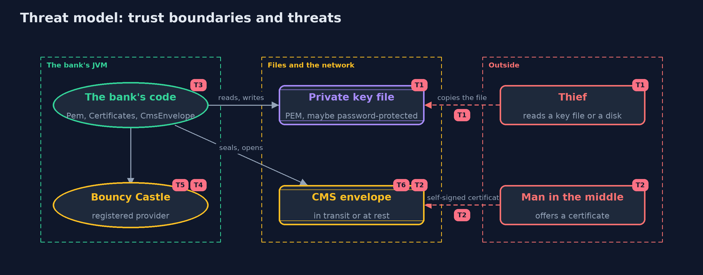

# Threat Model — Asymmetric Encryption with Bouncy Castle and OpenSSL

A threat model answers four questions: what are we protecting, who or what could harm it, how, and what do we do about it. This one covers this project's own demo system, not a production deployment. Domain: an online bank.

## Scope

How an online bank stores a customer's keys and sends her encrypted statements in standard formats: PEM key files, an X.509 certificate, and a CMS envelope that OpenSSL can also open. It covers a thief who reads
a key file, someone who offers a false certificate, and the risks of the library itself. It does not cover certificate authorities, or the storage of the keys in a key store or hardware module.

## What we protect (assets)

- Ana's private key, in a file.
- The contents of each statement.
- The correctness of the certificate that names the recipient.
- The JVM's list of security providers.

## Who and what acts on the system

- The bank, which seals envelopes for a certificate.
- Ana, who holds the private key.
- A thief who copies a key file or a backup.
- A man in the middle who offers a false certificate for Ana.
- A developer who copies an example that picks older padding.

## Trust boundaries

A trust boundary is a line that data or a request crosses between parts that trust each other differently. Threats cluster where those lines are.

- Key file to the filesystem: a PEM private key is a secret that sits in an ordinary file.
- Certificate to the bank: the bank must decide whether to trust a certificate it was handed.
- Library to the JVM: registering a provider affects every library in the program.

Each dashed box is a trust boundary. A rose tag such as T1 shows where the threat of that number, in the table below, applies.

## Threats, using STRIDE

STRIDE is a checklist of six kinds of threat: **Spoofing** (S), **Tampering** (T), **Repudiation** (R), **Information disclosure** (I), **Denial of service** (D), **Elevation of privilege** (E).

| Id | Kind | Threat | Where it shows up | Control in this project | What is left |
| --- | --- | --- | --- | --- | --- |
| T1 | Information disclosure | A private key file is copied | `Pem.privateKeyInTheClear` | Encrypt the PKCS#8 file with a password (`Pem.privateKeyEncrypted`), and keep it out of backups that others can read | A weak password can be guessed offline; a hardware module or a key store is stronger |
| T2 | Spoofing | A false certificate is offered for Ana, so the bank seals to the wrong key | `Certificates.selfSigned`, `CmsEnvelope.seal` | None in this project: a self-signed certificate proves nothing | Certificates signed by a trusted authority, in the next modules, answer this |
| T3 | Information disclosure | The easy call picks the older PKCS#1 v1.5 padding for the key | `CmsEnvelope.seal(cert, data, false)` | Ask for RSA-OAEP by name, which is the default in `seal(cert, data)` | Another developer can still call the easy form, so a code review should look for it |
| T4 | Elevation of privilege | Registering Bouncy Castle changes which algorithms every library in the JVM gets | `Providers` | Register once, on purpose, and name the provider where it is used | Other libraries in the same JVM still see the provider |
| T5 | Tampering | A vulnerable version of the library stays in use | the dependency on bcprov and bcpkix | The versions are pinned, and updating them is a routine task | A large library has a large history of fixes, so updates need testing against another program, as the OpenSSL check does |
| T6 | Tampering | An envelope is changed in transit, and AES-CBC does not notice | `CmsEnvelope` | A changed envelope never opens to the original statement, but may open to garbage | Use an authenticated envelope, or sign the envelope, to be sure to detect changes |

## Assumptions

- The certificate in the demo is self-signed, and its trust is assumed. A real bank checks it against a trusted authority.
- The openssl on the machine is a genuine version 3.
- Keys are fresh and random on every run.

## Out of scope

- Certificate authorities, chains and revocation.
- Hardware security modules and key stores.
- PGP, which Bouncy Castle also supports.

## How the tests check this

- `PemTest` checks the headers, round trips, the password protection and the salt.
- `CertificateTest` checks the subject, the self-signature, the fixed dates and key usage.
- `CmsEnvelopeTest` checks opening, refusal for another key or certificate, the key transport algorithm, and that a changed envelope never opens to the original.
- `OpenSslInteropTest` (tagged `openssl`) has openssl open the envelope, and checks the golden output.

## Where this model goes next

The next project, digital-signatures, supplies what a self-signed certificate lacks: a signature made with a private key, which anyone can check with the public key, so that who made something can be proved.
