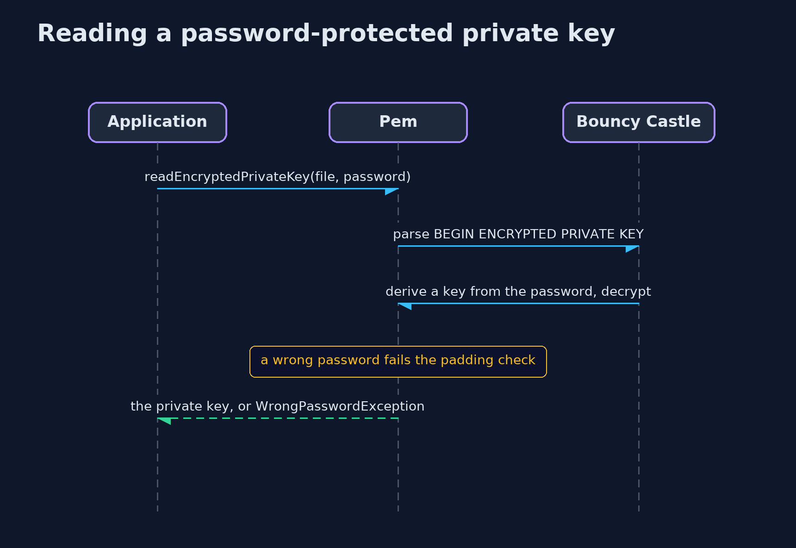
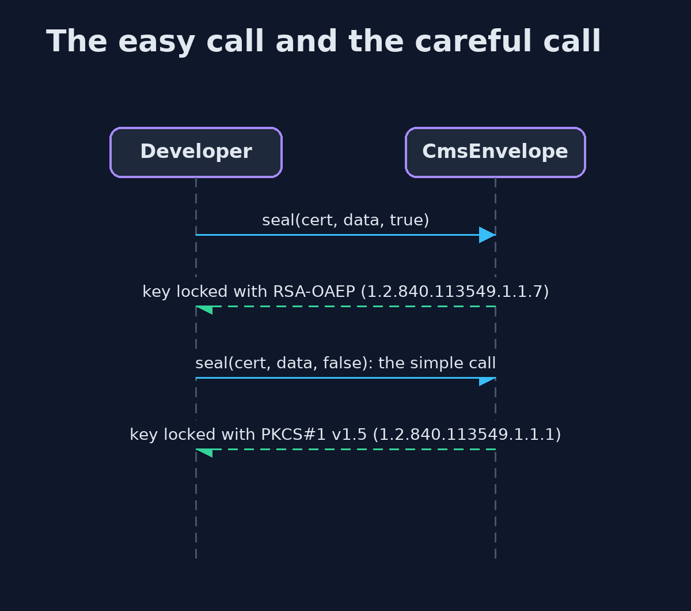

# Asymmetric Encryption with Bouncy Castle and OpenSSL — UML Sequence Diagrams

## 1. Reading a password-protected private key

The password makes a key that decrypts the PKCS#8 file; a wrong password fails.

## 2. The easy call and the careful call

Both envelopes open, but they record different algorithms for locking the key.

