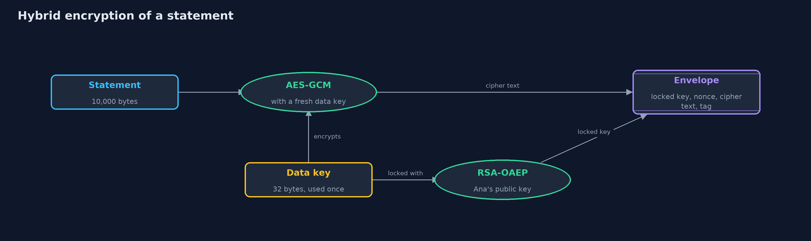
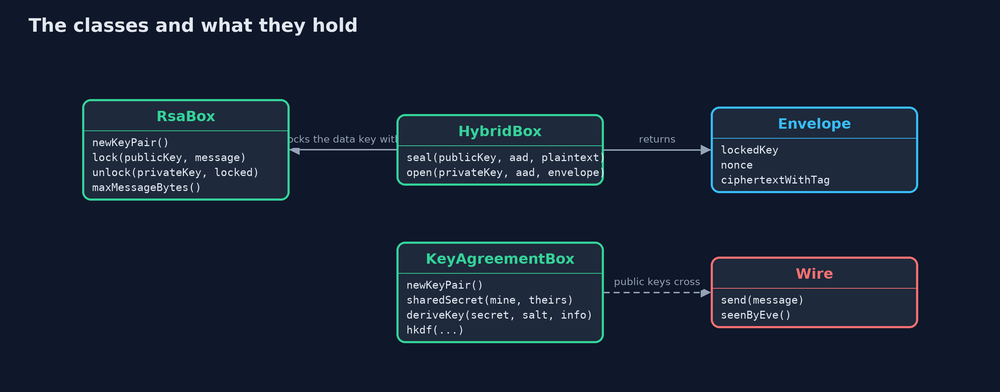
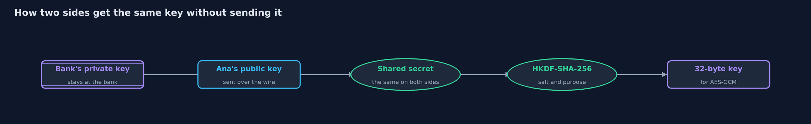
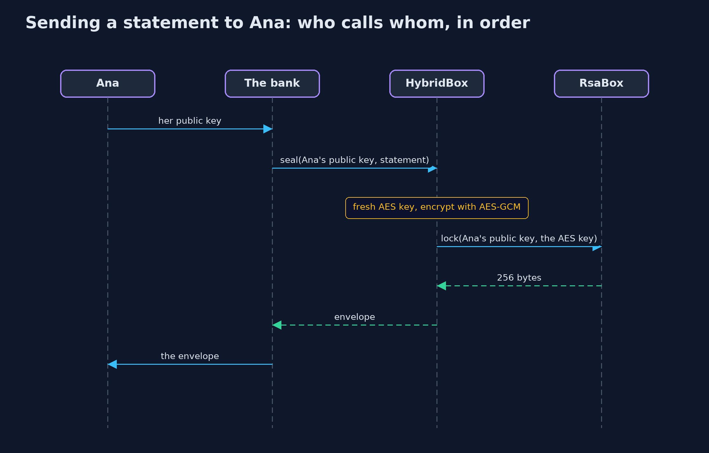

# Asymmetric Encryption (RSA and Key Agreement)

```
src/main/java/com/jk/explore/security/asymmetric/
├── AsymmetricDemo.java   Runs the online bank story in five numbered acts and prints exact, repeatable results
├── Envelope.java         A hybrid-encrypted message: the data key locked with RSA, the AES-GCM nonce, and the cipher text with its tag
├── Hex.java              Small helpers for text and bytes
├── HybridBox.java        Hybrid encryption: the data is encrypted with a fresh AES-256-GCM key made for this one message, and only that small key is locked with the recipient's RSA public key
├── KeyAgreementBox.java  Key agreement with X25519 (elliptic-curve Diffie-Hellman)
├── RsaBox.java           RSA encryption with OAEP padding
└── Wire.java             A network line with an eavesdropper on it
```

**A key pair lets a bank lock a message that only its owner can open, hybrid encryption carries big data under a small locked key, and key agreement makes a shared key without sending one, but none of it says whose public key it is.**

Symmetric encryption has a chicken-and-egg problem: both sides need the same secret key, and the only way to share one is to send it, which an
eavesdropper can read. **Asymmetric** encryption solves it with a **key pair**: a **public key**, which anyone may have, and a **private key**,
which its owner never shares. Anything locked with the public key can only be opened with the private key. **RSA** is the best known: the bank locks a small message, such as a key, with
the customer's public key, using **OAEP** padding, which adds randomness and must always be used. RSA can only lock a few hundred bytes, so real systems use **hybrid encryption**: a fresh AES key
encrypts the data, and RSA locks only that key. A second route, **key agreement**, such as **X25519**, sends no key at all: each side sends only a public key, and combining its own private key with the other's public key
gives both the same secret, which HKDF turns into a key.

This project follows an online bank and a customer, Ana, through these, and ends with what none of them can do: tell whose public key it is.

## The idea in everyday terms

Think of a mailbox on the street. Anyone can drop a letter through the slot, but only the owner, with the key, can open the box and take the letters out. The slot is the public key
and the owner's key is the private key. Hybrid encryption is putting a house key in the letter, and sending the big parcel separately, locked with that key.
Key agreement is two people each mixing their own colour of paint with a colour shown openly to everyone: both end with the same secret shade, which an onlooker cannot
make from what they saw. And the mailbox has a problem: nothing on it proves it is really Ana's, which is the last act.

## The scenario

An online bank wants to send Ana an encrypted statement, but the bank and Ana have never met, and Eve can read everything on the network between them. The bank first tries sending the key
in the clear, then a key pair, then hybrid encryption for a 10,000-byte statement, then key agreement, and finally meets a man in the middle, Mallory, who swaps in her own public key.

## Run

```bash
./gradlew run
```

The demo tells the story in 5 acts, each printing exact numbers that the tests check:

| Act | What it shows |
| --- | --- |
| 1. The problem: sharing a key | If the bank sends the key in the clear, Eve, who sees every message on the wire, has it, and can open anything. |
| 2. A key pair: lock with the public key, open with the private key | The bank locks a 32-byte key with Ana's 294-byte public key into 256 bytes; only Ana's private key opens it, Eve's does not, and OAEP makes every lock different; at most 190 bytes fit. |
| 3. Hybrid encryption: RSA for the key, AES for the data | A 10,000-byte statement is sealed with a fresh AES key, only that key is locked with RSA: 256 + 12 + 10,016 = 10,284 bytes; Eve's key and a flipped bit are refused. |
| 4. Key agreement: no key is sent at all | The bank and Ana swap 44-byte X25519 public keys and each derives the same 32-byte key; Eve, with both public keys, does not; a new session gives a new key. |
| 5. The bill: whose key is it? | Mallory swaps Ana's public key for her own, reads the message, locks it again for Ana, and nobody notices; RSA keys are 294 bytes and X25519 44; a stolen private key opens everything. |

## Test

```bash
./gradlew test
```

24 tests in `DemoRunsTest`, `HybridTest`, `KeyAgreementTest`, `RsaTest`, `StandardVectorsTest`. X25519 is checked against the test values of RFC 7748 and HKDF against RFC 5869. Keys are random, so the demo and its test check only sizes, equalities and refusals, and the golden output is the same on every run.

## What the simulation got right, and what it left out

Keys are generated fresh and at random on every run, so the demo prints only facts that do not depend on them: sizes, whether two things are equal, whether an operation is refused.
RSA key size 2048 and OAEP with SHA-256 are used because they are widely supported, and X25519 and HKDF-SHA-256 because they are modern and small. The man in the middle is a few lines that stand
for anyone who can alter the network. The tests check X25519 and HKDF against the published test values of RFC 7748 and RFC 5869.

## Technologies and versions

Every version below is pinned in the project's build files and was the latest stable release when the project was built.

| Technology | Version | Used for |
| --- | --- | --- |
| Java | 25 | the language and runtime; a Gradle toolchain finds or downloads the JDK |
| Gradle | 9.8.1 (wrapper) | build and run; nothing to install, the wrapper downloads it |
| org.junit.jupiter:junit-jupiter | 6.1.3, set by junit-bom | JUnit 5: the tests (tests only) |
| org.junit.platform:junit-platform-launcher | 6.1.3, set by junit-bom | JUnit platform launcher, which Gradle needs to run the tests (tests only) |
| videokit | repository tool (`tools/videokit`) | the narrated video and animation: Piper `en_US-amy-medium`, speed 0.8, longer pauses (the amy-slow voice) |

## Learning Material

| Document | What it is for |
| --- | --- |
| [Problem statement](docs/problem-statement.md) | the situation and what the project must show |
| [Prerequisites](docs/prerequisites.md) | what you need to know first |
| [Asymmetric Encryption (RSA and Key Agreement), explained](docs/asymmetric-encryption-explained.md) | the acts in prose |
| [Session guide](docs/session.md) | a one-hour lesson with exercises |
| [Animated walkthrough](docs/animation.html) | the acts step by step, narrated |
| [Threat model](docs/threat-model.md) | what is protected, who could harm it, and how, using STRIDE |
| [Spec](docs/spec.md) | what this project must be true of |
| [Expected output](docs/expected-output.txt) | the golden demo output every test and every port checks against |

### The idea in one picture

A fresh AES key encrypts the statement; only that small key is locked with Ana's public key; the envelope carries both.



### Where each piece sits

RsaBox locks keys, HybridBox uses it with AES-GCM for data, KeyAgreementBox makes keys by agreement, and Wire is the network with Eve on it.



### How the data moves

Each side combines its own private key with the other's public key; the results match, and HKDF turns the secret into a key.



### Who calls whom, in order




### Video

`video/asymmetric-encryption-explained.mp4` (with `.m4a` audio and `.srt` subtitles) is built by `video/build_video.sh`. Rendered media is not committed.

## What it costs

- **A public key must be known to be the right one.** Nothing in RSA or X25519 says whose key it is. A man in the middle who swaps the key reads everything. Signatures and certificates, in the next projects, answer this.
- **A stolen private key opens everything locked to its public key,** including old messages, unless fresh keys were used for each session (forward secrecy).
- **RSA is slow and small.** It locks at most 190 bytes at 2048 bits, and is used only to carry a key. Its keys are large: 294 bytes against 44 for X25519.
- **Padding must be right.** Textbook RSA, without OAEP, can be attacked, so the padding is not optional.
- **Key sizes need updating over time,** as computers and mathematics improve.

## When this is too much

For data that stays on one machine, a single symmetric key is simpler. Asymmetric methods earn their cost exactly when two parties have not shared a secret in advance, which is
most of the internet. In practice, nobody writes this by hand for a network connection: TLS does it, and the next modules show how.

## Where you have already met this

- Every HTTPS connection, which begins with a key agreement like the fourth act.
- PGP and S/MIME email encryption, which use hybrid encryption with the recipient's public key.
- SSH keys: `id_rsa.pub` is a public key, and `id_rsa` is the private one.
- The padlock in the browser, which is the result of keys being checked by a certificate.

## Where this sits

This project is the fourth in [cryptography](..), after [symmetric-encryption](../symmetric-encryption), and it leaves open the question that [digital-signatures](../digital-signatures) answers.
