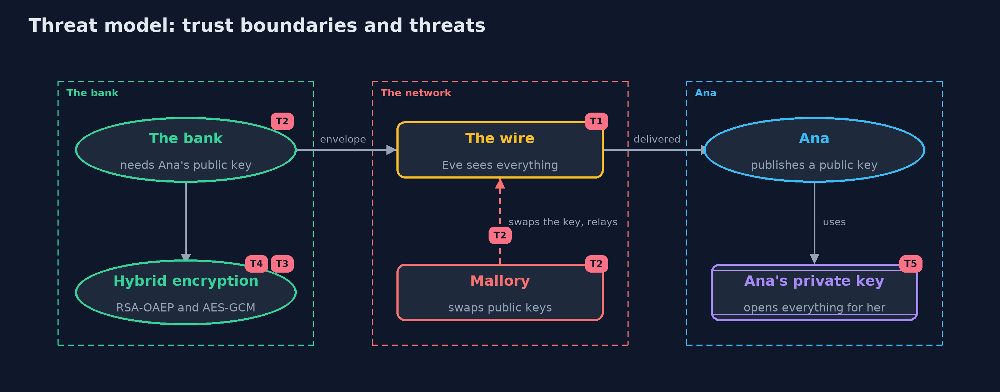

# Threat Model — Asymmetric Encryption (RSA and Key Agreement)

A threat model answers four questions: what are we protecting, who or what could harm it, how, and what do we do about it. This one covers this project's own demo system, not a production deployment. Domain: an online bank.

## Scope

How an online bank gets an encrypted statement to a customer it has never met: the customer's public key, RSA-OAEP, hybrid encryption with AES-GCM, and X25519 key agreement with HKDF. It covers eavesdropping, tampering with messages,
and swapping a public key. It does not cover how a public key is proved to be the customer's, how private keys are stored, or TLS.

## What we protect (assets)

- The contents of each statement.
- The customer's private key.
- The authenticity of the customer's public key.
- The session keys made by key agreement.

## Who and what acts on the system

- The bank, which locks messages to a public key.
- Ana, who publishes a public key and keeps a private one.
- Eve, who reads everything on the network.
- Mallory, who can change what is on the network, including a public key in transit.

## Trust boundaries

A trust boundary is a line that data or a request crosses between parts that trust each other differently. Threats cluster where those lines are.

- Bank to network: only envelopes and public keys cross it.
- Ana's device to the network: her private key never crosses it.
- Public key to its owner: the line the maths cannot draw.

Each dashed box is a trust boundary. A rose tag such as T1 shows where the threat of that number, in the table below, applies.

## Threats, using STRIDE

STRIDE is a checklist of six kinds of threat: **Spoofing** (S), **Tampering** (T), **Repudiation** (R), **Information disclosure** (I), **Denial of service** (D), **Elevation of privilege** (E).

| Id | Kind | Threat | Where it shows up | Control in this project | What is left |
| --- | --- | --- | --- | --- | --- |
| T1 | Information disclosure | Eve reads a key or a statement on the network | `Wire` | No key is sent in the clear: RSA-OAEP locks it, or key agreement makes it, and AES-GCM hides the data | Eve still sees sizes and timing, and who talks to whom |
| T2 | Spoofing | Mallory swaps Ana's public key for her own | `HybridBox.seal`, the bank's copy of Ana's public key | None in this project, by design | Signatures and certificates, in the next projects, prove whose public key it is |
| T3 | Tampering | A message is changed in transit, or moved to another account | `HybridBox.open` | AES-GCM's tag covers the cipher text and the associated data | An old valid message can be replayed |
| T4 | Information disclosure | RSA is used without padding, or on long data | `RsaBox` | OAEP is always used and at most 190 bytes are locked; data goes under AES | A different caller could bypass the helper, so code review should look for raw RSA |
| T5 | Information disclosure | Ana's private key is stolen, and past messages are opened | Ana's private key | With key agreement and fresh keys each session, a stolen long-term key does not reveal old sessions | Messages locked to a long-term RSA key stay readable by a thief of that key |

## Assumptions

- Private keys are not stolen.
- RSA-2048, X25519, AES-256-GCM and HKDF-SHA-256 are sound at this key size.
- In the demo, keys are fresh and random on each run, and the man in the middle is a few lines of code.

## Out of scope

- Certificates and signatures: they are the next projects.
- Storing private keys: the keystore project.
- Quantum computers, which would break RSA and X25519.

## How the tests check this

- `StandardVectorsTest` checks X25519 against RFC 7748 and HKDF against RFC 5869.
- `RsaTest` checks lock and unlock, other keys, OAEP's randomness, the 190-byte limit and sizes.
- `HybridTest` checks large messages, envelope sizes, per-message keys, refusals and the man in the middle.
- `KeyAgreementTest` checks both sides agree, an eavesdropper's key differs, and new sessions give new keys.

## Where this model goes next

The next project, digital-signatures, answers the question left open here: how a message can come with proof of who made it, so that a public key can be trusted.
