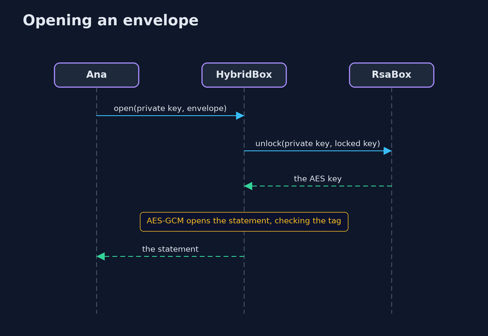
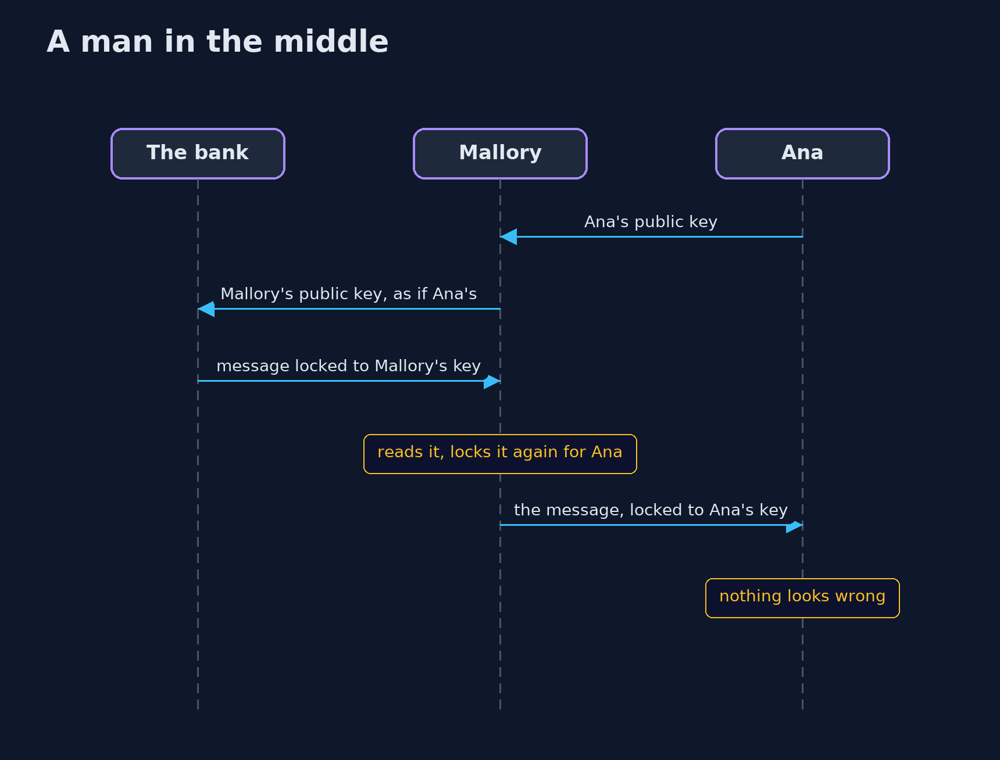

# Asymmetric Encryption (RSA and Key Agreement) — UML Sequence Diagrams

## 1. Opening an envelope

The private key opens the locked data key first; the data key then opens the statement.

## 2. A man in the middle

Mallory replaces Ana's public key with her own, reads the message, and locks it again for Ana.

