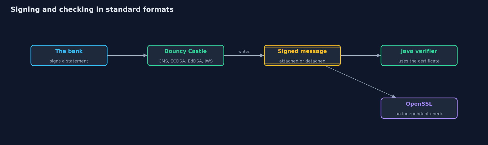

# Digital Signatures with Bouncy Castle and OpenSSL

```
src/main/java/com/jk/explore/security/signaturesbc/
├── Certificates.java      An ECDSA P-256 key pair and a self-signed certificate for it, with fixed dates so the demo text is the same on every run
├── Cms.java               CMS SignedData (RFC 5652), the standard signed-message format behind S/MIME email, signed PDFs and code signing
├── Ecdsa.java             ECDSA on P-256 with the nonce chosen two ways
├── EdDsa.java             Ed25519 and Ed448 (RFC 8032): deterministic signatures, 64 and 114 bytes, with no nonce to get wrong
├── Hex.java               Small helpers for text and bytes
├── Jws.java               A JWS compact signature with EdDSA (RFC 7515, RFC 8037), written by hand: BASE64URL(header) "." BASE64URL(payload) "." BASE64URL(signature)
├── OpenSsl.java           Calls a real OpenSSL 3 command-line tool, a different program written by different people, to check what this code wrote
├── PemSignatures.java     PEM armor for signatures and public keys: Base64 text between BEGIN and END lines, so they can be pasted into email or a ticket
├── Providers.java         Registers Bouncy Castle as a security provider
└── SignaturesBcDemo.java  Runs the online bank story in five numbered acts, with Bouncy Castle, and prints facts that do not depend on random keys
```

**Bouncy Castle adds the standard signed formats and curves the JDK leaves out, CMS SignedData, deterministic ECDSA, Ed448 and JWS, and OpenSSL can check what it writes, but a valid signature proves only that a key signed, not who owns the key.**

The plain version of this lesson used Ed25519 from the JDK. Real systems exchange signed messages in **standard formats** that other programs understand. **Bouncy Castle** is an open-source
library that fills the gaps. It writes **CMS SignedData**, the standard signed message behind S/MIME email, signed PDFs and code signing, with the signer's certificate and **signed attributes** inside, and it can leave the content out (**detached**)
so the content travels separately. It does **ECDSA** with the nonce chosen two ways, randomly or **deterministically** (RFC 6979), and **Ed448**, and it supplies the building blocks for a **JWS** token written by hand. Because these are standards, a different program can check them,
and this project proves that by asking **OpenSSL** to verify what Bouncy Castle wrote, and by having Java verify what OpenSSL signed.

The demo signs a bank statement, shows the one mistake that destroys ECDSA, reproduces published test values and ends with the bill: what a signature does not tell you.

## The idea in everyday terms

Think of a notary's stamp. The stamp has a standard shape that every office knows how to check, and the notary's register says when the stamp was applied. A good stamp proves that the notary's stamp was used on exactly this paper. It does not prove that the notary is who they say they are,
and the date is the notary's own writing, unless a trusted clock office adds its own stamp.

## The scenario

An online bank signs customer statements. The demo signs a statement in the standard CMS format, attached and detached, then looks at ECDSA nonces, reproduces the published values for Ed25519 and Ed448, builds a compact JWS token, and wraps a signed message in PEM text.

## Run

```bash
./gradlew run
```

The demo tells the story in 5 acts, each printing exact numbers that the tests check:

| Act | What it shows |
| --- | --- |
| 1. A standard signed message: CMS SignedData | The statement is signed with an ECDSA key and verifies both attached and detached; a changed statement, a changed bit and another certificate are refused; the signing time is only the signer's claim. |
| 2. ECDSA: the nonce that must never repeat | Deterministic signing repeats and matches RFC 6979, randomized signing differs each time, and two signatures with the same nonce reveal the private key. |
| 3. EdDSA: Ed25519 and Ed448 | Ed25519 gives 64-byte and Ed448 114-byte signatures that match RFC 8032, the same bytes every time, and one flipped bit is refused. |
| 4. A compact signed token: JWS | The RFC 8037 example token is reproduced exactly, detached works, and a token claiming alg none or carrying another payload is refused because the verifier decides the algorithm. |
| 5. Text armor, and the bill | A signed message as PEM text round-trips, but a valid signature does not say who owns the key, the signing time is a claim, and the private key still needs a home. |

## Test

```bash
./gradlew test
```

24 tests in `CmsAndJwsTest`, `DemoRunsTest`, `OpenSslInteropTest`, `VectorsTest`. Ed25519 and Ed448 are checked against RFC 8032, deterministic ECDSA against RFC 6979 appendix A.2.5, and the JWS against RFC 8037. The ordinary tests need only a JDK; the integration tests (tagged openssl) run a real OpenSSL 3 as an independent check.

## What the simulation got right, and what it left out

The keys are random, so the demo prints only facts that do not depend on them. Ed25519, Ed448 and deterministic ECDSA have published values, which are reproduced exactly. OpenSSL is used only by the integration tests, so the demo and ordinary tests need only a JDK.

## Technologies and versions

Every version below is pinned in the project's build files and was the latest stable release when the project was built.

| Technology | Version | Used for |
| --- | --- | --- |
| Java | 25 | the language and runtime; a Gradle toolchain finds or downloads the JDK |
| Gradle | 9.8.1 (wrapper) | build and run; nothing to install, the wrapper downloads it |
| org.bouncycastle:bcprov-jdk18on | 1.86 | Bouncy Castle: algorithms and providers the JDK lacks |
| org.bouncycastle:bcpkix-jdk18on | 1.86 | Bouncy Castle PKIX: PEM, X.509 certificates and CMS |
| org.junit.jupiter:junit-jupiter | 6.1.3, set by junit-bom | JUnit 5: the tests (tests only) |
| org.junit.platform:junit-platform-launcher | 6.1.3, set by junit-bom | JUnit platform launcher, which Gradle needs to run the tests (tests only) |
| OpenSSL (command-line tool) | 3.x | the independent check that verifies the signatures Java writes and signs a message Java verifies; needed for the integration tests |
| videokit | repository tool (`tools/videokit`) | the narrated video and animation: Piper `en_US-amy-medium`, speed 0.8, longer pauses (the amy-slow voice) |

## Learning Material

| Document | What it is for |
| --- | --- |
| [Dependencies](docs/dependencies.md) | what the framework and infrastructure are, and why they are here |
| [Problem statement](docs/problem-statement.md) | the situation and what the project must show |
| [Prerequisites](docs/prerequisites.md) | what you need to know first |
| [Digital Signatures with Bouncy Castle and OpenSSL, explained](docs/digital-signatures-with-bouncy-castle-explained.md) | the acts in prose |
| [Session guide](docs/session.md) | a one-hour lesson with exercises |
| [Animated walkthrough](docs/animation.html) | the acts step by step, narrated |
| [Threat model](docs/threat-model.md) | what is protected, who could harm it, and how, using STRIDE |
| [Spec](docs/spec.md) | what this project must be true of |
| [Expected output](docs/expected-output.txt) | the golden demo output every test and every port checks against |

### The idea in one picture

Java signs with Bouncy Castle; Java and OpenSSL both check.



### Where each piece sits

One class for each format or algorithm.


### How the data moves

The signature covers the attributes, and the attributes cover the content through its digest.


### Who calls whom, in order


### Video

`video/digital-signatures-with-bouncy-castle-explained.mp4` (with `.m4a` audio and `.srt` subtitles) is built by `video/build_video.sh`. Rendered media is not committed.

## What it costs

- **A valid signature proves the key, not the person.** The certificate in the message is self-signed here, so anyone can make one. Knowing who owns the key needs a chain of certificates, which is the next module.
- **The signing time is the signer's word.** It is covered by the signature, but a signer can write any time. A trusted time needs a timestamp authority (RFC 3161), which is described here and not run.
- **ECDSA can fail catastrophically.** One reused or guessable nonce reveals the private key. Deterministic signing and Ed25519 remove the risk.
- **The library is large.** About 7 MB of Bouncy Castle for a handful of format functions.
- **Formats are easy to misuse.** A JWS verifier that reads the algorithm from the token can be fooled with `alg: none`, so the verifier must decide.

## When this is too much

For signing a file or a token inside one application, the JDK alone is enough. Bring in Bouncy Castle when another system needs a standard format, such as CMS or PEM, when a curve is missing from the JDK, or when a library you use already depends on it.

## Where you have already met this

- Signed PDFs and S/MIME email, which are CMS SignedData.
- Java's `jarsigner` and Android's APK signing.
- JWT and JWS tokens in web logins, and `alg: none` in vulnerability reports.
- `openssl dgst -sign` and `openssl cms -sign` in scripts.

## Where this sits

This project follows [digital-signatures](../digital-signatures) and [asymmetric-encryption-with-bouncy-castle](../asymmetric-encryption-with-bouncy-castle) in [cryptography](..), and leads to [keystore-basics](../keystore-basics), which says where the private key should live.
