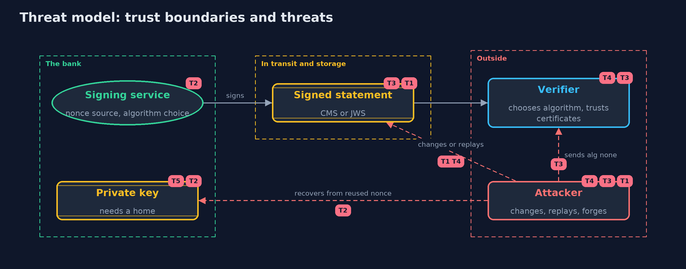

# Threat Model — Digital Signatures with Bouncy Castle and OpenSSL

A threat model answers four questions: what are we protecting, who or what could harm it, how, and what do we do about it. This one covers this project's own demo system, not a production deployment. Domain: an online bank.

## Scope

How an online bank signs statements and tokens in standard formats: the signing service, the choice of algorithm and nonce, the signed message in transit, and the verifier. It does not cover where the private key is stored, certificate chains and revocation, or timestamp authorities.

## What we protect (assets)

- The private signing key.
- The integrity and origin of each signed statement or token.
- The verifier's decision to accept a message.

## Who and what acts on the system

- The bank's signing service.
- Auditors and customers who verify.
- An attacker who can see, change, replay or forge messages, and send crafted tokens.

## Trust boundaries

A trust boundary is a line that data or a request crosses between parts that trust each other differently. Threats cluster where those lines are.

- Signer to the network: a signed message leaves the bank's control.
- Token to verifier: everything in a token is attacker-controlled input.
- Key to the signing service: the key must never leave it.

Each dashed box is a trust boundary. A rose tag such as T1 shows where the threat of that number, in the table below, applies.

## Threats, using STRIDE

STRIDE is a checklist of six kinds of threat: **Spoofing** (S), **Tampering** (T), **Repudiation** (R), **Information disclosure** (I), **Denial of service** (D), **Elevation of privilege** (E).

| Id | Kind | Threat | Where it shows up | Control in this project | What is left |
| --- | --- | --- | --- | --- | --- |
| T1 | Tampering | A signed statement is changed in transit or storage | `Cms.verify` | The signature covers the content digest and the signed attributes, so any change is refused | A valid old message can be replayed, so statements need dates or numbers the verifier checks |
| T2 | Information disclosure | The private key is recovered from signatures made with a reused or guessable ECDSA nonce | `Ecdsa` | Deterministic nonces (RFC 6979) or Ed25519, which need no random source | The key must still be stored safely, and a faulty implementation can still leak |
| T3 | Spoofing | A token that claims the algorithm none, or another algorithm, is accepted | `Jws.verify` | The verifier fixes the expected header and algorithm and ignores the token's claim | Every new format or algorithm option needs the same discipline |
| T4 | Spoofing | A valid signature from a key the verifier should not trust is accepted as the bank's | `Cms.verify`, `Certificates` | Verify against the one expected certificate, as the demo does | The demo certificate is self-signed; real use needs a chain of trust and revocation checks |
| T5 | Elevation of privilege | The signing key is stolen from where it is kept | the signing service | None here: the key lives in memory in the demo | A keystore, a key management service or a hardware module, and a plan to replace the key |
| T6 | Repudiation | The signer disputes when a statement was signed, or a signer backdates it | `Cms.claimedSigningTime` | The time is covered by the signature but is the signer's claim | A trusted timestamp (RFC 3161) is needed when the time matters |

## Assumptions

- The verifier already trusts the right public key or certificate.
- The signing key is stored safely (the next project).
- In the demo, keys are random and never printed, and the vector keys are published test values.

## Out of scope

- Certificate chains, revocation and name checks: the transport-security module.
- Trusted timestamps: described, not run.
- Hardware security modules and key management services.

## How the tests check this

- `VectorsTest` checks Ed25519 and Ed448 against RFC 8032, ECDSA against RFC 6979, the JWS against RFC 8037, and the reused-nonce recovery.
- `CmsAndJwsTest` checks attached and detached verification, changed content, another certificate, garbage, the signing time, PEM, and the JWS refusals.
- `OpenSslInteropTest` (integration) checks that OpenSSL 3 verifies CMS, Ed25519 and ECDSA signatures from Java, and that Java verifies an ECDSA signature from OpenSSL.
- `DemoRunsTest` compares the whole demo with the golden output.

## Where this model goes next

The next project, keystore-basics, says where the private key should live and how keys are replaced.
