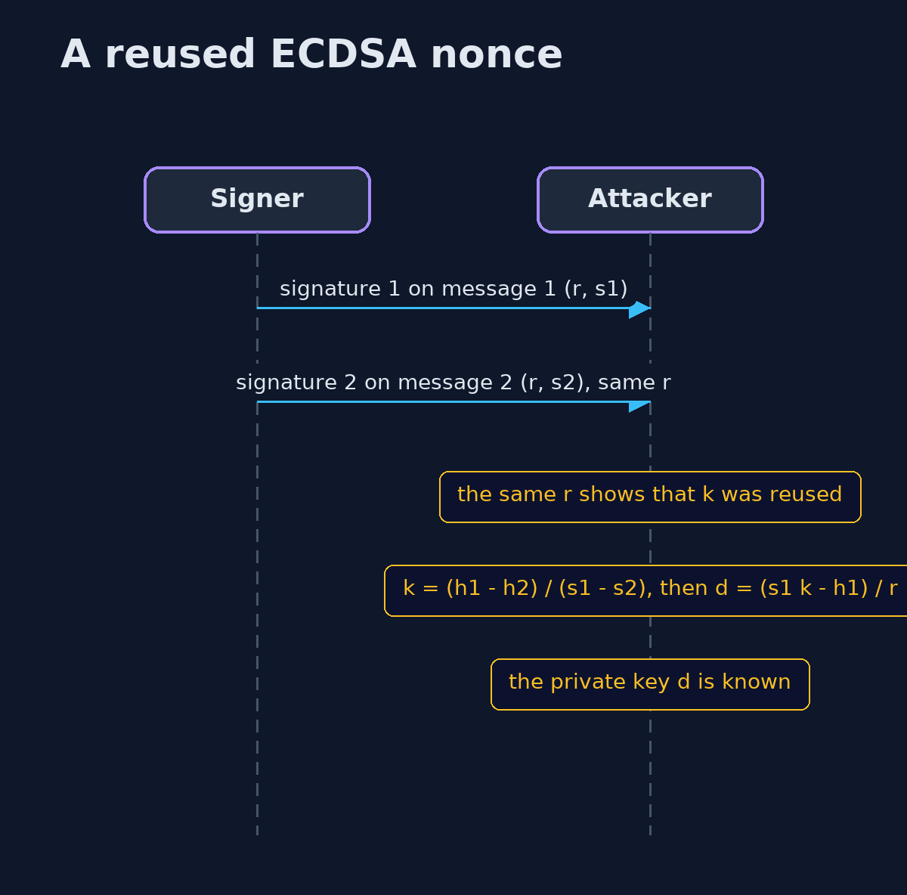
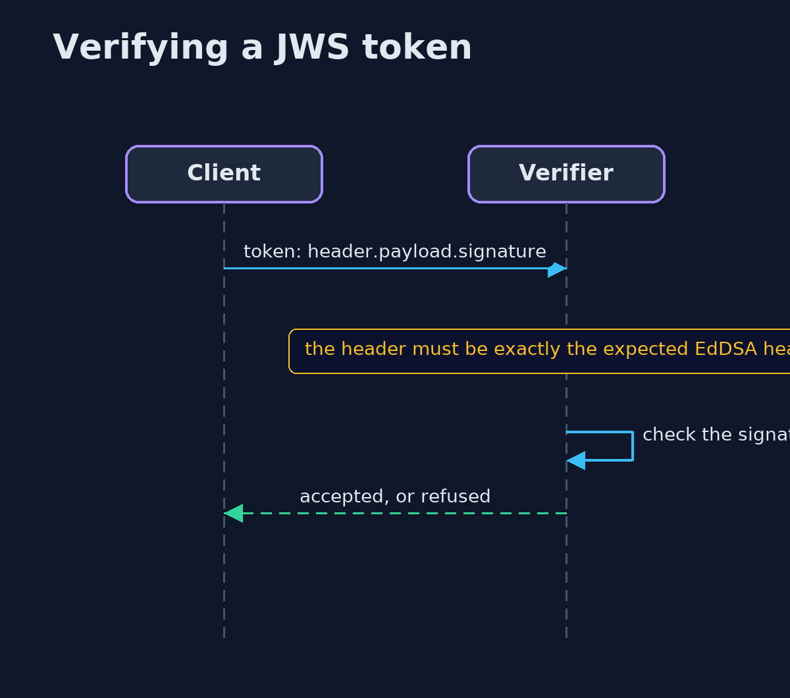

# Digital Signatures with Bouncy Castle and OpenSSL — UML Sequence Diagrams

## 1. A reused ECDSA nonce

Two signatures with the same k give two equations with two unknowns.

## 2. Verifying a JWS token

The verifier fixes the algorithm and ignores what the token claims.

