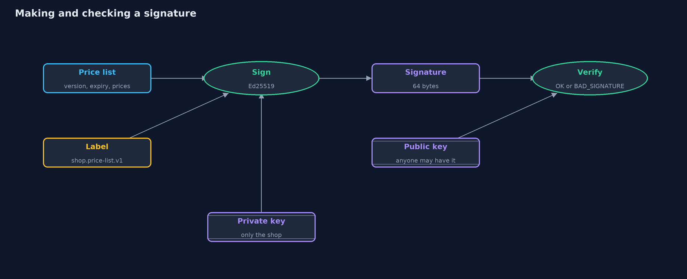
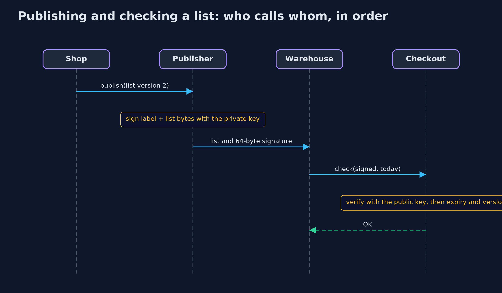

# Digital Signatures (Ed25519)

```
src/main/java/com/jk/explore/security/signatures/
├── Checkout.java        A service that must only use price lists published by the shop
├── Ed25519Keys.java     Ed25519 keys
├── Hex.java             Small helpers for text and bytes
├── HmacPublisher.java   The shop's price list tagged with HMAC, as in the hashing-and-integrity project
├── PriceList.java       The online store's price list: a version, the last day it may be used, and a price in dollars for each product
├── Publisher.java       The shop, which holds the private key and signs each price list it publishes
├── SignaturesDemo.java  Runs the online store story in five numbered acts and prints exact, repeatable results
├── Signed.java          A message together with its signature, as the shop publishes it
├── Signing.java         Signs and checks messages with Ed25519
└── Verdict.java         What a checkout service concludes about a published price list
```

**A digital signature is made with a private key and checked with a public key, so anyone can check it and only the key holder can make it, but it is only as good as the key you check against, and a good signature can still sit on an old message.**

An HMAC tag proves that a message came from someone with the shared key, but everyone who can check the tag holds that key, so everyone who can check can also forge. A **digital signature** separates the
two jobs. It is made with a **private key**, which only the signer has, and checked with the matching **public key**, which anyone may have. Anyone can check, only the signer can sign. The modern, simple choice
is **Ed25519**: a 32-byte public key, a 64-byte signature, and no random number needed, because the same key and message always give the same signature.

This project signs an online store's price list. It shows the forgery that HMAC allows, the signature and its three refusals, why a signature should be tied to its purpose, why a perfect signature on an old
message is still a problem, and what a signature cannot do, which is to say whose public key it is. The code is checked against the published test values of RFC 8032.

## The idea in everyday terms

Think of a notary's signature. Anyone can compare it with the specimen the notary left on file, and nobody else can write it so that it matches. With a shared stamp, like an HMAC, everyone who is
allowed to check the stamp can also stamp. A signature is better than the stamp, but it has the same two weak points as any signature: you must be sure the specimen on file is really the notary's, and a genuine
signature on an old document is still genuine, so the date has to be part of what was signed.

## The scenario

An online store publishes a price list, and a warehouse and a checkout service use it. Version 2 has the laptop at 1,200 dollars. The store wants every service to be sure that a list really comes from the store, and that
no service can make a list that looks as if it did. It first tags the list with HMAC and sees the warehouse forge one. It then signs with Ed25519, and tries a changed list, another key, a signature made for another purpose, an old
but genuine list, and a public key swapped by an attacker.

## Run

```bash
./gradlew run
```

The demo tells the story in 5 acts, each printing exact numbers that the tests check:

| Act | What it shows |
| --- | --- |
| 1. A tag made with a shared key | The warehouse must hold the HMAC key to check tags, so it can make a tag for a list of its own, with the laptop at 12 dollars, and the shop accepts it. |
| 2. A signature: made with the private key, checked with the public key | The shop's signature is 64 bytes and the same every time; the warehouse checks it with only the public key; a changed list or another key's signature is refused. |
| 3. What exactly is signed | A price list always becomes the same bytes however it was built; a signature made for a refund order is refused when offered as a price list, because each is tied to its purpose. |
| 4. A good signature on an old message | A replayed genuine version 1 is accepted by a naive checkout and refused as OLD_VERSION by one that remembers the newest; a list past its expiry is EXPIRED. |
| 5. The bill: whose key is it, and what if it is stolen? | A checkout given Mallory's public key accepts her forgery; with the real key it refuses it; a stolen private key signs anything; a signature hides nothing; and it is 64 bytes against a 32-byte key. |

## Test

```bash
./gradlew test
```

20 tests in `CheckoutTest`, `DemoRunsTest`, `HmacContrastTest`, `PriceListTest`, `Rfc8032Test`, `SigningTest`. Ed25519 is checked against the published test vectors of RFC 8032. Every line the demo prints is checked against `docs/expected-output.txt`; the shop's key is fixed and Ed25519 is deterministic, and the keys that are random in the demo are never printed.

## What the simulation got right, and what it left out

The shop's key is the test key of RFC 8032 (test 1), so the signatures are the same on every run, and the code is checked against the standard's published values. That key is public and must never protect anything
real. Days are plain numbers, and the "attacker" is a few lines of code. Ed25519 comes from the JDK, with no library. Other signature schemes, such as ECDSA and RSA-PSS, are used in practice too: ECDSA needs a
fresh secret random number for every signature, and reusing or predicting one reveals the private key, which is one reason Ed25519's deterministic design is attractive.

## Technologies and versions

Every version below is pinned in the project's build files and was the latest stable release when the project was built.

| Technology | Version | Used for |
| --- | --- | --- |
| Java | 25 | the language and runtime; a Gradle toolchain finds or downloads the JDK |
| Gradle | 9.8.1 (wrapper) | build and run; nothing to install, the wrapper downloads it |
| org.junit.jupiter:junit-jupiter | 6.1.3, set by junit-bom | JUnit 5: the tests (tests only) |
| org.junit.platform:junit-platform-launcher | 6.1.3, set by junit-bom | JUnit platform launcher, which Gradle needs to run the tests (tests only) |
| videokit | repository tool (`tools/videokit`) | the narrated video and animation: Piper `en_US-amy-medium`, speed 0.8, longer pauses (the amy-slow voice) |

## Learning Material

| Document | What it is for |
| --- | --- |
| [Problem statement](docs/problem-statement.md) | the situation and what the project must show |
| [Prerequisites](docs/prerequisites.md) | what you need to know first |
| [Digital Signatures (Ed25519), explained](docs/digital-signatures-explained.md) | the acts in prose |
| [Session guide](docs/session.md) | a one-hour lesson with exercises |
| [Animated walkthrough](docs/animation.html) | the acts step by step, narrated |
| [Threat model](docs/threat-model.md) | what is protected, who could harm it, and how, using STRIDE |
| [Spec](docs/spec.md) | what this project must be true of |
| [Expected output](docs/expected-output.txt) | the golden demo output every test and every port checks against |

### The idea in one picture

The private key and the labelled message make the signature; anyone with the public key can check it; nobody with only the public key can make one.



### Where each piece sits

Publisher signs, Checkout verifies, and Signing holds the Ed25519 calls and the label rule.


### How the data moves

The signature is checked first; only a genuine list is then tested for expiry and for being older than one already accepted.


### Who calls whom, in order




### Video

`video/digital-signatures-explained.mp4` (with `.m4a` audio and `.srt` subtitles) is built by `video/build_video.sh`. Rendered media is not committed.

## What it costs

- **A signature is only as good as the key you check it against.** If an attacker can give the checker a different public key, a forged list verifies perfectly. Certificates and pinned keys, in the next modules, deal with this.
- **A good signature can sit on an old message.** Without a version or an expiry inside the signed bytes, an attacker can replay an old list that really was signed.
- **A stolen private key signs anything,** and nothing in the signature says the key was stolen. Keys need protection, rotation and a way to be revoked.
- **A signature hides nothing.** The signed message is readable by anyone. For secrecy as well, encrypt too.
- **What is signed must be unambiguous.** The message has to become bytes in one fixed way, and carry a label for its purpose, or a signature can be reused where it was never meant.

## When this is too much

For two services that already share a secret and trust each other fully, an HMAC is simpler and faster. A signature earns its cost when there are many checkers who should not be able to make the
message, when the signature must be shown to a third party later, or when the signer and the checker have never shared a secret.

## Where you have already met this

- Signed software downloads and updates, and the signature files beside them (`.sig`, `.asc`).
- JWTs signed with RS256, ES256 or EdDSA, as opposed to HS256 which is HMAC.
- Git commits and tags that show "Verified" when signed.
- The certificate chain behind every HTTPS connection, which is signatures on signatures.

## Where this sits

This project is the sixth in [cryptography](..), after [asymmetric-encryption](../asymmetric-encryption), whose last act asked how a public key can be known to be the right one.
