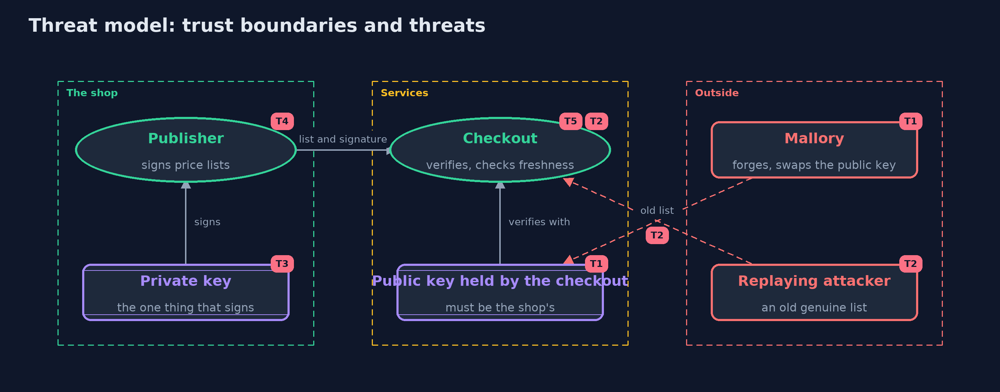

# Threat Model — Digital Signatures (Ed25519)

A threat model answers four questions: what are we protecting, who or what could harm it, how, and what do we do about it. This one covers this project's own demo system, not a production deployment. Domain: an online store.

## Scope

An online store's signed price list: the shop that signs, the services that verify, the public key they hold, and the version and expiry inside what is signed. It covers forgery by a service, a signature reused
for another purpose, replay of an old list, a swapped public key and a stolen private key. It does not cover how public keys are distributed or revoked, or how the private key is stored.

## What we protect (assets)

- The correctness and freshness of the price list.
- The shop's private key.
- The public key each service holds.
- The record of the newest version each service has accepted.

## Who and what acts on the system

- The shop, which signs.
- The warehouse and the checkout, which verify.
- Mallory, who forges lists and tries to swap a public key.
- An attacker who replays an old genuine list.
- A thief who takes the private key.

## Trust boundaries

A trust boundary is a line that data or a request crosses between parts that trust each other differently. Threats cluster where those lines are.

- Shop to services: lists and signatures cross a network an attacker can touch.
- Services to the public key they hold: the line the maths cannot draw.
- The shop's private key store: the one place that can sign.

Each dashed box is a trust boundary. A rose tag such as T1 shows where the threat of that number, in the table below, applies.

## Threats, using STRIDE

STRIDE is a checklist of six kinds of threat: **Spoofing** (S), **Tampering** (T), **Repudiation** (R), **Information disclosure** (I), **Denial of service** (D), **Elevation of privilege** (E).

| Id | Kind | Threat | Where it shows up | Control in this project | What is left |
| --- | --- | --- | --- | --- | --- |
| T1 | Spoofing | A checker is given the wrong public key, so a forgery verifies | `Checkout`'s public key | None in this project: the checkout trusts the key it holds | Certificates, or a key pinned in the software, give the checker a trustworthy key |
| T2 | Tampering | A genuine old price list is replayed | `Checkout.check` | Version and expiry are inside the signed bytes, and the checkout refuses older versions and expired lists | A checkout that forgets the newest version after a restart can be replayed; store it durably |
| T3 | Spoofing | The shop's private key is stolen | the shop's key store | None in this project | Protect and rotate the key, and be able to revoke it; a thief signs anything until then |
| T4 | Tampering | A signature made for one purpose is reused for another | `Signing.withContext` | A label for the purpose is signed with the message, separated by a zero byte | Every new message type needs its own label, and a code review should check it |
| T5 | Repudiation | A service with a shared key forges a message and denies it | `HmacPublisher` | Signatures: only the shop can make one, so a signed list points to the shop | A stolen private key points to the shop too, which is why key protection matters |

## Assumptions

- Each service already holds the shop's correct public key, which is exactly what a certificate or a pinned key would provide.
- The shop's private key has not been stolen.
- In the demo, the shop's key is the public RFC 8032 test key, and the other keys are random and never printed.

## Out of scope

- Certificates, chains of trust and revocation.
- Hardware security modules and key rotation.
- Encrypting the price list: a signature hides nothing.

## How the tests check this

- `Rfc8032Test` checks Ed25519 against the published vectors, and refusals of changed messages and wrong-length signatures.
- `SigningTest` checks verification, determinism, other keys, other contexts, and that the label cannot run into the message.
- `PriceListTest` checks the fixed encoding.
- `CheckoutTest` checks forgery, other purposes, a swapped key, replay and expiry.
- `HmacContrastTest` shows a shared-key tag can be forged by a checker.

## Where this model goes next

The next module, transport security, builds on this: certificates are signatures that bind a public key to a name, and TLS uses them to answer the question this project leaves open.
