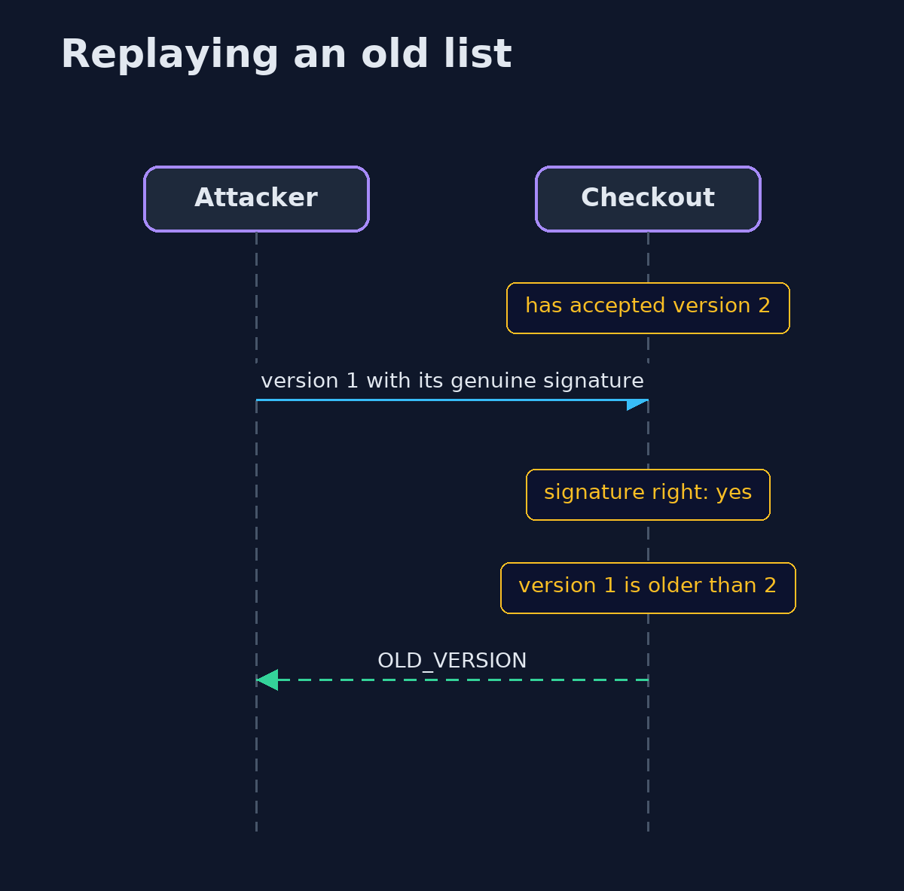
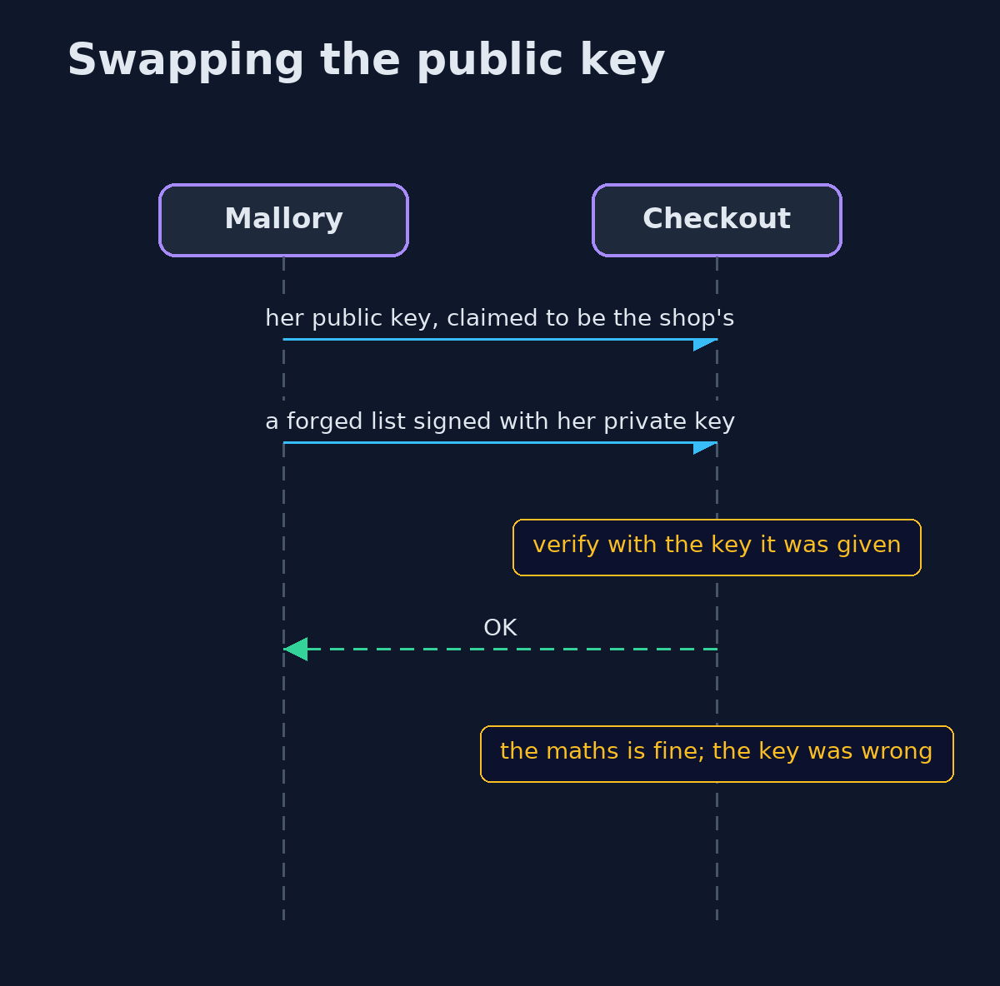

# Digital Signatures (Ed25519) — UML Sequence Diagrams

## 1. Replaying an old list

A genuine old signature passes the signature check; only the version check refuses it.

## 2. Swapping the public key

The checkout trusts whatever public key it holds, so giving it a different one makes a forgery verify.

