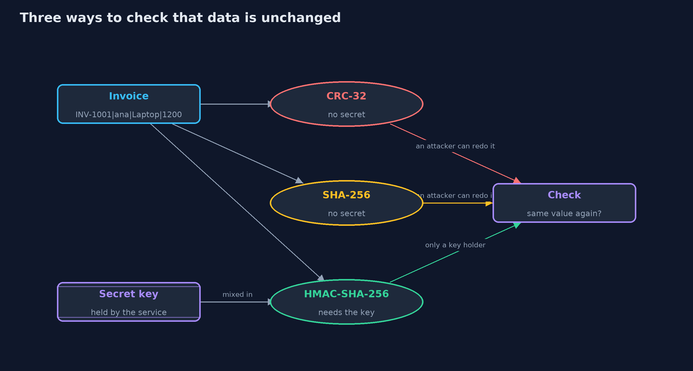
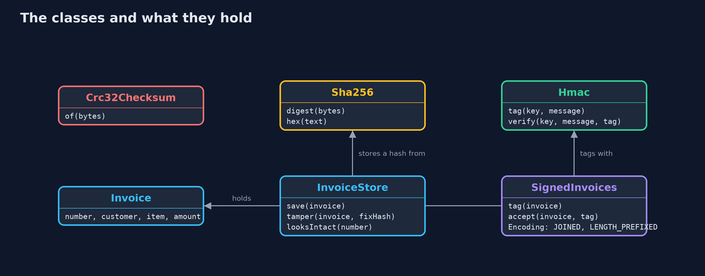

# Hashing and Integrity

```
src/main/java/com/jk/explore/security/integrity/
├── Crc32Checksum.java   A cyclic redundancy check: a short number that changes when data is damaged by accident, such as a flipped bit on a disk or a noisy line
├── Hex.java             Small helpers for turning bytes into text and comparing them
├── Hmac.java            HMAC-SHA-256: a hash that needs a secret key
├── IntegrityDemo.java   Runs the online store story in five numbered acts and prints exact, repeatable results
├── Invoice.java         One invoice of the online store: its number, the customer, the item and the amount in dollars
├── InvoiceStore.java    Stores invoices, each with a plain SHA-256 hash of its text kept right beside it
├── Sha256.java          SHA-256: a cryptographic hash
└── SignedInvoices.java  The order service's way of tagging invoices with HMAC, in two versions of how an invoice becomes bytes: fields simply joined together, which is ambiguous, and fields each written with their length in front, which is not
```

**A checksum catches accidents, a hash fingerprints data, and only a keyed hash such as HMAC proves that the data was not changed by someone without the key.**

How do you know that some data was not changed? There are three answers, and each is stronger than the one before. A
**checksum** such as CRC-32 is a short number that changes when data is damaged by accident. It is fast, it has no
secret, and anyone can work out a new one for changed data, so it does not stop an attacker. A **cryptographic hash** such as
SHA-256 turns any data into a fixed-size fingerprint. A tiny change gives a completely different fingerprint, and nobody can
find different data with the same one. But a hash has no secret either: if the attacker can change the data, and the hash is kept next to
it, the attacker changes the hash too. A **keyed hash**, **HMAC**, mixes in a secret key. Only a key holder can make a tag that
checks out, so a good tag shows that the data came from a key holder and was not changed since.

This project shows each in turn on an online store's invoices and an installer for download, and then the three things that still go wrong around
a good HMAC: fields joined without a clear boundary, a valid tag sent again, and a key that every checker also holds.

## The idea in everyday terms

Think of a wax seal on a letter. A seal that anyone can buy and press is like a checksum: it shows the letter was not
smudged on the way, and nothing more. A fingerprint of the letter written on the envelope, by whoever sent it, is like a plain hash: anyone who opens
and rewrites the letter just writes a new fingerprint. But a seal pressed with a private signet ring, which only the shop owns, is like HMAC. A forger
cannot make it, so a good seal means something.

## The scenario

An online store sends invoices and offers an installer for its app. Ana's invoice, INV-1001, is for a laptop at 1,200 dollars. An attacker wants to change
it to 12 dollars without anyone noticing. The store first tries a checksum, then a plain hash, then a hash kept beside the invoice,
then a hash published somewhere else, and finally HMAC. After each, the attacker tries again.

## Run

```bash
./gradlew run
```

The demo tells the story in 5 acts, each printing exact numbers that the tests check:

| Act | What it shows |
| --- | --- |
| 1. A checksum for accidents | A flipped bit changes the CRC-32 from a7c21715 to d0c52783, but an attacker who changes the amount just stores the new CRC, 5e22dd78, and the check passes. |
| 2. A cryptographic hash: SHA-256 | Any input gives 64 hex digits; changing one digit of the amount changes 62 of the 64 digits, 134 of 256 bits, about half. |
| 3. A hash kept beside the data | A hash stored next to the invoice fails when only the invoice is changed, but passes when the attacker changes both; a hash published on another channel catches a tampered download. |
| 4. A keyed hash: HMAC-SHA-256 | The order service tags the invoice with HMAC; the invoice with its tag is OK, and a changed invoice with the old tag, a plain SHA-256 tag, or a tag made with a guessed key are all refused. |
| 5. The bill: boundaries, repeats, and a shared key | Joined fields let a boundary move without changing the tag, a valid tag can be sent twice, and the warehouse that can check a tag can also make one. |

## Test

```bash
./gradlew test
```

25 tests in `DemoRunsTest`, `HashesTest`, `InvoiceStoreTest`, `SignedInvoicesTest`. CRC-32, SHA-256 and HMAC-SHA-256 are each checked against published standard values (the CRC-32 check value, the SHA-256 vectors, and RFC 4231 test cases one and two). Every line the demo prints is checked against `docs/expected-output.txt`.

## What the simulation got right, and what it left out

The key is a fixed demo value in the code: a real system keeps it in a secrets store and rotates it. The attacker is a few lines
of code that change a stored value, standing in for anyone who can reach a database or sit on a network. The "mirror" and
the "trusted site" are two strings. CRC-32, SHA-256 and HMAC are the JDK's own, and the demo checks each against the published
test values, so the point of the project is how they are used, not how they are built.

## Technologies and versions

| Technology | Version | Used for |
| --- | --- | --- |
| Java | 25 | the code (toolchain set in `build.gradle`; Gradle finds or downloads the JDK) |
| Gradle | 9.2.1 (wrapper) | build and run, nothing to install |
| JUnit | 5.10.2 | the tests |
| videokit | repository tool (`tools/videokit`) | the narrated video and animation: Piper `en_US-amy-medium`, speed 0.8, longer pauses (the amy-slow voice) |

## Learning Material

| Document | What it is for |
| --- | --- |
| [Problem statement](docs/problem-statement.md) | the situation and what the project must show |
| [Prerequisites](docs/prerequisites.md) | what you need to know first |
| [Hashing and Integrity, explained](docs/hashing-and-integrity-explained.md) | the acts in prose |
| [Session guide](docs/session.md) | a one-hour lesson with exercises |
| [Animated walkthrough](docs/animation.html) | the acts step by step, narrated |
| [Threat model](docs/threat-model.md) | what is protected, who could harm it, and how, using STRIDE |
| [Spec](docs/spec.md) | what this project must be true of |
| [Expected output](docs/expected-output.txt) | the golden demo output every test and every port checks against |

### The idea in one picture

A CRC and a plain hash can be recomputed by anyone; only HMAC needs a secret that the attacker lacks.



### Where each piece sits

Three small tools, one store that keeps a plain hash beside the data, and one service that tags with HMAC.



### How the data moves

The invoice becomes bytes in an agreed form, the tag is made from the key and the bytes, and the checker repeats it and compares.


### Who calls whom, in order


### Video

`video/hashing-and-integrity-explained.mp4` (with `.m4a` audio and `.srt` subtitles) is built by `video/build_video.sh`. Rendered media is not committed.

## What it costs

- **A good tag is not a whole protocol.** HMAC proves the bytes came from a key holder. How the invoice becomes bytes, whether it was already used, and who else holds the key are separate design questions.
- **Ambiguous encoding lets a boundary move.** If fields are joined with nothing between them, `ab` and `c` look the same as `a` and `bc`. Each field should carry its length, or a separator that cannot appear in the data.
- **A tag does not say when.** A valid invoice and its tag can be sent again, so the receiver must remember numbers or timestamps.
- **A shared key means no proof of who.** Every service that can check a tag can also make one, so a tag shows only that some key holder made it. Digital signatures, in a later project, separate the two.
- **The key must be kept secret and rotated,** which is a job of its own.

## When this is too much

For data that no one has a reason to change on purpose, such as a log of sensor readings on a disk, a checksum is enough. For data that someone could
profit from changing, such as invoices, payment instructions, downloads and tokens, use HMAC or a signature. Never use a plain hash or a CRC to protect against
an attacker.

## Where you have already met this

- SHA-256 checksums beside downloads on a project's website, so you can check a file you fetched.
- Git, whose commits are named by hashes of their contents.
- Webhook callbacks that arrive with an `X-Signature` header, which is an HMAC of the body.
- JWTs signed with HS256, which is HMAC with SHA-256.

## Where this sits

This project is the first one in [cryptography](..), the fourth module of the beginner track. It builds on the keyed hash used inside the one-time codes of [totp-multi-factor](../../passwords-and-mfa/totp-multi-factor).
