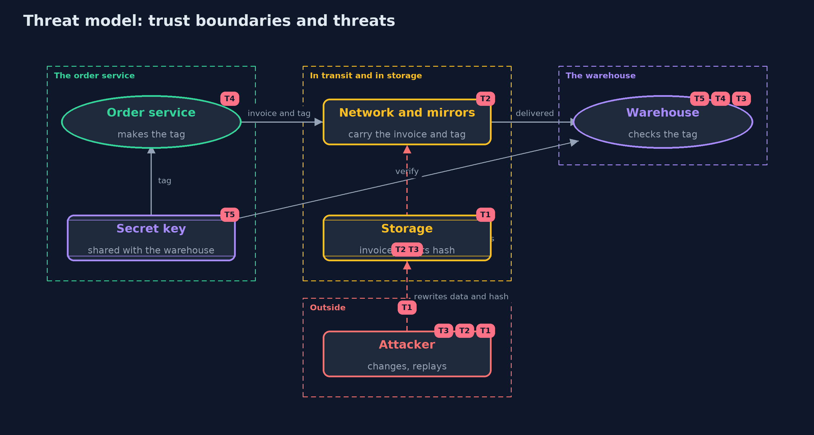

# Threat Model — Hashing and Integrity

A threat model answers four questions: what are we protecting, who or what could harm it, how, and what do we do about it. This one covers this project's own demo system, not a production deployment. Domain: an online store.

## Scope

Invoices and an installer of an online store, from the order service to the warehouse and to customers, while they are stored,
carried over networks and mirrors, and checked. It covers whether a change can go unnoticed, whether a tag can be forged, copied or
reused, and who holds the key. It does not cover keeping the contents secret, which is the job of encryption, in the next project.

## What we protect (assets)

- The correctness of each invoice, especially its amount.
- The installer, which customers will run.
- The secret key for HMAC.
- The record of which invoice numbers were accepted.

## Who and what acts on the system

- The order service, which tags invoices.
- The warehouse, which checks tags, and holds the same key.
- An attacker who can change stored data, a transfer, or a mirror.
- An attacker who can watch and resend valid messages.

## Trust boundaries

A trust boundary is a line that data or a request crosses between parts that trust each other differently. Threats cluster where those lines are.

- Order service to warehouse: invoices and tags cross a network an attacker may influence.
- Application to storage: the invoice and any hash beside it can be rewritten together.
- Shop's website to mirrors: the published hash and the file travel by different roads.
- Key holders: everyone inside this line can make tags.

Each dashed box is a trust boundary. A rose tag such as T1 shows where the threat of that number, in the table below, applies.

## Threats, using STRIDE

STRIDE is a checklist of six kinds of threat: **Spoofing** (S), **Tampering** (T), **Repudiation** (R), **Information disclosure** (I), **Denial of service** (D), **Elevation of privilege** (E).

| Id | Kind | Threat | Where it shows up | Control in this project | What is left |
| --- | --- | --- | --- | --- | --- |
| T1 | Tampering | An attacker who can write the data also writes a new hash or CRC beside it | `InvoiceStore`, `Crc32Checksum` | Do not rely on a plain hash or a CRC against an attacker; use HMAC, or a hash that arrives by another channel | A published hash only protects while the channel that carries it is safe |
| T2 | Tampering | A mirror or a network changes a download or an invoice in transit | the installer and the invoice on their way | A hash published on the shop's own HTTPS site; an HMAC tag on the invoice | Whoever controls the shop's own site controls the published hash |
| T3 | Tampering | A valid invoice and tag are sent again, or a field boundary is moved | `SignedInvoices` | Length-prefixed fields, and the service remembers invoice numbers | Remembered numbers must be kept as long as tags stay valid; a timestamp can limit how long |
| T4 | Spoofing | An attacker forges a tag without the key | `Hmac` | A tag is only valid for the right key and message; the comparison is constant-time | HMAC is only as strong as the secrecy and length of the key |
| T5 | Repudiation | A holder of the shared key makes a tag and nobody can tell who | the key shared by the order service and the warehouse | None with HMAC | Digital signatures with a private key give each maker an identity; the next projects cover them |

## Assumptions

- The key is kept secret, and the attacker does not hold it.
- The shop's own website is trusted for the published hash.
- The JDK's SHA-256 and HMAC are correct; the tests check them against published values.
- The demo key is a fixed value for repeatability and must never protect real data.

## Out of scope

- Confidentiality: encryption is the next project.
- Signatures that prove which key holder made a tag.
- Key storage, rotation and distribution.
- Timing attacks beyond the constant-time comparison.

## How the tests check this

- `HashesTest` checks CRC-32, SHA-256 and HMAC against published values, and the avalanche counts.
- `InvoiceStoreTest` shows a hash beside the data is replaceable, and a hash from another channel is not.
- `SignedInvoicesTest` checks tags, forged tags, the boundary trick in both encodings, replay and the shared key.
- `DemoRunsTest` compares the whole demo with the golden output.

## Where this model goes next

The next project, symmetric-encryption, adds secrecy: AES-GCM both hides the data and detects changes, and shows what goes wrong with reused nonces.
