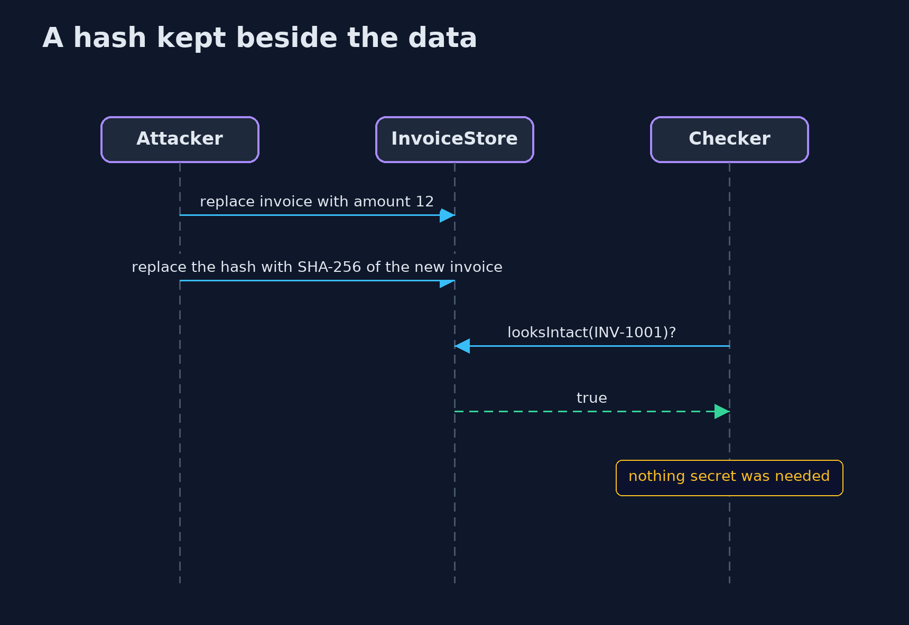
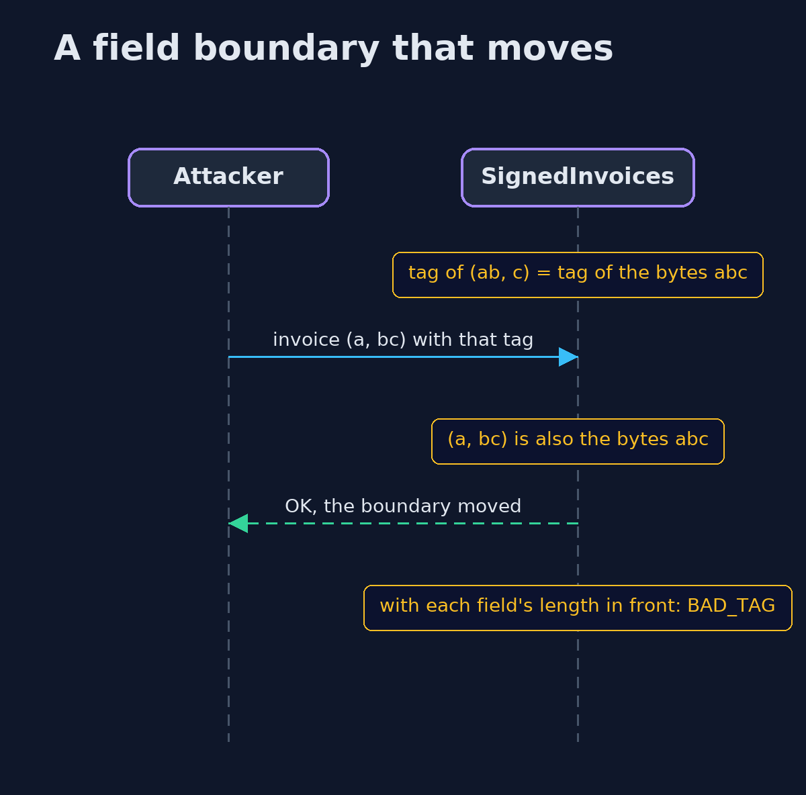

# Hashing and Integrity — UML Sequence Diagrams

## 1. A hash kept beside the data

An attacker who can write the invoice writes a new hash beside it, and the check passes.

## 2. A field boundary that moves

With fields joined and nothing between them, two different invoices give the same bytes, and so the same tag.

