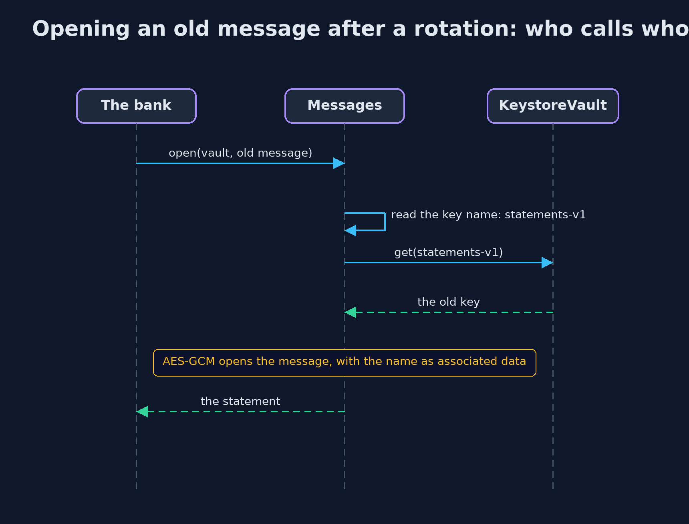

# Keystores and Key Management Basics

```
src/main/java/com/jk/explore/security/keystore/
├── Derivation.java     Making keys from other secrets
├── HardCodedKey.java   The first and worst way to keep a key: write it in the source
├── Hex.java            Small helpers for text and bytes
├── KeyFile.java        Keeping the key in a file outside the program
├── KeystoreDemo.java   Runs the online bank story in five numbered acts and prints exact, repeatable results
├── KeystoreVault.java  A PKCS12 keystore holding AES keys under aliases
└── Messages.java       Messages sealed with AES-256-GCM under a key from the vault
```

**A strong cipher is only as safe as the key's home: not in the code, not in a file anyone can read, but in an encrypted keystore, with separate keys for separate purposes, and a plan for replacing them.**

Every earlier project in this module used a key, and none asked where it came from. This one does. A key can live in the **source code**, which is the worst place:
it is in the compiled file, in every copy of the program, and in the source history for ever. It can live in a **file** outside the program, which is better, but only as private as the file's
permissions. It can live in a **keystore**, an encrypted file that opens with a password, such as the **PKCS12** format that the JDK reads and writes. Keys can also be **derived**: PBKDF2 turns a password and a salt into
a key, slowly, and HKDF turns one master key into a separate key for each purpose. And because keys must be replaced, each message records the **name** of the key that sealed it, so old messages still open until the old key is retired.

The demo follows an online bank's statement key through all of these, and ends with the costs: the keystore needs a password too, and what its file really records about its own protection.

## The idea in everyday terms

Think of a bank that spends a fortune on a vault door and leaves the key under the doormat. Writing the key in the code is taping it to the door. A key file with loose permissions is a
spare key in the staff room that every employee can enter. A keystore is a locked key cabinet, whose own key is a long passphrase in someone's head. Deriving keys is cutting a different key for each door from one master pattern,
and rotation is changing the locks while the customers' boxes are still full.

## The scenario

An online bank encrypts customer statements with an AES key. The demo asks where that key should live. It first writes it into the program, then into a file, then into a PKCS12 keystore, derives keys from a password and a master key, and finally adds a second key
to the keystore, seals new messages with it, retires the first, and counts the cost of the whole arrangement.

## Run

```bash
./gradlew run
```

The demo tells the story in 5 acts, each printing exact numbers that the tests check:

| Act | What it shows |
| --- | --- |
| 1. A key written in the source code | The key's text is found inside the compiled class file, so anyone with the program has the key; it is also in the repository and every build, and changing it means shipping the program again. |
| 2. A key in a file outside the program | A key file with default permissions rw-r--r-- is readable by others; owner-only rw------- is not; but either way the file holds the key in the clear. |
| 3. A PKCS12 keystore: an encrypted file of keys | The keystore shows neither the key nor its name, opens only with the password, refuses a wrong one, and records 10,000 rounds of protection, with a raised setting reaching only one place. |
| 4. Making keys from other secrets | PBKDF2 with 600,000 rounds turns a password and a salt into a 32-byte key, the same each time, different for another salt; HKDF makes a separate key for each purpose from one master key. |
| 5. Replacing a key, and the bill | A second key is added and new messages name it while old ones name the first; both open until the first is removed, and then the old message is refused; the keystore needs a password, and its default rounds are low. |

## Test

```bash
./gradlew test
```

25 tests in `DemoRunsTest`, `DerivationTest`, `HardCodedAndFileTest`, `KeystoreVaultTest`, `MessagesTest`. PBKDF2 and HKDF are checked against published values (the PBKDF2-HMAC-SHA-256 values for one and two rounds, and RFC 5869 test case one). Keys, salts and nonces are random, so the demo and its test check only facts that do not depend on them, and the golden output is the same on every run.

## What the simulation got right, and what it left out

The keystore is a PKCS12 file in a temporary folder, and the keys, salts and nonces are random, so the demo prints only facts that do not depend on them: whether bytes appear in a file,
whether an operation is refused, and which numbers the file records. A key management service or a hardware module is described, not run. PBKDF2 is checked against published test values, and HKDF
against RFC 5869. File permissions are the POSIX ones that macOS and Linux use.

## Technologies and versions

Every version below is pinned in the project's build files and was the latest stable release when the project was built.

| Technology | Version | Used for |
| --- | --- | --- |
| Java | 25 | the language and runtime; a Gradle toolchain finds or downloads the JDK |
| Gradle | 9.8.1 (wrapper) | build and run; nothing to install, the wrapper downloads it |
| org.junit.jupiter:junit-jupiter | 6.1.3, set by junit-bom | JUnit 5: the tests (tests only) |
| org.junit.platform:junit-platform-launcher | 6.1.3, set by junit-bom | JUnit platform launcher, which Gradle needs to run the tests (tests only) |
| videokit | repository tool (`tools/videokit`) | the narrated video and animation: Piper `en_US-amy-medium`, speed 0.8, longer pauses (the amy-slow voice) |

## Learning Material

| Document | What it is for |
| --- | --- |
| [Problem statement](docs/problem-statement.md) | the situation and what the project must show |
| [Prerequisites](docs/prerequisites.md) | what you need to know first |
| [Keystores and Key Management Basics, explained](docs/keystore-basics-explained.md) | the acts in prose |
| [Session guide](docs/session.md) | a one-hour lesson with exercises |
| [Animated walkthrough](docs/animation.html) | the acts step by step, narrated |
| [Threat model](docs/threat-model.md) | what is protected, who could harm it, and how, using STRIDE |
| [Spec](docs/spec.md) | what this project must be true of |
| [Expected output](docs/expected-output.txt) | the golden demo output every test and every port checks against |

### The idea in one picture

From the worst place to the best: the code, a file, a keystore, and a service or module that never lets the key leave.


### Where each piece sits

KeystoreVault holds keys; Messages seals with them by name; Derivation makes keys from other secrets.


### How the data moves

The key's name comes first, so any message can be opened by looking up the key that made it.


### Who calls whom, in order




### Video

`video/keystore-basics-explained.mp4` (with `.m4a` audio and `.srt` subtitles) is built by `video/build_video.sh`. Rendered media is not committed.

## What it costs

- **The keystore needs a password, and the password needs a home.** Keystores move the problem to a smaller secret, which is the point, and it is still a secret that must be kept somewhere, ideally outside the application, in a key management service or a hardware module.
- **A lost keystore is lost data.** Without the file and its password, every message sealed under its keys is gone, so the file and its password need separate, tested backups.
- **Defaults can be weaker than you expect.** The file in the demo records 10,000 rounds of key derivation for its protection, against 600,000 recommended for PBKDF2 today. Raising the setting reached only one place in the file, so what the file records has to be checked, and the password has to be strong.
- **Replacing a key needs a plan.** Old messages must be sealed again with the new key before the old key is removed, or they are lost.
- **Keys in memory can still be read.** A keystore protects keys at rest. Once opened, the key is in the program's memory, where a heap dump or a debugger can find it.

## When this is too much

For a throwaway demo, a key in the code is fine, and so is a test key in a test file. For anything real, a keystore is the minimum, and above it a key management service or a hardware security
module, where the key never leaves a protected boundary. How far up to go depends on what the key protects.

## Where you have already met this

- Java's `cacerts` file and `keytool`, which manage the certificates the JDK trusts.
- `.p12` and `.pfx` files for TLS keys, and Spring's `server.ssl.key-store`.
- Cloud key management services, and hardware security modules, which hold keys that never leave them.
- Breach reports that begin "an API key was committed to a public repository".

## Where this sits

This project is the sixth in [cryptography](..), after [digital-signatures](../digital-signatures), and it leaves the question of where private keys live with a real answer.
