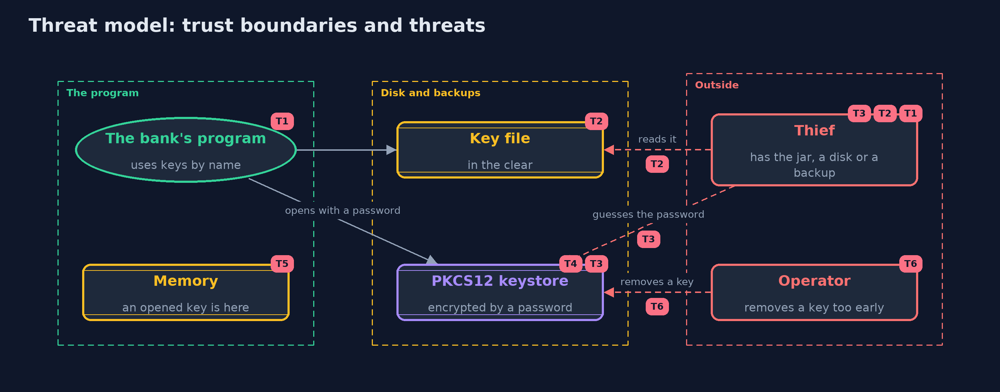

# Threat Model — Keystores and Key Management Basics

A threat model answers four questions: what are we protecting, who or what could harm it, how, and what do we do about it. This one covers this project's own demo system, not a production deployment. Domain: an online bank.

## Scope

Where an online bank keeps its statement key: in the code, in a key file, or in a PKCS12 keystore, how other keys are derived from passwords and master keys, and how a key is replaced. It covers a thief who has the program, a disk or a backup,
and an operator who makes a mistake. It does not cover key management services or hardware modules, TLS keys, or the application's memory being read.

## What we protect (assets)

- The statement key, and any key derived from it.
- The keystore file and its password.
- Every message sealed under a key that may be removed.
- The record of which key name each message carries.

## Who and what acts on the system

- The bank's program, which uses keys by name.
- A thief who has a copy of the program, a disk or a backup.
- A person with a login on the machine.
- An operator who replaces or removes keys.

## Trust boundaries

A trust boundary is a line that data or a request crosses between parts that trust each other differently. Threats cluster where those lines are.

- Program to repository and build servers: a key in the code crosses it for good.
- Application to the filesystem: a key file's permissions are the only guard.
- Keystore file to its password: the line a thief must cross by guessing.

Each dashed box is a trust boundary. A rose tag such as T1 shows where the threat of that number, in the table below, applies.

## Threats, using STRIDE

STRIDE is a checklist of six kinds of threat: **Spoofing** (S), **Tampering** (T), **Repudiation** (R), **Information disclosure** (I), **Denial of service** (D), **Elevation of privilege** (E).

| Id | Kind | Threat | Where it shows up | Control in this project | What is left |
| --- | --- | --- | --- | --- | --- |
| T1 | Information disclosure | A key written in the code is read from the program, the repository or a build | `HardCodedKey` | Keep keys out of the code and repositories | A key that was ever committed must be treated as leaked and replaced |
| T2 | Information disclosure | A key file is read by another user or from a backup | `KeyFile` | Owner-only permissions | The file still holds the key in the clear, so backups and the owner's account must be protected too |
| T3 | Information disclosure | A stolen keystore file is attacked offline by guessing its password | `KeystoreVault` | The file is encrypted and integrity-protected by a key made from the password, and a wrong password is refused | The file records only 10,000 rounds by default, so a strong password matters, and raised settings must be checked in the file |
| T4 | Tampering | A keystore file is changed | `KeystoreVault.open` | The file carries an integrity code, so a changed file is refused | A deleted or replaced file is still a loss of keys, so keep a backup |
| T5 | Information disclosure | An opened key is read from the program's memory | the running program | None here | A key service or hardware module keeps keys out of the program's memory |
| T6 | Denial of service | A key is removed before old messages are sealed again, and the data is lost | `KeystoreVault.remove`, `Messages.open` | Messages name their key, so the problem is visible, and old messages are sealed again first | A runbook and a backup are still needed, because nothing stops the removal |

## Assumptions

- The keystore's password is strong and kept outside the application.
- The machine's memory is not read by an attacker.
- In the demo, keys, salts and nonces are random and never printed, and the key texts in the code are demo values.

## Out of scope

- Key management services and hardware security modules.
- TLS private keys and certificates: the transport-security module.
- Secret scanning of source history.

## How the tests check this

- `HardCodedAndFileTest` checks the key is found in the class file, and the permissions of key files.
- `KeystoreVaultTest` checks round trips, hidden keys and names, wrong passwords, changed files and the rounds a file records.
- `DerivationTest` checks PBKDF2 and HKDF against published values, and separate keys for separate purposes.
- `MessagesTest` checks key names in messages, rotation, removal and refusals.
- `DemoRunsTest` compares the whole demo with the golden output.

## Where this model goes next

The next module, networking, looks at what travels between machines: sockets, names and the web. After it, transport security brings keys, certificates and signatures together in TLS.
