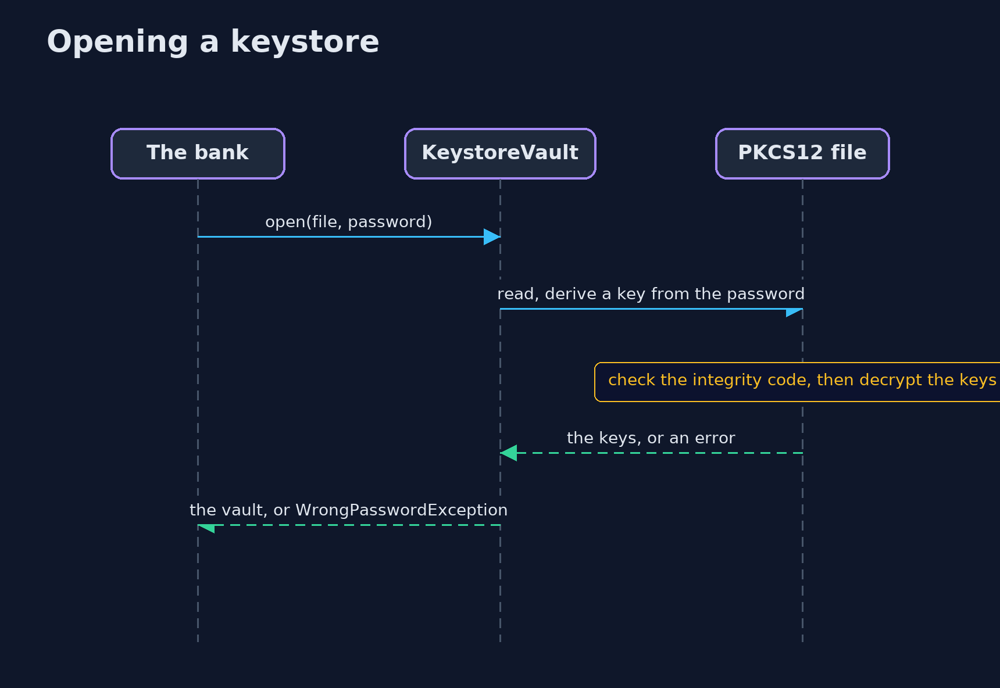
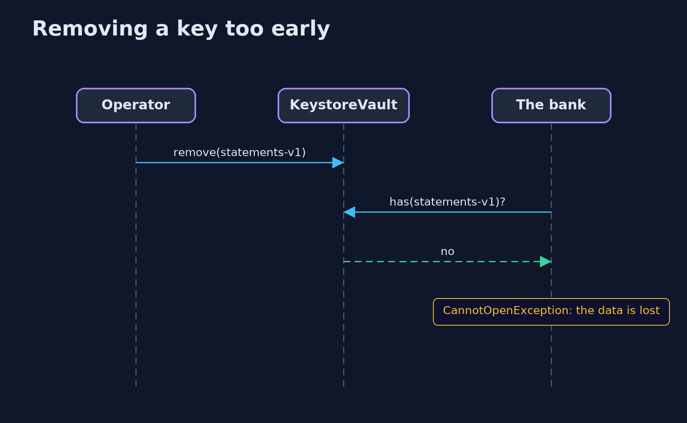

# Keystores and Key Management Basics — UML Sequence Diagrams

## 1. Opening a keystore

The password makes the key that checks and decrypts the file; a wrong password fails the check.

## 2. Removing a key too early

The old message names a key that is no longer in the vault, so it cannot be opened.

