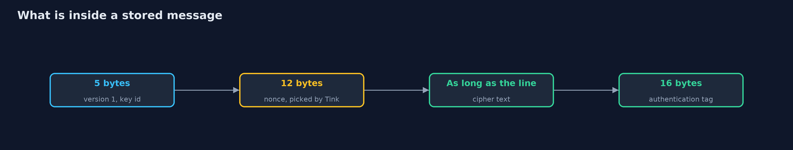
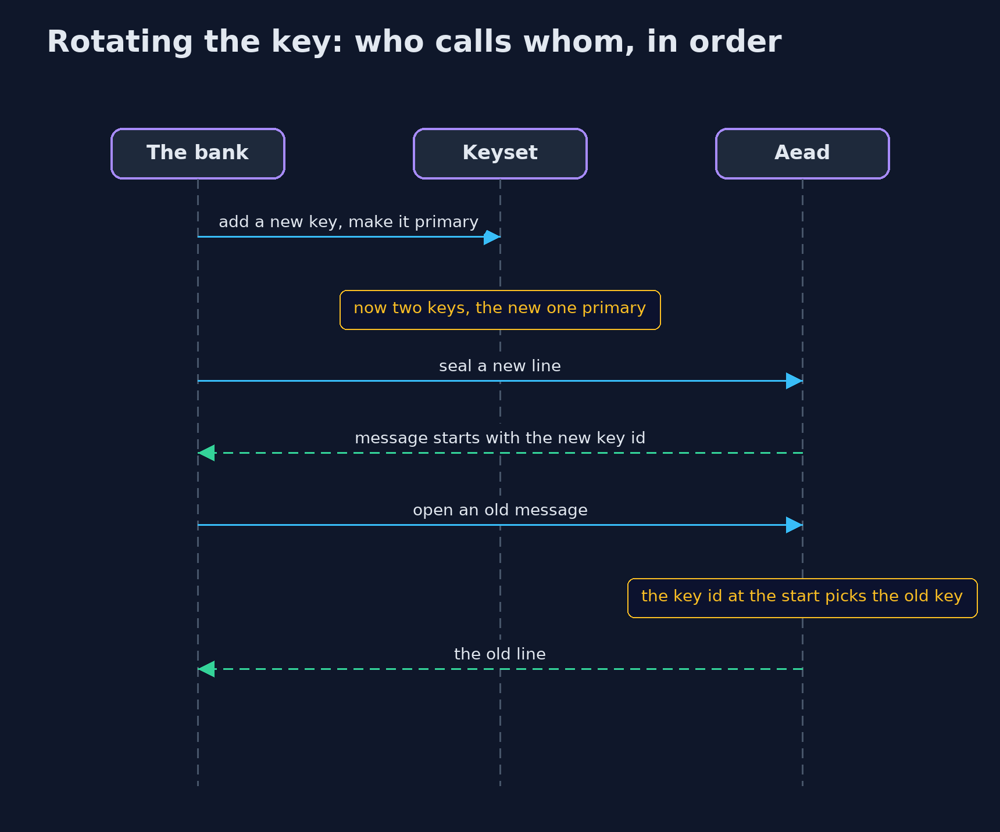

# Symmetric Encryption with Google Tink

```
src/main/java/com/jk/explore/security/symmetrictink/
├── Bank.java         The bank's encryption of statement lines with Tink's AEAD primitive: Tink picks the nonce, the layout and the mode
├── DemoKeysets.java  Keysets with fixed contents, so the demo prints the same text on every run
└── TinkDemo.java     Runs the online bank story in five numbered acts, with Google's Tink, and prints exact, repeatable results
```

**Google's Tink library gives one safe call for encryption, picks the nonce and the layout for you, keeps keys in a keyset that can be rotated, and leaves out the unsafe choices, but the keyset still needs a safe place to live.**

The plain version of this lesson used AES-GCM straight from the JDK, and showed how many things the caller must get right: the
mode, the nonce, the format of the stored message, and the key. **Tink**, a library from Google, takes most of those decisions away. Its
**Aead** primitive has two calls, `encrypt` and `decrypt`, and nothing else to configure: it chooses a fresh nonce every time, lays out the
message, and refuses to offer unsafe modes. Its keys live in a **keyset**, a list of keys of which one is *primary*. New messages use the primary key, and every key in the
keyset can still open its old messages. That makes **rotation** simple: add a new key, make it primary, and later remove the old one.

The demo runs the same online bank as the plain project, with the same statement line, in five acts: one call and no nonce, any change refused,
rotating the key, keeping the keyset itself safe, and what Tink does not do for you.

## The idea in everyday terms

Think of a lock box maker who is also a careful advisor. You do not choose the lock, the combination or the seal. The maker fits a fresh combination to
every box, stamps on it which key opens it, and does not sell the models that are known to be weak. When you want new keys, you do not rebuild the
boxes: the maker keeps a key ring, adds a new key, and the old boxes still open with the old ones until you take them off the ring.

## The scenario

The online bank from the plain project stores a statement line, `RENT -1200`, for the account ANA-1. It now encrypts with Tink. The demo seals the line twice, flips a
bit, moves a message to another account, adds a second key to the keyset and removes the first, writes the keyset to disk under a master key, and ends by listing
what remains the bank's job.

## Run

```bash
./gradlew run
```

The demo tells the story in 5 acts, each printing exact numbers that the tests check:

| Act | What it shows |
| --- | --- |
| 1. One call, and no nonce to look after | Sealing the same line twice gives different bytes, the message starts with 01000003e9 (version 1, key id 1001), and 16 bytes become 49. |
| 2. Any change is refused | A flipped bit, a message moved to another account, and a different key of the same id are all refused. |
| 3. Replacing the key without losing the data | Adding a new primary key gives a keyset of 2 keys; old messages still open, new messages use the new key id, and removing the old key makes old messages unreadable. |
| 4. Keeping the keyset itself safe | The keyset is written encrypted under a master key: the file has an encryptedKeyset field, the key's own bytes are not in it, it reads back with the master key and not with another. |
| 5. The bill: what Tink decides for you, and what it does not | Tink offers authenticated templates and no ECB one, but the format is its own, it adds a library, the master key needs a home, and lengths still show. |

## Test

```bash
./gradlew test
```

15 tests in `DemoRunsTest`, `KeysetTest`, `TinkAeadTest`. Every line the demo prints is checked against `docs/expected-output.txt`. Tink's nonces are random, so the demo and the tests check lengths, equality and key ids, never the random bytes themselves.

## What the simulation got right, and what it left out

The keyset is built from fixed key bytes so every run prints the same text, and its Base64 form is in the source. A real keyset is made with `generateNew`,
which picks a random key and a random key id, and must never be written in the clear. The master key stands in for a key management service. Tink's nonces are random,
so the demo prints facts that do not depend on them: whether two messages are equal, their length, and the five-byte start that names the key. Tink 1.24 marks the
encrypted-keyset functions the demo uses as deprecated, and the code says so where it uses them.

## Technologies and versions

| Technology | Version | Used for |
| --- | --- | --- |
| Java | 25 | the code (toolchain set in `build.gradle`; Gradle finds or downloads the JDK) |
| Gradle | 9.2.1 (wrapper) | build and run, nothing to install |
| JUnit | 5.10.2 | the tests |
| videokit | repository tool (`tools/videokit`) | the narrated video and animation: Piper `en_US-amy-medium`, speed 0.8, longer pauses (the amy-slow voice) |

## Learning Material

| Document | What it is for |
| --- | --- |
| [Dependencies](docs/dependencies.md) | what the framework and infrastructure are, and why they are here |
| [Problem statement](docs/problem-statement.md) | the situation and what the project must show |
| [Prerequisites](docs/prerequisites.md) | what you need to know first |
| [Symmetric Encryption with Google Tink, explained](docs/symmetric-encryption-with-tink-explained.md) | the acts in prose |
| [Session guide](docs/session.md) | a one-hour lesson with exercises |
| [Animated walkthrough](docs/animation.html) | the acts step by step, narrated |
| [Threat model](docs/threat-model.md) | what is protected, who could harm it, and how, using STRIDE |
| [Spec](docs/spec.md) | what this project must be true of |
| [Expected output](docs/expected-output.txt) | the golden demo output every test and every port checks against |

### The idea in one picture

The bank gives Tink a line and the associated data; Tink takes the primary key from the keyset, picks a nonce, and returns one stored message.


### Where each piece sits

The demo is small because Tink does the work: Bank wraps an Aead, and DemoKeysets builds fixed keysets for repeatable output.


### How the data moves

Five bytes name the key, then Tink's nonce, the cipher text and the tag.



### Who calls whom, in order




### Video

`video/symmetric-encryption-with-tink-explained.mp4` (with `.m4a` audio and `.srt` subtitles) is built by `video/build_video.sh`. Rendered media is not committed.

## What it costs

- **A library and its dependency.** Tink brings a protocol buffer library with it, and a recent JDK warns about the unsafe memory access that library uses.
- **A format of its own.** A message starts with five bytes naming the key, then Tink's nonce, cipher text and tag. Another library cannot read it without Tink, or without code that knows the layout.
- **The keyset still needs a safe home.** Tink can write it encrypted under a master key, but the master key has to live somewhere, ideally in a key management service or a hardware module.
- **Some of its functions move.** Tink 1.24 marks its encrypted-keyset functions as deprecated, in favour of keeping the master key in a key management service, so code that uses them needs a plan.
- **Lengths still show,** and a lost keyset is lost data.

## When this is too much

For one small value in one program, the JDK's AES-GCM and a careful nonce is enough. As soon as there are many messages, several programs, or any need to replace keys, a library that
makes the safe choice the only choice is worth its weight. Tink is one such library, and libsodium is another.

## Where you have already met this

- Tink's `Aead` in Android and server code at Google and elsewhere, and its cousins `DeterministicAead`, `Mac` and `PublicKeySign`.
- Key rotation in cloud key management services, which use the same primary and old keys idea.
- A stored value that begins with a small version byte and a key id, before the nonce.
- Libraries that do not let you pick ECB, or reuse a nonce, because the API has no place to put one.

## Where this sits

This project is the third in [cryptography](..), the library version of [symmetric-encryption](../symmetric-encryption).
