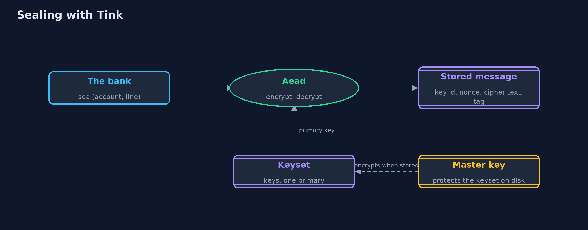

# Symmetric Encryption with Google Tink — Architecture Diagram

The bank gives Tink a line and the associated data; Tink takes the primary key from the keyset, picks a nonce, and returns one stored message.

