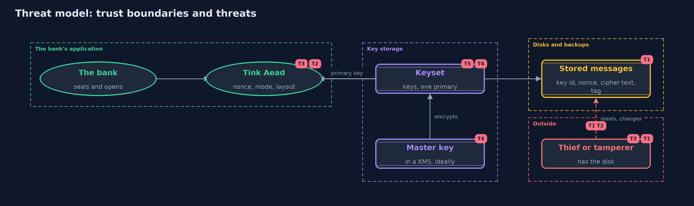

# Threat Model — Symmetric Encryption with Google Tink

A threat model answers four questions: what are we protecting, who or what could harm it, how, and what do we do about it. This one covers this project's own demo system, not a production deployment. Domain: an online bank.

## Scope

An online bank's use of Google's Tink to encrypt statement lines: the Aead primitive, the keyset with its primary key, key rotation, and the keyset stored under a master key. It covers a thief who reads a disk,
one who changes a message, and the loss or exposure of keys. It does not cover who may ask for a statement, or the key management service that should hold the master key.

## What we protect (assets)

- The contents and integrity of each statement line.
- The keyset: every key that can open stored messages.
- The master key that protects the keyset on disk.
- The record of which key id made which message.

## Who and what acts on the system

- The bank's services, which seal and open messages.
- A thief who copies disks, backups or the stored keyset.
- An attacker who changes or moves stored messages.
- An operator who rotates keys, and may remove one too early.

## Trust boundaries

A trust boundary is a line that data or a request crosses between parts that trust each other differently. Threats cluster where those lines are.

- Application to disk: messages leave as key id, nonce, cipher text and tag.
- Application to key storage: the keyset reaches memory only after the master key opens it.
- Master key to key management service: the line that should hold the master key.

Each dashed box is a trust boundary. A rose tag such as T1 shows where the threat of that number, in the table below, applies.

## Threats, using STRIDE

STRIDE is a checklist of six kinds of threat: **Spoofing** (S), **Tampering** (T), **Repudiation** (R), **Information disclosure** (I), **Denial of service** (D), **Elevation of privilege** (E).

| Id | Kind | Threat | Where it shows up | Control in this project | What is left |
| --- | --- | --- | --- | --- | --- |
| T1 | Information disclosure | A thief reads statements from a disk or a backup | stored messages | Tink's AES-GCM hides the contents; the keyset is kept apart from the messages | Message lengths show, and a thief who also gets the keyset reads everything |
| T2 | Tampering | Someone changes a message, or moves it to another account | `Bank.openOrNull` | The tag covers the cipher text and the associated data, so a change or a move is refused | A valid old message can be put back for the same account |
| T3 | Information disclosure | A developer picks a weak mode or reuses a nonce | the `Aead` API | Tink has no place to put a nonce and offers no ECB template | A developer can still choose a weak primitive elsewhere, or build a key from a weak password |
| T4 | Information disclosure | The keyset is read from disk or from a backup | the stored keyset | It is written encrypted under a master key | The master key now needs a safe home; Tink's own encrypted-keyset functions are deprecated in favour of a key management service |
| T5 | Denial of service | A key is removed too early, and old messages can no longer be opened | keyset rotation | Add the new key first, make it primary, re-encrypt, and only then remove the old key | A mistake in the order loses data, so the steps need a runbook and a backup |
| T6 | Repudiation | A message cannot be traced to the key that made it | the five-byte start of each message | The key id at the start of every message names the key | It names the key, not the person or service that used it |

## Assumptions

- The attacker does not have the keyset or the master key.
- Tink and its dependency are kept up to date.
- In the demo, keysets are built from fixed public bytes, and the master key is another demo keyset. Real keysets come from `generateNew`.

## Out of scope

- Hardware security modules and cloud key management services.
- Who is allowed to ask for a decrypted statement.
- Other Tink primitives: signatures, MACs and hybrid encryption.

## How the tests check this

- `TinkAeadTest` checks nonce freshness, the five-byte start, the 33-byte overhead, and refusal for changed, moved and wrongly keyed messages.
- `KeysetTest` checks rotation, removal of an old key, the encrypted keyset file and the missing ECB template.
- `DemoRunsTest` compares the whole demo with the golden output.

## Where this model goes next

The next project, asymmetric-encryption, tackles what both versions leave open: how two parties who have never met agree on a key at all.
