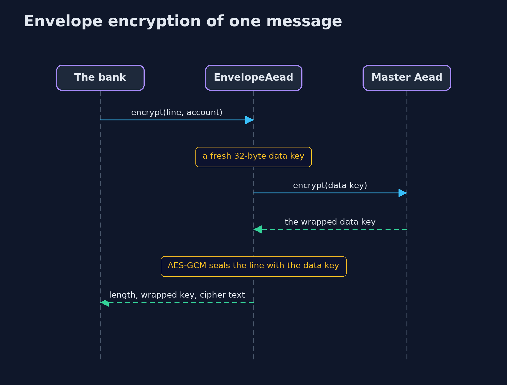
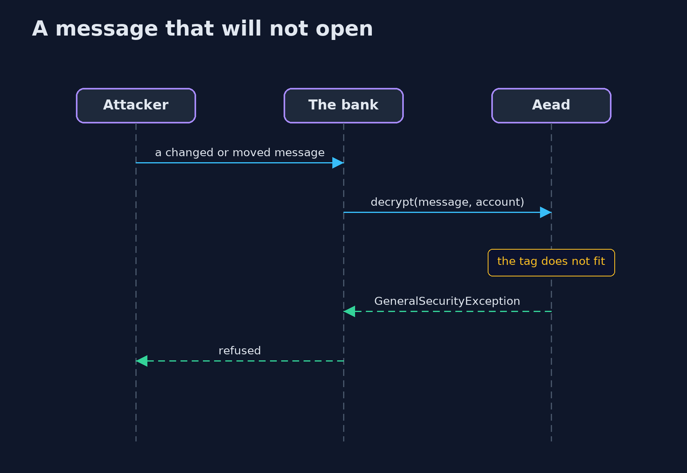

# Symmetric Encryption with Google Tink — UML Sequence Diagrams

## 1. Envelope encryption of one message

The data key is made for this message, used once, and sent to the master key to be wrapped; the master key never sees the message.

## 2. A message that will not open

Wrong key, changed bit or different associated data all end in the same refusal.

