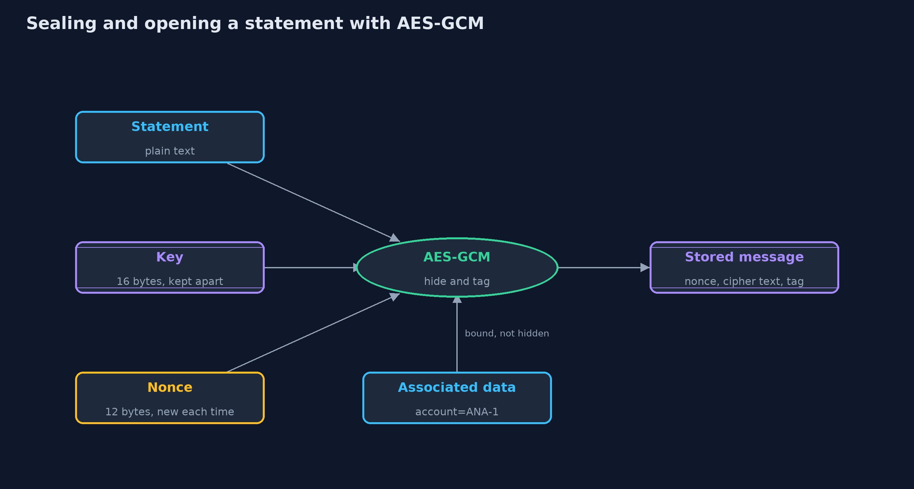
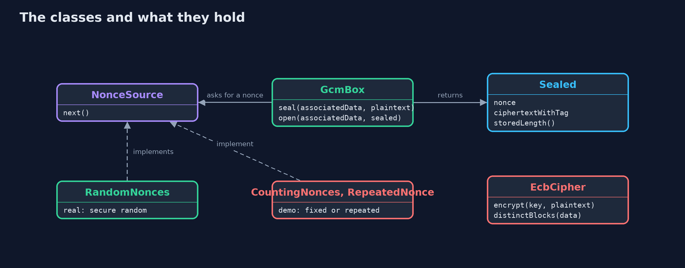
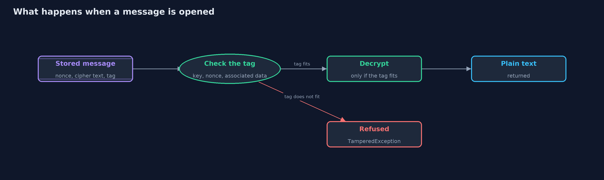
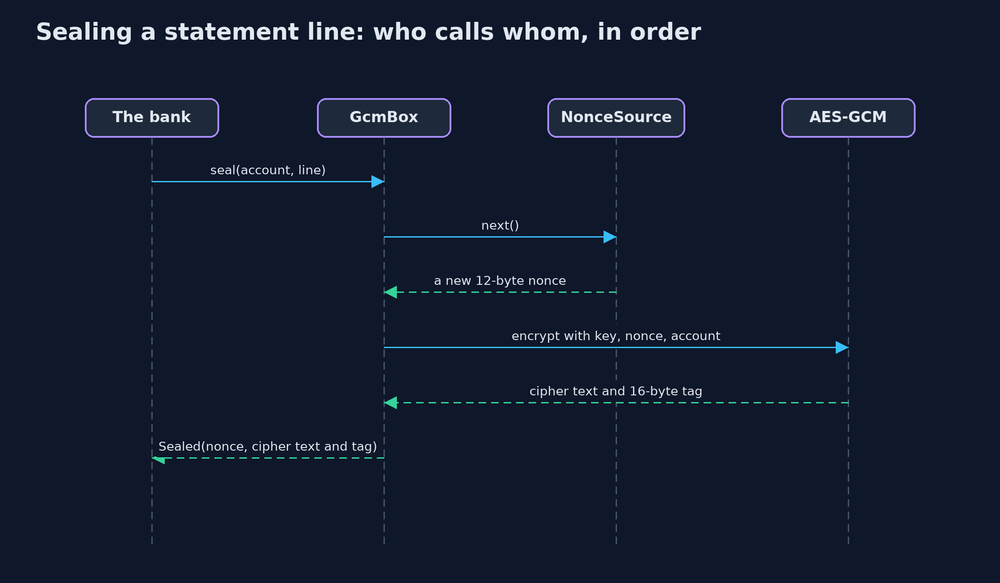

# Symmetric Encryption (AES-GCM)

```
src/main/java/com/jk/explore/security/symmetric/
├── CountingNonces.java  Nonces that are different every time but the same on every run: 1, 2, 3 and so on
├── EcbCipher.java       AES in ECB mode: every 16-byte block is encrypted on its own, with nothing to tell one block from the next
├── GcmBox.java          AES in GCM mode, an authenticated encryption: it hides the data and also adds a tag, so that any change to the cipher text, the nonce or the associated data is noticed when the message is opened
├── Hex.java             Small helpers for text and bytes
├── NonceSource.java     Where the 12-byte nonces for AES-GCM come from
├── RandomNonces.java    Real nonces: 12 random bytes from the system's secure random generator
├── RepeatedNonce.java   A "nonce source" that gives the same nonce every time: the mistake this project warns about
├── Sealed.java          An encrypted message: the nonce that was used, and the cipher text with its 16-byte authentication tag at the end
└── SymmetricDemo.java   Runs the online bank story in five numbered acts and prints exact, repeatable results
```

**AES-GCM hides data and notices any change to it, but only when every message gets a nonce that is never reused, and the key is kept somewhere safe.**

**Symmetric encryption** uses one secret key for both locking and unlocking: whoever has the key can read the data. The standard
cipher is **AES**, which scrambles one 16-byte block at a time. How blocks are put together, the **mode**, matters as much as the
cipher. In **ECB** mode, each block is scrambled on its own, so identical blocks give identical results and the pattern of the data shows through. **GCM**
mode fixes this, and does more: it is an **authenticated** encryption, adding a tag so that any change to the message is noticed when it is opened. It needs a
**nonce**, a number used once, for every message, and the one rule that matters most is that a nonce must never be reused with the same key.

This project encrypts an online bank's account statements five ways: not at all, in ECB, in GCM, in GCM with a reused nonce, and then GCM with its costs. The numbers
are exact, and the code checks AES and GCM against published test values.

## The idea in everyday terms

Think of a lock box where the same key closes it and opens it. Storing a statement in plain text is leaving it on the table. ECB is a lock box that is
scrambled line by line in the same way every time, so a burglar who cannot read a line can still see that five lines are the same. GCM is a lock box with a
tamper seal: a fresh combination each time, and a seal that breaks if anyone has been inside. Reusing a nonce is using the same combination twice, which lets a burglar
compare the two boxes and work out one from the other.

## The scenario

An online bank stores customers' account statements. A statement has eight lines of 16 bytes: a salary, five payments of the same rent, and a food bill.
The disk the statements sit on may be stolen, and the files may be changed by someone who can reach them. The bank tries plain text, AES in ECB mode, AES-GCM, GCM
with a nonce that repeats, and finally looks at what GCM costs.

## Run

```bash
./gradlew run
```

The demo tells the story in 5 acts, each printing exact numbers that the tests check:

| Act | What it shows |
| --- | --- |
| 1. A statement stored as it is | A stolen disk shows the whole statement, 8 lines, all readable. |
| 2. AES in ECB mode: every block on its own | In ECB the 8 blocks give only 3 different cipher blocks, so an attacker sees that 5 of the 8 lines are the same payment. |
| 3. AES-GCM: hiding and checking | With a new nonce each time, the same line seals to different cipher texts; a flipped bit, a message moved to another account, and a wrong key are all refused. |
| 4. The one mistake: using a nonce twice | Two messages sealed with the same key and nonce XOR to the XOR of their plain texts, so an attacker who knows one recovers the other, with no key. |
| 5. The bill: sizes, nonces, and the key | Sealing adds 28 bytes and the length still shows, random nonces run out near 4,294,967,296 messages, and a lost key means lost data. |

## Test

```bash
./gradlew test
```

21 tests in `DemoRunsTest`, `EcbTest`, `GcmBoxTest`, `NonceReuseTest`, `StandardVectorsTest`. AES and GCM are checked against published values (FIPS 197, and test cases one and two of the original GCM specification). Every line the demo prints is checked against `docs/expected-output.txt`, and the key and nonces are fixed, so every run gives the same result.

## What the simulation got right, and what it left out

Keys and nonces in the demo are fixed values, and the nonces count 1, 2, 3, so every run prints the same text. A real system uses a random key from a key
store and a random or carefully counted nonce for each message, and this project provides `RandomNonces` for that. The ECB demonstration uses lines
that are exactly one block each, so the repeats line up with the blocks. In real data, patterns are less tidy, and ECB is still unsafe. The tests check
AES and GCM against published test values.

## Technologies and versions

Every version below is pinned in the project's build files and was the latest stable release when the project was built.

| Technology | Version | Used for |
| --- | --- | --- |
| Java | 25 | the language and runtime; a Gradle toolchain finds or downloads the JDK |
| Gradle | 9.8.1 (wrapper) | build and run; nothing to install, the wrapper downloads it |
| org.junit.jupiter:junit-jupiter | 6.1.3, set by junit-bom | JUnit 5: the tests (tests only) |
| org.junit.platform:junit-platform-launcher | 6.1.3, set by junit-bom | JUnit platform launcher, which Gradle needs to run the tests (tests only) |
| videokit | repository tool (`tools/videokit`) | the narrated video and animation: Piper `en_US-amy-medium`, speed 0.8, longer pauses (the amy-slow voice) |

## Learning Material

| Document | What it is for |
| --- | --- |
| [Problem statement](docs/problem-statement.md) | the situation and what the project must show |
| [Prerequisites](docs/prerequisites.md) | what you need to know first |
| [Symmetric Encryption (AES-GCM), explained](docs/symmetric-encryption-explained.md) | the acts in prose |
| [Session guide](docs/session.md) | a one-hour lesson with exercises |
| [Animated walkthrough](docs/animation.html) | the acts step by step, narrated |
| [Threat model](docs/threat-model.md) | what is protected, who could harm it, and how, using STRIDE |
| [Spec](docs/spec.md) | what this project must be true of |
| [Expected output](docs/expected-output.txt) | the golden demo output every test and every port checks against |

### The idea in one picture

The key, a fresh nonce and the associated data go in with the plain text; out come a nonce, cipher text and tag, which are stored together.



### Where each piece sits

GcmBox seals and opens messages, taking nonces from a NonceSource; EcbCipher is there to show a mistake.



### How the data moves

The tag is checked first; only a message that passes is decrypted and returned.



### Who calls whom, in order




### Video

`video/symmetric-encryption-explained.mp4` (with `.m4a` audio and `.srt` subtitles) is built by `video/build_video.sh`. Rendered media is not committed.

## What it costs

- **A nonce must never repeat under one key.** Reusing one lets an attacker who knows one message recover another, and in GCM it can also reveal the key used for authentication.
- **Random nonces run out.** With 12-byte random nonces, a repeat becomes likely near 2 to the power 32, about 4.3 billion messages, so the key must be replaced before that.
- **Encryption does not hide the length.** A 5-byte message and a 500-byte one are told apart by their sizes, which is 28 bytes more than the message in each case.
- **The key must live somewhere.** A key kept next to the data protects nothing, and a key that is lost takes every message with it.
- **A shared key has no identity.** Anyone who can open a message can also make one. A signature, in a later project, tells makers apart.

## When this is too much

Never use less than authenticated encryption for data an attacker could read or change. For data with no value to an attacker, such as public product photos, encryption is
unnecessary. The question is never whether to use AES-GCM for secrets, but where the key comes from and how many messages it will see.

## Where you have already met this

- Disk and phone encryption, which use AES, in modes designed for storage.
- HTTPS connections, whose bulk data is protected with AES-GCM or ChaCha20-Poly1305.
- Database fields that are encrypted by the application before they are stored.
- Security advisories about "nonce reuse" in a library or a protocol.

## Where this sits

This project is the second one in [cryptography](..), after [hashing-and-integrity](../hashing-and-integrity), whose HMAC added a tag but no secrecy.
