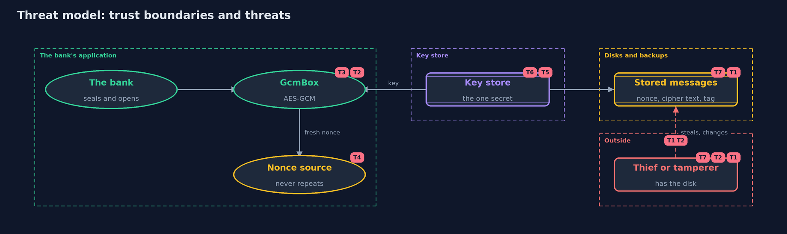

# Threat Model — Symmetric Encryption (AES-GCM)

A threat model answers four questions: what are we protecting, who or what could harm it, how, and what do we do about it. This one covers this project's own demo system, not a production deployment. Domain: an online bank.

## Scope

An online bank's stored account statements, encrypted by the application before they are stored: the choice of mode, the nonces, the
associated data, the key, and the messages on disk and in backups. It covers a thief who reads a disk, and one who changes a file. It does
not cover who is allowed to ask the application for a statement, or how the key is stored and rotated.

## What we protect (assets)

- The contents of each statement.
- The integrity of each statement.
- The encryption key.
- The record of which nonces have been used.

## Who and what acts on the system

- The bank's application, which seals and opens messages.
- A thief who copies a disk or a backup.
- An attacker who can change or move stored messages.
- An attacker who sees two messages made with the same nonce.

## Trust boundaries

A trust boundary is a line that data or a request crosses between parts that trust each other differently. Threats cluster where those lines are.

- Application to disk: messages leave the application only as nonce, cipher text and tag.
- Key store to application: the key must reach the application and nowhere else.
- Account to account: associated data stops one account's message being used for another.

Each dashed box is a trust boundary. A rose tag such as T1 shows where the threat of that number, in the table below, applies.

## Threats, using STRIDE

STRIDE is a checklist of six kinds of threat: **Spoofing** (S), **Tampering** (T), **Repudiation** (R), **Information disclosure** (I), **Denial of service** (D), **Elevation of privilege** (E).

| Id | Kind | Threat | Where it shows up | Control in this project | What is left |
| --- | --- | --- | --- | --- | --- |
| T1 | Information disclosure | A thief reads statements from a disk or a backup | stored messages | AES-GCM hides the contents, so the disk holds only cipher text | The length of each message still shows, and the key must not be on the same disk |
| T2 | Tampering | Someone changes a stored message, or moves it to another account | `GcmBox.open` | The tag covers the cipher text, nonce and associated data, so any change or move is refused | An attacker can still delete a message, or replace it with an older valid one for the same account |
| T3 | Information disclosure | Patterns in the data show through the cipher text | `EcbCipher` | Use GCM, not ECB, so equal blocks give different cipher text | Message lengths and timing can still leak something |
| T4 | Information disclosure | A nonce is reused and an attacker recovers one message from another | `NonceSource` | A fresh nonce for every message, from `RandomNonces` or a carefully kept counter | Random nonces may repeat near 2^32 messages under one key; replace the key before that |
| T5 | Information disclosure | The key is read by someone who should not have it | the key store | None in this project; the key is kept apart from the data | Whoever holds the key reads everything, so it must be guarded and its use logged |
| T6 | Denial of service | The key is lost, and with it every message | the key store | None in this project | Back up the key separately from the data, and test that the backup works |
| T7 | Repudiation | Anyone with the key can make a valid message, so nobody can tell who made it | `GcmBox` | None with a shared key | Digital signatures give each maker an identity; a later project covers them |

## Assumptions

- The attacker does not have the key.
- The application's memory is not itself compromised.
- In the demo, keys and nonces are fixed values. Real systems use a random key from a key store and never repeat a nonce.

## Out of scope

- Key generation, storage, rotation and destruction: the keystore-basics project.
- Who may open a statement: authorization, in the identity module.
- Traffic analysis, which can use message sizes and timing.

## How the tests check this

- `StandardVectorsTest` checks AES and GCM against FIPS 197 and the original GCM specification.
- `EcbTest` shows ECB keeps the repeats of the plain text.
- `GcmBoxTest` shows a changed bit, tag, nonce, associated data or key all make `open` fail, and the overhead is 28 bytes.
- `NonceReuseTest` shows an attacker who knows one message recovers another when a nonce is reused, and not when nonces are fresh.

## Where this model goes next

The next project, asymmetric-encryption, solves the problem that this one leaves: how two parties who have never met can agree on a key.
