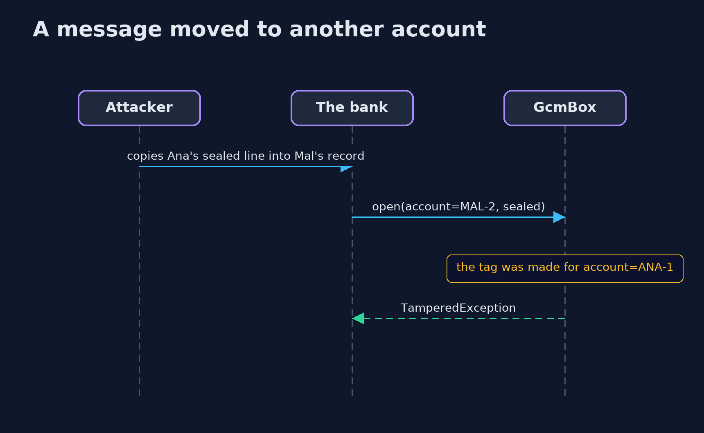
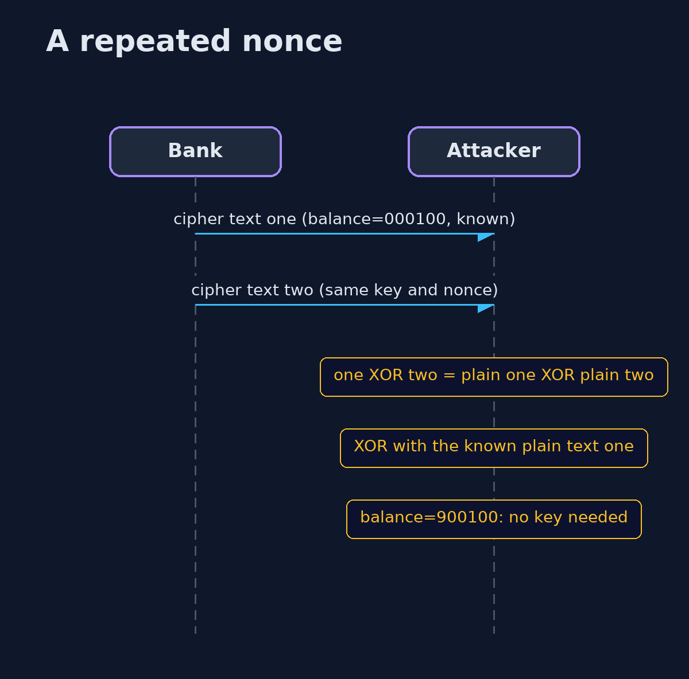

# Symmetric Encryption (AES-GCM) — UML Sequence Diagrams

## 1. A message moved to another account

The associated data is part of the tag, so opening it with another account's data fails.

## 2. A repeated nonce

Two messages with the same key and nonce share a stream of scrambling bytes, which cancel when the two are combined.

