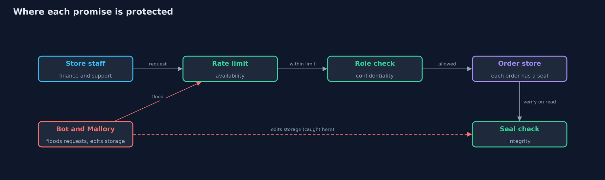
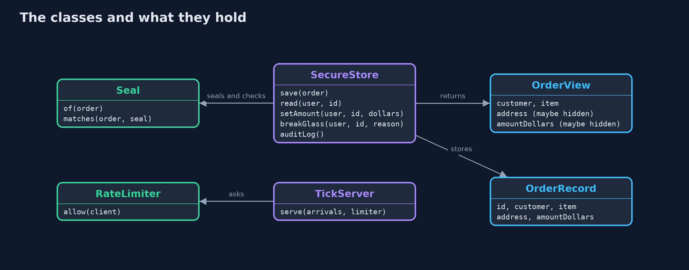
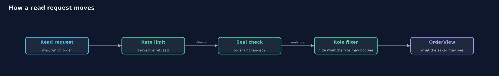

# The CIA Triad

```
src/main/java/com/jk/explore/security/cia/
├── AccessDeniedException.java   Thrown when a user asks for something their role does not allow
├── CiaDemo.java                 Runs the online store story in five numbered acts and prints exact, repeatable results
├── NaiveStore.java              The first version of the store's order system: anyone who can reach it can read anything and change anything, and nothing notices
├── OrderRecord.java             Everything the store keeps about one order: customer, item, shipping address and amount paid
├── OrderView.java               What one user is allowed to see of an order; a field they may not see is null
├── RateLimiter.java             Availability control: each client may make only a fixed number of requests per tick
├── Request.java                 One request arriving at the order server, from a named client
├── Role.java                    The job a store employee does, which decides what they may see and change
├── Seal.java                    Makes and checks the seal on an order: a short code worked out from the order and a secret key
├── SecureStore.java             The store's order system with a control for confidentiality (what each role may see), integrity (a seal checked on every read), and a logged emergency exception
├── TamperedOrderException.java  Thrown when a stored order no longer matches the seal made when it was saved
├── TickServer.java              A order server that can do a fixed amount of work in one tick (a slice of simulated time, so every run is identical)
└── User.java                    A person using the store's order system, with the role they were given
```

**Confidentiality, integrity and availability are the three promises a system makes about its information, and every security control protects one of them.**

Every security control exists to protect one of three things. **Confidentiality**
means only the right people can see the information. **Integrity** means nobody
can change it without being noticed. **Availability** means it is there when it
is needed. Together they are called the CIA triad, and they are the first
question to ask about any system: which of the three can fail, and who is hurt
when it does?

This project builds one small system, an online store's order records, and
breaks each promise on purpose. Then it adds the simplest control that restores
each one, and shows what those controls cost.

## The idea in everyday terms

Think of a bank vault. The thick door keeps strangers out: that is
confidentiality. The seals on the money bags show if anything was touched: that
is integrity. And the vault opens every morning, so customers can reach their
money: that is availability. A vault that nobody can open is safe but useless,
which is the lesson the last act of the demo comes back to.

## The scenario

An online store keeps a record for every order: the customer, the item, the
shipping address and the amount paid. Ana works in finance. Raj works in
support. Mallory also works in support, but is careless with what should not be
touched. The first version of the order system trusts everyone, so three things
go wrong in one morning. Raj reads a shipping address he did not need. Mallory
changes an amount and nobody notices. And during a flash sale, a bot floods the
checkout so that a real customer cannot buy anything.

## Run

```bash
./gradlew run
```

The demo tells the story in 5 acts, each printing exact numbers that the tests check:

| Act | What it shows |
| --- | --- |
| 1. The first version, with no controls | A support agent reads a shipping address, an amount is changed in silence, and a bot floods the checkout so a customer is refused. |
| 2. Confidentiality: each role sees what it needs | Support sees the customer and the item only, finance sees everything, and only finance may change an amount. |
| 3. Integrity: a change behind the application is caught | Each order carries a seal worked out from its contents and a secret key; an edit made directly in storage no longer matches its seal. |
| 4. Availability: one client cannot use up the server | Each client may make 3 requests per tick, so the bot gets 3 and Maya's request is served. |
| 5. The bill: strict controls get in the way of emergencies | Support cannot see a shipping address when a courier is at the wrong door; an emergency exception shows it, but only with a reason, and logs the use. |

## Test

```bash
./gradlew test
```

17 tests in `AvailabilityTest`, `BreakGlassTest`, `ConfidentialityTest`, `DemoRunsTest`, `IntegrityTest`, `NaiveStoreTest`. Every line the demo prints is checked against `docs/expected-output.txt`, and nothing depends on the real clock, so every run gives the same result.

## What the simulation got right, and what it left out

The simulation uses a clock made of ticks, one slice of simulated time, instead of real time,
so every run prints the same numbers. The storage is an in-memory map that stands in for a
database, and the secret key is a fixed demo value. A real system keeps its key out of the
code and its orders in a database that has its own access controls. Later projects cover
keys, hashing and real protocols; this one only builds the intuition.

## Technologies and versions

Every version below is pinned in the project's build files and was the latest stable release when the project was built.

| Technology | Version | Used for |
| --- | --- | --- |
| Java | 25 | the language and runtime; a Gradle toolchain finds or downloads the JDK |
| Gradle | 9.8.1 (wrapper) | build and run; nothing to install, the wrapper downloads it |
| org.junit.jupiter:junit-jupiter | 6.1.3, set by junit-bom | JUnit 5: the tests (tests only) |
| org.junit.platform:junit-platform-launcher | 6.1.3, set by junit-bom | JUnit platform launcher, which Gradle needs to run the tests (tests only) |
| videokit | repository tool (`tools/videokit`) | the narrated video and animation: Piper `en_US-amy-medium`, speed 0.8, longer pauses (the amy-slow voice) |

## Learning Material

| Document | What it is for |
| --- | --- |
| [Problem statement](docs/problem-statement.md) | the situation and what the project must show |
| [Prerequisites](docs/prerequisites.md) | what you need to know first |
| [The CIA Triad, explained](docs/cia-triad-explained.md) | the acts in prose |
| [Session guide](docs/session.md) | a one-hour lesson with exercises |
| [Animated walkthrough](docs/animation.html) | the acts step by step, narrated |
| [Threat model](docs/threat-model.md) | what is protected, who could harm it, and how, using STRIDE |
| [Spec](docs/spec.md) | what this project must be true of |
| [Expected output](docs/expected-output.txt) | the golden demo output every test and every port checks against |

### The idea in one picture

A request passes the rate limit (availability), then the role check (confidentiality), and the stored order is checked against its seal (integrity).



### Where each piece sits

SecureStore combines the role check, the seal and the audit log. The server side, TickServer with RateLimiter, is separate.



### How the data moves

A read passes the limit, the seal check and the role filter, and comes back filtered for the asker's role.



### Who calls whom, in order


### Video

`video/cia-triad-explained.mp4` (with `.m4a` audio and `.srt` subtitles) is built by `video/build_video.sh`. Rendered media is not committed.

## What it costs

- **Role checks need rules.** Someone has to decide, and keep deciding, what each role may see. Rules that are too tight stop real work.
- **Seals need a key.** The seal is only as trustworthy as the secret key behind it, and now the key has to be protected as well as the data.
- **Rate limits can block real people.** A limit that stops a bot also stops a busy but honest customer on a bad day.
- **The promises pull against each other.** The stricter confidentiality is, the harder an emergency becomes, so an exception is needed, and the exception must be logged.

## When this is too much

For a personal notes app with one user and no sensitive data, seals and role
checks are more than the problem needs. The triad itself is never too much: it
is a way of thinking, and asking the three questions costs nothing. The
controls that answer them should match the size of the harm.

## Where you have already met this

- A support screen that shows an order's item but not the card or the address (confidentiality).
- A download page that shows a checksum beside the file, so you can tell if it was altered (integrity).
- A shop that goes down on a sale day, and the protection services that absorb the flood of traffic (availability).
- The phrase "break glass in case of emergency" on a fire alarm, and its twin in business software.

## Where this sits

This project is the first one in [foundations](..), the first module of the beginner track.
