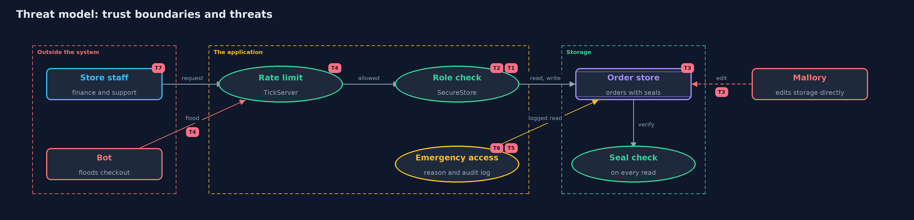

# Threat Model — The CIA Triad

A threat model answers four questions: what are we protecting, who or what could harm it, how, and what do we do about it. This one covers this project's own demo system, not a production deployment. Domain: an online store.

## Scope

The demo order system of an online store: the unprotected `NaiveStore`, the protected `SecureStore` with its
role check, seal and emergency exception, and the `TickServer` with its `RateLimiter`. It covers what the
three promises of the CIA triad protect inside this one system. It does not cover the network, the
database product, or how staff sign in.

## What we protect (assets)

- The order records: customer, item, shipping address and amount paid (confidentiality).
- The correctness of each amount (integrity).
- The checkout, which must stay usable during a sale (availability).
- The seal key, which makes tampering detectable.
- The audit log of emergency access.

## Who and what acts on the system

- Finance staff (Ana): may see and change amounts.
- Support staff (Raj): may see the customer and the item only.
- A careless or hostile insider (Mallory): has a support account, and may reach storage directly.
- An outside bot: floods the checkout during a sale.
- A real customer (Maya): wants to buy.

## Trust boundaries

A trust boundary is a line that data or a request crosses between parts that trust each other differently. Threats cluster where those lines are.

- Internet to server: where the rate limit sits.
- Staff to the order system: where the role check sits.
- Application to storage: where the seal is checked on every read.
- Normal access to emergency access: where a reason is required and the use is logged.

Each dashed box is a trust boundary. A rose tag such as T1 shows where the threat of that number, in the table below, applies.

## Threats, using STRIDE

STRIDE is a checklist of six kinds of threat: **Spoofing** (S), **Tampering** (T), **Repudiation** (R), **Information disclosure** (I), **Denial of service** (D), **Elevation of privilege** (E).

| Id | Kind | Threat | Where it shows up | Control in this project | What is left |
| --- | --- | --- | --- | --- | --- |
| T1 | Information disclosure | A support agent reads an address or an amount they do not need | `SecureStore.read` | A role filter returns only the fields the role needs | A finance account can still read everything, so a misused finance account is not stopped |
| T2 | Tampering | An insider changes an amount through the application | `SecureStore.setAmount` | Only finance may change an amount, and the order is sealed again | A finance account used wrongly is allowed; changes are not yet logged |
| T3 | Tampering | Someone edits an order directly in storage | `SecureStore.storageForDemo` (stands in for database access) | An HMAC seal is checked on every read, and a mismatch refuses the order | Anyone who also has the key can reseal; the key must be protected |
| T4 | Denial of service | A bot floods the checkout so real customers are refused | `TickServer` | `RateLimiter` allows each client a few requests per tick | Many bots from many clients each stay under the limit |
| T5 | Elevation of privilege | Emergency access is used as a shortcut around the role check | `SecureStore.breakGlass` | A reason is required and every use is written to the audit log | Reasons can be false, and the log only helps if someone reviews it |
| T6 | Repudiation | Someone denies they used emergency access | `SecureStore.auditLog` | Each entry records who, which order and why | The demo log is in memory and could be altered; a real log is append-only and stored elsewhere |
| T7 | Spoofing | Someone pretends to be a finance user | the whole system (users are simply given) | None in this project, by design | Covered by the identity module: authentication, then passwords and one-time codes |

## Assumptions

- Users are who they say they are. Proving it is the job of the identity module, starting with authentication-vs-authorization.
- The seal key is kept secret. In the demo it is a fixed value; a real system keeps it in a secrets store.
- An attacker may reach the stored data without going through the application (that is what act three simulates).

## Out of scope

- Network attacks such as eavesdropping: the transport-security module covers them.
- Attacks on the server operating system or the database product.
- Distributed floods from many addresses at once.
- Backups and recovery: the safe-habits module covers them.

## How the tests check this

- `ConfidentialityTest` shows support never receives the address or the amount, and only finance may change an amount.
- `IntegrityTest` shows that a change made behind the application is refused on read.
- `AvailabilityTest` shows one client cannot take more than its share of the server in one tick.
- `BreakGlassTest` shows emergency access needs a reason and leaves an audit entry.

## Where this model goes next

The next project, threats-and-risk, turns a list like this into a ranked register with scores. Later modules replace
the assumptions one by one: who the user is, how keys are kept, and how traffic is protected on the way in.
