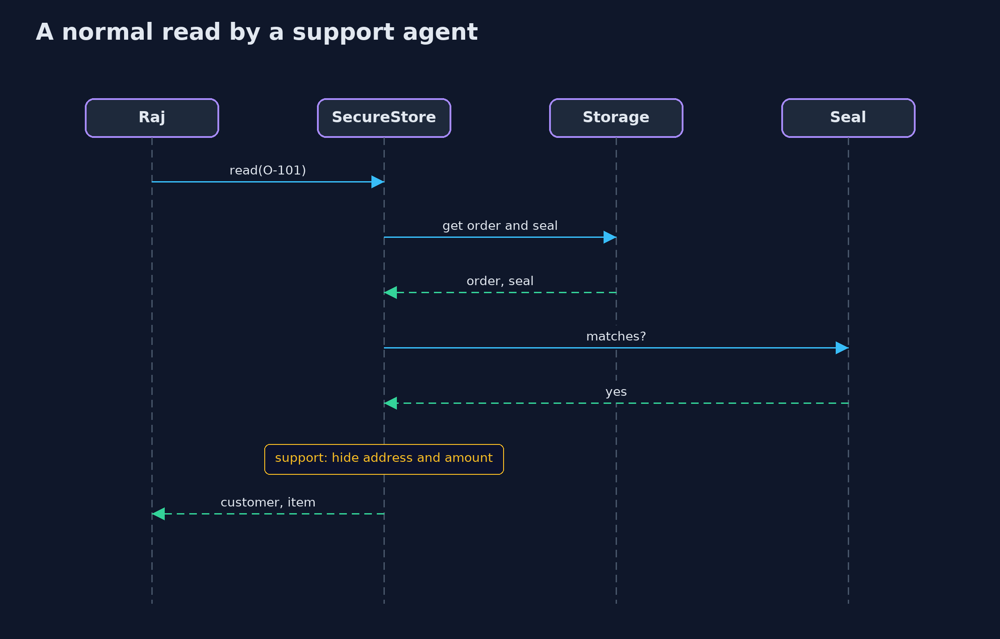
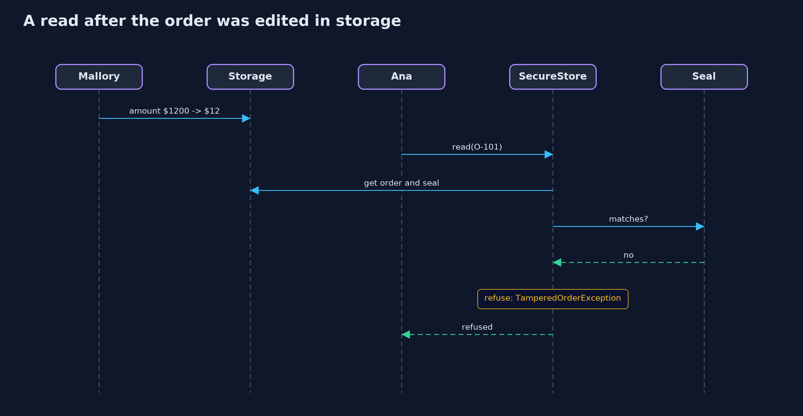

# The CIA Triad — UML Sequence Diagrams

## 1. A normal read by a support agent

The seal is checked first, then the role decides what comes back.

## 2. A read after the order was edited in storage

The edit left the seal as it was, so the check fails and nothing is returned.

