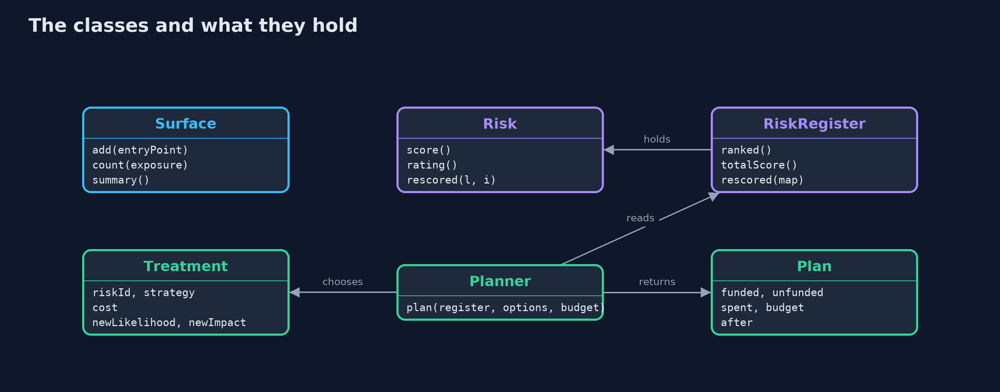
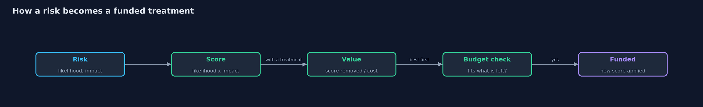

# Threats and Risk

```
src/main/java/com/jk/explore/security/threats/
├── EntryPoint.java    One way into the system, such as a web address the store answers, and the data behind it
├── Exposure.java      Who can reach an entry point: anyone on the internet, a signed-in customer, or only staff
├── Plan.java          The treatments that were paid for, what they cost, and the register as it looks afterwards
├── Planner.java       Chooses which treatments to pay for
├── Rating.java        A risk score turned into a word: up to 5 is low, up to 12 is medium, above that is high
├── Risk.java          One thing that could go wrong
├── RiskRegister.java  The list of risks, ranked from the worst to the least
├── Strategy.java      What to do about a risk: reduce it, remove its cause, hand it to someone else, or live with it
├── Surface.java       The attack surface: the list of every entry point an attacker could try
├── ThreatsDemo.java   Runs the online store story in five numbered acts and prints exact, repeatable results
└── Treatment.java     A proposed answer to one risk, what it costs, and the likelihood and impact left afterwards
```

**Security starts with a list: every way in, everything that could go wrong, and a score that says what to fix first.**

You cannot protect everything equally, so the first job in security is to decide
what matters most. That takes four words. An **asset** is something worth
protecting. A **threat** is someone or something that could harm it. A
**vulnerability** is the weakness the threat would use. A **risk** is how likely
the harm is, and how bad it would be. The **attack surface** is the list of every
way in that an attacker could try.

This project builds a small risk register for an online store. It counts the
ways in, scores seven risks as likelihood times impact, ranks them, spends a
budget where it removes the most risk, and then shows why the scores are
judgments and not measurements.

## The idea in everyday terms

Think of a house owner before buying locks. First walk round and count every
door, window and gap: that is the attack surface. Then ask what is inside worth
stealing, who might try, and which weakness they would use. A rusty back-door
lock on a house full of valuables comes before a fancy lock on the garden shed.
That ordering is what a risk score is for.

## The scenario

An online store has six ways in: a catalogue page, a login, a checkout, an order
page, a refund tool and a customer export. Then the team ships a reviews feature
and leaves a debug page behind, and the store has eight. Seven things could go
wrong, from stolen order data to rivals scraping the price list. There is only a
small budget to spend, so the team has to choose.

## Run

```bash
./gradlew run
```

The demo tells the story in 5 acts, each printing exact numbers that the tests check:

| Act | What it shows |
| --- | --- |
| 1. The attack surface: every way in | The store has 6 ways in; shipping reviews and leaving a debug page behind makes it 8, with a third one open to everyone. |
| 2. Threat, vulnerability, asset, and risk | One risk named in full: customer orders, stolen, through an order page that does not check the owner, scored 4 times 4 is 16, high. |
| 3. Ranking the risks | Seven risks ranked by score: the order page 16, the debug page 15, the login 12, down to the price scraping at 4; the total is 73. |
| 4. Spending a budget where it removes the most | With a budget of 10, four treatments are paid for, the total score falls from 73 to 35, and the card risk is left waiting. |
| 5. The bill: a score is a judgment | Engineering and finance score two risks differently, and their top three differ; accepted risks need an owner and a review date. |

## Test

```bash
./gradlew test
```

17 tests in `DemoRunsTest`, `JudgmentTest`, `PlannerTest`, `RiskTest`, `SurfaceTest`. Every line the demo prints is checked against `docs/expected-output.txt`, and ranking and planning use no clock and no randomness, so every run gives the same result.

## What the simulation got right, and what it left out

The scores are fixed numbers chosen to make the lesson clear, and the planner is a simple
greedy rule: buy the best value first while the budget lasts. Real teams use richer scales,
money figures for impact, and judgment calls the rule cannot make, such as a mitigation that
unlocks another. The point here is the vocabulary and the habit of ranking, not the formula.

## Technologies and versions

| Technology | Version | Used for |
| --- | --- | --- |
| Java | 25 | the code (toolchain set in `build.gradle`; Gradle finds or downloads the JDK) |
| Gradle | 9.2.1 (wrapper) | build and run, nothing to install |
| JUnit | 5.10.2 | the tests |
| videokit | repository tool (`tools/videokit`) | the narrated video and animation: Piper `en_US-amy-medium`, speed 0.8, longer pauses (the amy-slow voice) |

## Learning Material

| Document | What it is for |
| --- | --- |
| [Problem statement](docs/problem-statement.md) | the situation and what the project must show |
| [Prerequisites](docs/prerequisites.md) | what you need to know first |
| [Threats and Risk, explained](docs/threats-and-risk-explained.md) | the acts in prose |
| [Session guide](docs/session.md) | a one-hour lesson with exercises |
| [Animated walkthrough](docs/animation.html) | the acts step by step, narrated |
| [Threat model](docs/threat-model.md) | what is protected, who could harm it, and how, using STRIDE |
| [Spec](docs/spec.md) | what this project must be true of |
| [Expected output](docs/expected-output.txt) | the golden demo output every test and every port checks against |

### The idea in one picture

The entry points give the places to look, each risk is scored and ranked, and the planner spends the budget on the best value first.


### Where each piece sits

A Risk scores itself; a RiskRegister ranks and rescores; a Planner picks Treatments within a budget and returns a Plan.



### How the data moves

A risk is scored, ranked and matched with a treatment; the treatment's value is the score it removes per unit of cost.



### Who calls whom, in order


### Video

`video/threats-and-risk-explained.mp4` (with `.m4a` audio and `.srt` subtitles) is built by `video/build_video.sh`. Rendered media is not committed.

## What it costs

- **Scores are judgments.** Likelihood and impact are estimates. Two sensible reviewers can score the same risk differently and rank the list differently.
- **The list goes stale.** Every new feature adds ways in, so the register has to be revisited, not written once.
- **Accepting a risk is a decision, not a default.** A risk left alone should have a named owner and a review date, or it is simply forgotten.
- **Low scores add up.** Seven small risks can be worth more than one medium one, which a ranked list alone does not show.

## When this is too much

A one-person project with no customer data does not need a formal register. A
short list on paper, with three columns for what, how bad and what to do, is
enough. The register grows with the harm: the more a failure would cost, the more
careful the list should be.

## Where you have already met this

- A penetration test report, which is a ranked list of findings.
- The "threat model" step in a design review, which starts by drawing the entry points.
- A risk matrix in a company policy, a grid of likelihood against impact with red, amber and green cells.
- A security ticket labelled high, medium or low priority.

## Where this sits

This project is the second one in [foundations](..), after [cia-triad](../cia-triad), which names the three promises that a risk can break.
