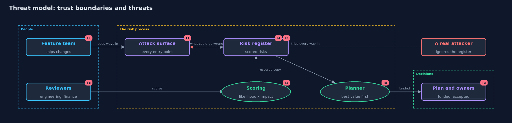

# Threat Model — Threats and Risk

A threat model answers four questions: what are we protecting, who or what could harm it, how, and what do we do about it. This one covers this project's own demo system, not a production deployment. Domain: an online store.

## Scope

The risk register and planner of this project: the list of entry points, the scored risks, the ranking, and the
budgeted plan. The threats here are about the process of assessing risk, not about the store's own endpoints
(those are the register's content). It covers how the register itself can mislead.

## What we protect (assets)

- The attack surface list, which is only useful if it is complete.
- The scores, which drive what gets fixed first.
- The budget, which is limited and must go where it helps most.
- The record of accepted risks, owners and review dates.

## Who and what acts on the system

- The security reviewer who scores the risks.
- The finance and engineering reviewers, who score the same risks differently.
- The feature team, which ships changes that add ways in.
- A real attacker, who does not care what the register says.

## Trust boundaries

A trust boundary is a line that data or a request crosses between parts that trust each other differently. Threats cluster where those lines are.

- Feature work to the register: where new entry points should be added.
- Reviewer to score: where judgment enters.
- Plan to action: where a funded treatment must actually be done.

Each dashed box is a trust boundary. A rose tag such as T1 shows where the threat of that number, in the table below, applies.

## Threats, using STRIDE

STRIDE is a checklist of six kinds of threat: **Spoofing** (S), **Tampering** (T), **Repudiation** (R), **Information disclosure** (I), **Denial of service** (D), **Elevation of privilege** (E).

| Id | Kind | Threat | Where it shows up | Control in this project | What is left |
| --- | --- | --- | --- | --- | --- |
| T1 | Information disclosure | A forgotten entry point leaves a secret open, such as a debug page | `Surface` | Count the surface again whenever a feature ships | The list is only as complete as the people keeping it |
| T2 | Tampering | A score is nudged to move a risk down the list | `Risk`, `RiskRegister.rescored` | Rescoring returns a copy, so the original scores stay on record; assumptions are written down | Nothing stops a reviewer from choosing a convenient number |
| T3 | Repudiation | An accepted risk has no owner, so nobody can say who agreed to it | the plan's unfunded and accepted risks | Every accepted risk needs an owner and a review date | The demo prints the rule; a real process must enforce it |
| T4 | Denial of service | A long list of low risks swamps the few that matter | `RiskRegister.ranked` | Ranking with a fixed tie-break puts the highest first | Many small risks can add up to more than one medium one |
| T5 | Elevation of privilege | A cheap treatment is chosen only because it is cheap | `Planner` | Treatments are valued by score removed per unit of cost | A treatment that unlocks another is not modeled |
| T6 | Spoofing | A score is attributed to a reviewer who did not give it | the review process | None in code; the engineering and finance views are named separately | Real teams record who scored what and when |

## Assumptions

- The risks given to the planner are real and described honestly.
- Scores from 0 to 5 are accepted as a rough guide, not as measurements.
- Someone owns each accepted risk and will look at it again.

## Out of scope

- Discovering real vulnerabilities in a real system.
- A formal threat-modeling method with data flow diagrams for every feature: each later project has its own threat model.
- Money figures for impact.

## How the tests check this

- `SurfaceTest` shows the count of ways in grows when a feature ships.
- `RiskTest` shows the score, the rating bands and the tie-break rule.
- `PlannerTest` shows the budget is never exceeded and the total score falls as expected.
- `JudgmentTest` shows two reviewers can rank the same list differently, and the original is unchanged.

## Where this model goes next

Each later project gets its own threat model in this format. When a project's threats are scored, they can be added to
a shared register and ranked with the planner from this project.
