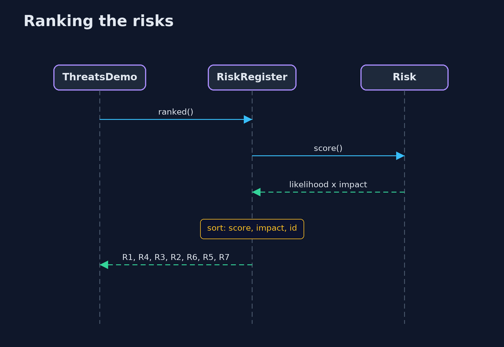
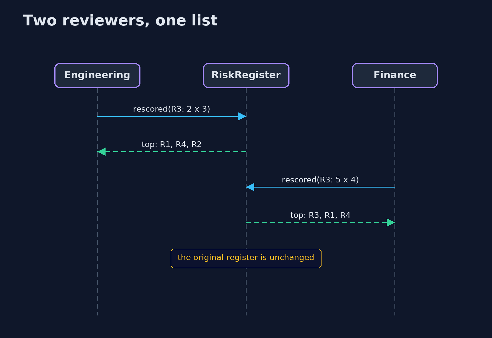

# Threats and Risk — UML Sequence Diagrams

## 1. Ranking the risks

Highest score first; a tie goes to the higher impact, then to the lower id.

## 2. Two reviewers, one list

The same rules, scored with different assumptions, give a different top three.

