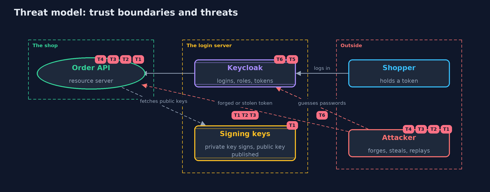

# Threat Model — Authentication vs Authorization with Keycloak

A threat model answers four questions: what are we protecting, who or what could harm it, how, and what do we do about it. This one covers this project's own demo system, not a production deployment. Domain: an online store.

## Scope

An online store's order API that accepts OAuth 2 access tokens from a Keycloak login server: token validation, role mapping, the realm configuration, token lifetime and revocation. It covers an attacker who can send requests with forged,
stolen, tampered or replayed tokens, and who can try passwords at the login server. It does not cover the login server's host, its database, or the web front end's handling of tokens.

## What we protect (assets)

- The orders, and the sales report.
- The login server's private signing key.
- The users' passwords, held only by the login server.
- The access tokens in transit and in the front end.

## Who and what acts on the system

- Shoppers, support staff, an admin and a nightly job.
- An attacker with no token, a stolen token, or a forged token.
- An operator who changes roles in the login server.

## Trust boundaries

A trust boundary is a line that data or a request crosses between parts that trust each other differently. Threats cluster where those lines are.

- Internet to the order API: every request crosses it with only a token as proof.
- Order API to the login server: the API trusts the keys the login server publishes.
- Public client to login server: the front end has no secret and relies on PKCE.

Each dashed box is a trust boundary. A rose tag such as T1 shows where the threat of that number, in the table below, applies.

## Threats, using STRIDE

STRIDE is a checklist of six kinds of threat: **Spoofing** (S), **Tampering** (T), **Repudiation** (R), **Information disclosure** (I), **Denial of service** (D), **Elevation of privilege** (E).

| Id | Kind | Threat | Where it shows up | Control in this project | What is left |
| --- | --- | --- | --- | --- | --- |
| T1 | Spoofing | A forged token, signed with the attacker's own key or with no signature, is accepted | `Validators`, the decoder | Signatures are verified against the login server's published keys, and unsigned tokens are refused | If the signing key leaks, forged tokens verify until the key is replaced |
| T2 | Spoofing | A token meant for another API, or from another issuer, is accepted | `Validators.audience`, the issuer check | Issuer and audience are checked on every token, and Keycloak adds the audience with a mapper | A missing mapper makes every token fail, and a wildcard audience would make every token pass, so the realm file is tested |
| T3 | Elevation of privilege | A stolen token is used until it expires, or a removed role keeps working | `Shop`, `Revocations` | Short access token lifetimes (15 seconds in the test realm, minutes in practice), and an optional revocation list | The stale window is the token's lifetime, and the revocation list costs a lookup per request |
| T4 | Tampering | A token's claims are changed to add a role | the signature check | The signature covers the claims, so any change breaks it | None while the signature check stays on |
| T5 | Elevation of privilege | The login server is configured loosely: a wildcard redirect address, an enabled password grant or a long token lifetime | `infra/shop-realm.json` | Exact redirect addresses, PKCE for the public client, the password grant switched off and short tokens, all checked by a test | The imported file is only the starting point; changes made later in the admin console are not tested |
| T6 | Denial of service | Password guessing against the login page, or the login server going down | Keycloak | Brute force protection is enabled in the realm | If the login server is down nobody can log in; existing tokens work until they expire |

## Assumptions

- Requests reach the API over TLS, which the transport-security module covers.
- The login server's signing key is protected and its host is patched.
- In the demo, the stand-in issuer's key is random and never printed, and all passwords in the realm file are demo values.

## Out of scope

- Running Keycloak in production.
- Token storage in browsers, cross-site scripting and logout.
- Writing an authorization server.

## How the tests check this

- `TokenRulesTest` checks 401 and 403, ownership, expiry at the exact second, forged, unsigned and tampered tokens, issuer and audience, role mapping and revocation.
- `RealmFileTest` checks the realm: PKCE public client, no password grant, exact redirect addresses, audience mapper, short tokens and brute force protection.
- `KeycloakIntegrationTest` (integration, Docker) logs in to the real Keycloak with PKCE, uses a service account, checks a wrong password and wrong audience, and shows a removed role working until a real token expires.
- `DemoRunsTest` compares the whole demo with the golden output.

## Where this model goes next

The next module, passwords-and-mfa, looks at how the login server itself should store and check passwords and second factors.
